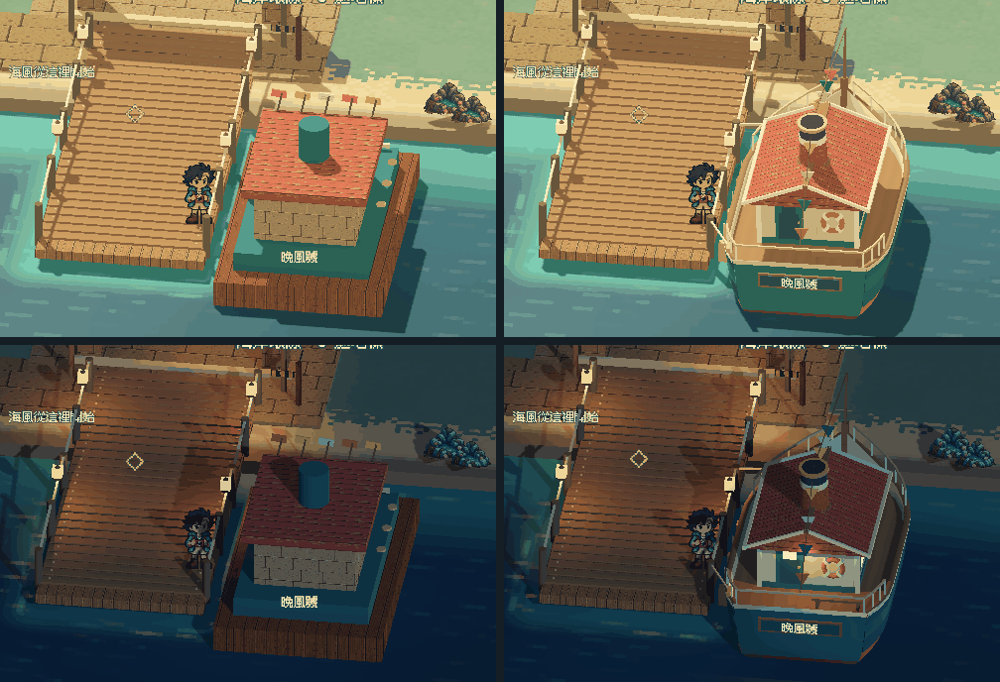

# [ART-45] 重做晚風號船身造型

> 狀態：完成

## 內文

### 需求

停在碼頭的晚風號是由方塊和圓柱疊成，看得出一塊一塊的純色，不像一艘船。重做成有船首、船舷、甲板、船艙與煙囪細節的小渡輪，和碼頭的木作與瓦頂風格一致。

### 來源

2026-11-27 使用者附三張迎賓碼頭截圖，指出地面層超出、方形色塊道具、樹木風格與影子錯誤，並要求讓同類問題不再發生。

### 驗收條件

- [x] 晚風號有可辨認的船首與船尾輪廓，不是矩形平台。
- [x] 船身、甲板、船艙與煙囪有材質與細節，沒有大面積純色方塊。
- [x] 船會隨水面輕微起伏，開啟減少動態後靜止。
- [x] 船名、登船互動與序章流程不變。
- [x] 夜間有船燈且不超出原有燈光數量限制。

### 測試流程

1. 在碼頭從正面與側面觀察晚風號。
2. 執行登船互動與重看序章。
3. 切換時段與減少動態。

---

# 跟其他票的關係

- Blocks：無
- Blocked by：無
- Related：ART-38、ART-46

---

# Commit-1

## 內文

停在碼頭的晚風號原本是一塊木箱平台、一塊青色方塊、一間石磚方屋和一根圓柱疊起來的，看不出船首和船尾，船身各塊都是整片的色面。
現在晚風號是一艘小渡輪：船首收尖並向前傾、船尾內收成平尾板；船殼是一道道疊接的漆板，水線有珊瑚色的漆帶，舷緣有淺色舷板和木質壓條；甲板是順著船身的木條；船艙是直條木板牆，配青色窗框、船尾的門與紅色斜屋頂；屋頂上有紅漆煙囪（淺色環帶、深色頂段與銅色口緣）；船首和船尾有欄杆，船艙後牆掛著救生圈，煙囪到船首旗桿和船尾各拉一串三角旗，靠碼頭一側有靠墊和兩條繫在碼頭木樁上的纜繩。船會隨水面輕輕起伏和左右微晃，三角旗也會擺動；開啟減少動態後船和旗子都靜止在原位。入夜後船尾的提燈亮起，船艙窗戶透出暖光，白天則熄滅；提燈併入碼頭原有的燈光數量限制。船名改寫在船尾的名牌上，船的佔地、碼頭上的「重播上島導覽」互動點與序章站位都沒有變動，序章中旅人仍站在前甲板上。
以原生畫面在碼頭比對修正前後（中午與夜晚），另看過修正後的傍晚畫面；並以序章視角確認旅人站在前甲板上、臉部沒有被三角旗擋住。

### 測試結果

| 項目 | 結果 |
|---|---|
| 島嶼版面檢查（船形輪廓、無大面積純色方塊、起伏與減少動態、船燈與燈光上限、船名／佔地／互動點不變） | 通過 |
| 序章狀態、序章舞台、序章整合 | 通過 |
| 日照、元件動畫、建物遮擋、海岸自由遊玩、主場景整合、啟動 | 通過 |
| 迎賓區節點數（修正前 → 後） | 2226 → 2243 |
| 碼頭視點繪製數（中午／夜晚，修正前 → 後） | 1804 → 1806／2340 → 2324 |

### 截圖

