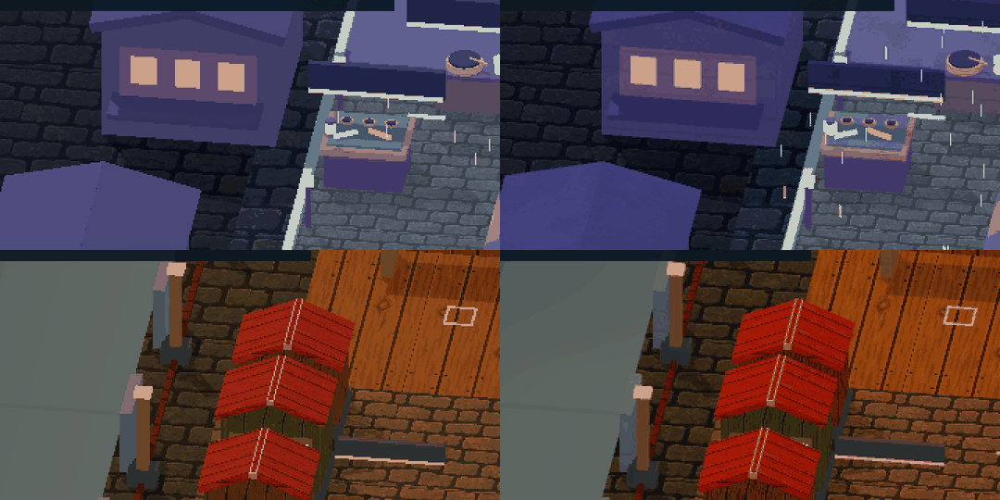

# [ART-46] 替換園區簡陋色塊道具

> 狀態：進行中

## 內文

### 需求

園區許多道具與建物是未加工的純色方塊、圓柱或圓球，在有材質的地面與像素角色旁顯得簡陋。盤點七個區域中最顯眼的色塊道具，改成有材質、倒角或細節的造型。

### 來源

2026-11-27 使用者附三張迎賓碼頭截圖，指出地面層超出、方形色塊道具、樹木風格與影子錯誤，並要求讓同類問題不再發生。

### 驗收條件

- [x] 盤點列出各區鏡頭內可見的純色基本形狀道具，並標出處理結果。
- [ ] 迎賓廣場、大道與碼頭鏡頭內沒有邊長超過一公尺的純色方塊或圓柱。
- [x] 其他六區各至少處理最顯眼的三處。
- [x] 替換後的道具位置、碰撞與互動不變。
- [x] 每個區域的場景節點與繪製數量不高於替換前。

### 測試流程

1. 逐區以固定視點比對替換前後的畫面。
2. 走過被替換的道具確認碰撞。
3. 比對各區的節點與繪製數量。

---

# 跟其他票的關係

- Blocks：MAIN-53
- Blocked by：無
- Related：ART-45

---

# Commit-1

## 內文

園區的建物與道具大量使用未加工的純色方塊、圓柱與圓球；場景檢查盤點出七區共 316 處露出大片純色面的形狀。
現在所有區域共用的建造方式會自動判斷：只要形狀大到會露出一整片面，就改用帶像素顆粒、深淺斑塊與橫向接縫的漆面材質，細小的欄杆與收邊仍維持原色；建物被玩家擋住時的透視效果照常運作。因為是從共用的建造方式改起，之後新蓋的東西也不會再出現大面積純色。
盤點結果由 316 處降到 27 處：潮汐碼頭、霓虹夜市與發條玩具城歸零，糖果工廠剩 1、迎賓區剩 10、鏡之馬戲團與苔光溫室各剩 8，都是另外指定了特殊材質的零件（遊樂設施轉盤、觀景台、溫室曬架、布幕等），留待各區整建時處理，所以迎賓區的條件尚未完成。這次只改變表面質感，方塊的輪廓沒有變，造型由各區整建票負責。
位置、碰撞與互動沒有改動；各區同一視點的繪製數量與改動前相同（差異在五個以內，來自先前加入的環境效果）。

### 測試結果

| 項目 | 結果 |
|---|---|
| 大面積純色形狀 | 316 → 27（迎賓 10、糖果 1、馬戲團 8、溫室 8，其餘為 0） |
| 場景檢查（欠債基準已下修） | 通過 |
| 七區世界、劇情、佈局、光照、遮擋透視、旅行、整合 | 通過 |
| 各區繪製數量 | 與改動前相同（±5） |

### 截圖

