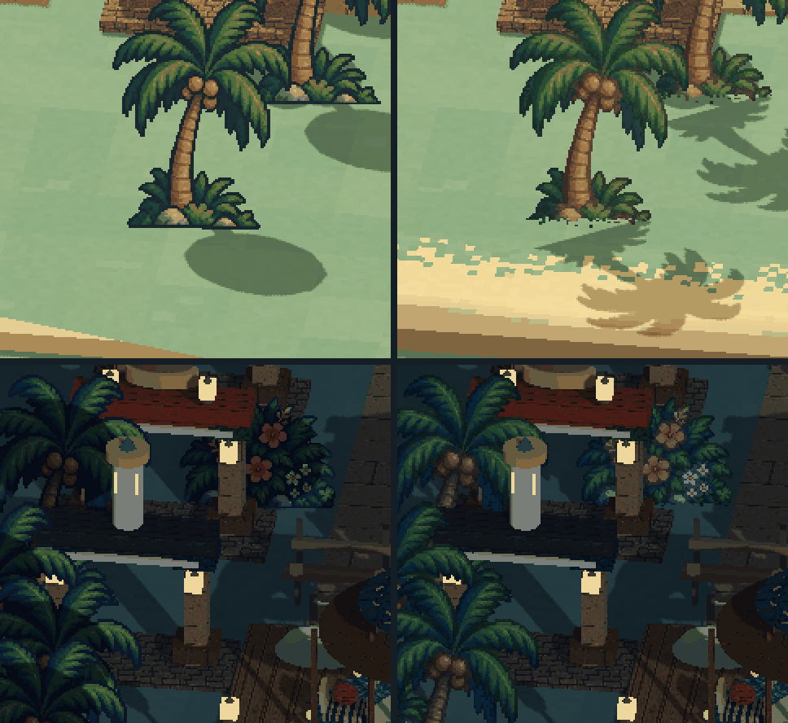

# [ART-47] 統一樹木風格並修正樹影

> 狀態：完成

## 內文

### 需求

樹木是粗黑邊的高彩度貼圖，和周圍地面與建物的質感不一致，像貼上去的；影子是一顆球接一根棒，和樹的形狀不符，岸邊的樹還把影子投在水面上。讓樹木的色調與描邊融入場景，影子符合樹形，並把樹移到合理的位置。

### 來源

2026-11-27 使用者附三張迎賓碼頭截圖，指出地面層超出、方形色塊道具、樹木風格與影子錯誤，並要求讓同類問題不再發生。

### 驗收條件

- [x] 樹影的輪廓與樹冠、樹幹的形狀相符，不再是球與棒。
- [x] 樹木色調隨時段與周圍地面一致，描邊不比建物與角色更重。
- [x] 樹根處有落地的陰影或草叢銜接，不像浮在地上。
- [x] 沒有樹種在沙灘水線上或把影子投到海面中央。
- [x] 灌木、花盆與路燈的影子同樣符合外形。

### 測試流程

1. 在碼頭與大道比對修正前後的樹與影子。
2. 切換四個時段確認色調與影長。
3. 沿岸檢查樹的位置。

---

# 跟其他票的關係

- Blocks：MAIN-53
- Blocked by：無
- Related：ART-40、ART-44

---

# Commit-1

## 內文

樹、灌木、花盆與路燈的影子原本是用看不見的圓球、圓柱和方塊代替，所以棕櫚樹的影子是一顆球接一根棒；樹的顏色不管幾點都是白天的鮮綠，加上很粗的近黑描邊和一條筆直的底邊，看起來像貼在地上。海岸步道旁還有兩棵棕櫚種在碼頭邊的水裡，把影子投在海面上，另有樹壓在步道上。
現在每一棵樹、灌木、花盆、路燈和岸石都用自己的圖案剪影投影，影子從看得到的樹根處開始，並隨四個時段轉向光源，所以凌晨、中午、傍晚和夜晚的影子都是樹的形狀。樹木改為每次換時段調一次色：傍晚偏暖、夜晚偏藍暗，不再維持白天的顏色；近黑的描邊改成鄰近葉色或樹幹色的暗部，路燈的鐵件則保留深色；底部以零碎的草點和一塊柔和的接地陰影銜接地面。樹只種在開闊草地上，離水線至少 1.5 公尺且不壓到步道與平台；原本種在水裡的兩棵和壓在步道上的樹已移除，海岸步道旁靠岸的樹往內移。
以原生畫面在碼頭、大道、廣場與東、西南岸比對四個時段的修正前後，影子輪廓、色調與落地都符合上述描述。逐影子方向的原生量測中，樹、路燈、花盆四個時段全數通過；灌木在傍晚與夜晚未通過，原因是光從正面來時影子的根部被灌木本身擋住，量測只取到露出的一小塊；另有一項小角在傍晚燈光下的量測，修正前就未通過。

### 測試結果

| 項目 | 結果 |
|---|---|
| 日照檢查（剪影影子、不懸空、無碰撞、不逐幀更新、四時段調色與轉向） | 通過 |
| 島嶼版面檢查（樹離水線 1.5 公尺以上、只在開闊草地） | 通過 |
| 角色剪影、元件動畫、建物遮擋、海岸自由遊玩、主場景整合、啟動 | 通過 |
| 迎賓區節點數（修正前 → 後） | 2275 → 2226 |
| 碼頭視點繪製數（中午／夜晚，修正前 → 後） | 1858 → 1804／2410 → 2342 |

### 截圖

