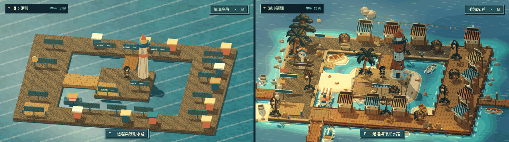

# [ART-48] 整建潮汐碼頭場景

> 狀態：完成

## 內文

### 需求

潮汐碼頭是浮在斜紋水面上的木板平台，水面是滿幅平行亮線，燈塔與攤位是純色方塊。把它整建成有岸線、棧橋、礁石與燈塔的完整海港。

### 來源

2026-11-27 使用者指出地圖簡陋、有方形色塊且缺少場景感；同日原生畫面顯示此區是懸浮在單色背景上的平台。

### 驗收條件

- [x] 區域地面延伸到鏡頭可見範圍之外或有完整背景，四個時段都看不到單色空白底。
- [x] 區域邊界有符合主題的收邊，平台不再像懸浮的板子。
- [x] 鏡頭內沒有邊長超過一公尺的純色方塊或圓柱，主要設施有可辨認的造型與材質。
- [x] 至少有三種符合主題的環境動態，開啟減少動態後靜止。
- [x] 原有互動點、動線、小遊戲入口、返回迎賓大道與燈光數量限制不變。
- [x] 符合場景搭建規範，場景節點與繪製數量在該區預算內。

### 測試流程

1. 進入此區，以固定視點比對整建前後的畫面。
2. 走遍所有互動點與小遊戲入口並返回迎賓大道。
3. 切換四個時段與減少動態。

---

# 跟其他票的關係

- Blocks：無
- Blocked by：無
- Related：MAIN-53、ART-46

---

# Commit-1

## 內文

潮汐碼頭原本是一塊浮在斜紋海面上的木板平台，燈塔是一根圓錐柱，攤位與告示牌是純色方塊，夜晚沒有任何燈。

現在是一座圍著潟湖的小海港。西、北側是石砌碼頭與收邊石，東、南側是架在木樁上的棧道，中央的燈塔小島有沙灘環繞；海面在岸邊變淺、分層變色，岸壁與船身邊有碎浪，海域一路延伸到畫面之外，遠處有礁石、浮標與一座長著椰子樹的小沙洲。燈塔是紅白相間的錐形塔身，有門窗、瞭望台與玻璃燈室，傍晚後燈室發亮、光束緩緩旋轉。十一個小遊戲入口各有一座條紋遮陽棚攤位，掛著遊戲名稱與代表圖樣；返回迎賓大道的位置有旗杆、告示牌與一條通往外海的長棧橋。

漲退潮現在看得出來：退潮時沙洲與灘地露出，擱淺的小船斜靠在沙上，岸壁露出深色水痕；漲潮時海面升高蓋過沙洲，小船浮起，潮汐鐘的指針轉向、小鐘擺動。免費渡船會停在玩家所在的那一側。

環境動態有海浪與岸邊碎浪、隨浪起伏的船與浮標、飄動的旗幟彩旗與曬網、潟湖裡繞圈的魚群，以及夜間旋轉的燈塔光束。沙洲與棧道上的螃蟹在玩家靠近時會橫著跑開，不計分也不寫入存檔。開啟減少動態後全部靜止。

十七個互動點的代號與位置、可走範圍、沙洲與渡船規則、返回迎賓大道都沒有變動。攤位與貨物堆現在會擋路，不能再直接穿過。全區共八盞燈，可以同時全亮，不會隨玩家走動忽明忽滅。

以原生畫面在凌晨、中午、傍晚、夜晚，退潮與漲潮，分別從渡船碼頭、東側棧道、燈塔島、北岸、南岸、潮汐鐘與沙洲檢視，四周都是海面與遠景，沒有露出背景底色；減少動態下相隔一秒多的兩張畫面完全相同。場景規範的自動檢查在此區沒有任何違規，純色大方塊由 26 處降為 0，並把此區的容許數鎖在 0；規範中需看畫面的項目以截圖逐節對照。以上是畫面與自動測試的檢查，不是遊戲試玩。

### 測試結果

| 項目 | 結果 |
|---|---|
| 碼頭場景測試（地形、潮汐、渡船、地圖、重入，另加地標、燈數、潮位、減少動態與螃蟹反應） | 通過 |
| 碼頭收藏、碼頭小遊戲進度、區域旅行、區域進度、主場景整合、遊戲啟動、環境氛圍、鏡頭跟隨、日夜光影 | 全部通過 |
| 場景規範自動檢查（純色大方塊／替代形狀影子／懸空看板／節點預算） | 26／0／0／0 → 0／0／0／0 |
| 場景節點 | 156 → 214（上限 900） |
| 單一視點繪製數 | 白天 149–203 → 160–174，傍晚 294，夜晚 302 → 340–343（上限 800） |
| 進區建置時間 | 與整建前相同，約 1.2–1.3 秒 |
| 執行 log | 無新增 ERROR |

### 截圖

---
