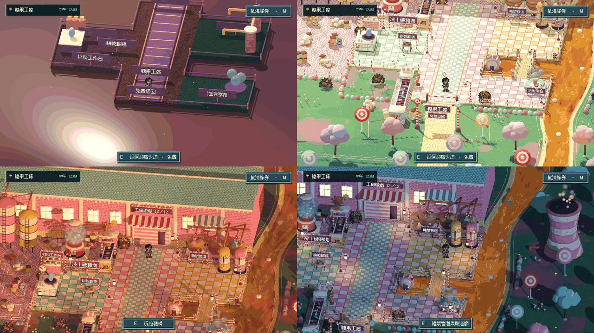

# [ART-49] 整建糖果工廠場景

> 狀態：完成

## 內文

### 需求

糖果工廠是浮在粉紅色空白中的幾塊平台，機具是純色圓柱與方塊。把它整建成有廠房地坪、輸送帶、糖漿管線與糖果機具的工廠。

### 來源

2026-11-27 使用者指出地圖簡陋、有方形色塊且缺少場景感；同日原生畫面顯示此區是懸浮在單色背景上的平台。

### 驗收條件

- [x] 區域地面延伸到鏡頭可見範圍之外或有完整背景，四個時段都看不到單色空白底。
- [x] 區域邊界有符合主題的收邊，平台不再像懸浮的板子。
- [x] 區域外緣是可以往外延伸的自然地面與植栽（臨海處除外），之後接上大島時不需要重做；並至少有一個不用進關卡、會對玩家產生反應的即時互動。
- [x] 鏡頭內沒有邊長超過一公尺的純色方塊或圓柱，主要設施有可辨認的造型與材質。
- [x] 至少有三種符合主題的環境動態，開啟減少動態後靜止。
- [x] 原有互動點、動線、小遊戲入口、返回迎賓大道與燈光數量限制不變。
- [x] 符合場景搭建規範，場景節點與繪製數量在該區預算內。

### 測試流程

1. 進入此區，以固定視點比對整建前後的畫面。
2. 走遍所有互動點與小遊戲入口並返回迎賓大道。
3. 切換四個時段與減少動態。

---

# 跟其他票的關係

- Blocks：無
- Blocked by：無
- Related：MAIN-53、MAIN-56、MAIN-57、ART-46、ART-48

---

# Commit-1

## 內文

糖果工廠原本是四塊浮在粉紅色空白裡的深色平台，機具是純色圓柱與方塊，招牌是近五公尺寬的色板，夜晚沒有燈。

現在是大島東側的一個工廠街區。四塊地坪鋪上粉紅、薄荷、檸檬與薰衣草色的磁磚，邊緣有餅乾色收邊石與拐杖糖欄杆；北側是整面粉紅板牆的廠房，有成排的窗、糖霜簷口、條紋遮陽棚、鋸齒屋頂與兩支條紋煙囪；西側是畫了格位的倉儲場，堆著糖袋、木箱與三座儲料塔，再過去是包裝廠房；東側是一條金黃色的糖漿河，上面漂著棉花糖，對岸有冒煙的冷卻塔；南側的拱門與小徑通往迎賓大道。四周一律是偏粉的草地、棒棒糖樹、棉花糖樹、雷根糖樹籬與糖果花，一路延伸到畫面之外，之後接上大島時可以直接延伸。

管道廊與泡泡停靠區之間原本是不能走的缺口，現在是糖漿運河，有一座威化餅小橋可以走過去，運河頭有一座轉動的水車。主廊兩側各有一條輸送帶：北段從廠房送出麵團，經過壓模機壓成餅乾；南段從包裝機送出包好的糖果到出貨口。另有大型扭蛋機、三口冒泡的銅鍋、糖漿儲槽與帶閥門壓力錶的管線。材料工作台改成有抽屜、玻璃瓶與加熱盤的實驗桌，溫度切換時樣品變形變色、錶盤指針跟著轉。

環境動態有輸送帶上的產品、壓模機、齒輪、水車、鍋裡的泡泡與蒸氣、煙囪與冷卻塔的煙、流動的糖漿、漂流的棉花糖、泡泡停靠區上方浮動的大泡泡與飄動的彩旗。玩家走到主廊旁的試吃機前，機器會彈出一顆糖再落回杯裡，離開再回來會再彈一次；靠近扭蛋機時裡面的球滾得更快。兩者都不計分、不寫入存檔。開啟減少動態後全部靜止。

十七個互動點的代號、位置與行為、返回迎賓大道都沒有變動；可走範圍只多了那座橋。實驗桌、材料架、儲槽、泡泡池、翻模台與試吃機現在會擋路，每個互動點周圍仍保留 1.2 公尺淨空；兩座儲槽移到北側欄杆邊，避免玩家走到它們後面被擋住。招牌縮成跟文字一樣寬並移到不擋路的位置，文字在任何距離都看得到。全區共八盞拐杖糖燈，可以同時全亮；夜晚廠房的窗與燈泡發亮，糖漿河帶一點微光。

以原生畫面在凌晨、中午、傍晚、夜晚，分別從入口、材料實驗區、管道廊、泡泡停靠區、廠房門口、主廊中央、橋上與四個角落檢視，四周都是地面與場景，沒有露出背景底色；減少動態下等粒子消散後相隔一秒多的兩張畫面完全相同。以上是畫面與自動測試的檢查，不是遊戲試玩。

### 測試結果

| 項目 | 結果 |
|---|---|
| 糖果工廠場景測試（地形、溫度、重置、地圖、重入，另加地面覆蓋、地標、淨空、燈數、夜間發光、減少動態、三種動態與試吃機反應） | 通過 |
| 潮汐碼頭場景、環境氛圍、區域旅行、區域進度、主場景整合、遊戲啟動 | 全部通過 |
| 場景規範自動檢查（純色大方塊／替代形狀影子／懸空看板／節點預算） | 1／0／0／0 → 0／0／0／0，容許數鎖在 0 |
| 場景節點 | 165 → 159（上限 900） |
| 單一視點繪製數 | 中午 200–254 → 138–177，傍晚 194–289，夜晚 237–309（上限 800） |
| 進區建置時間 | 約 0.6 秒 |
| 執行 log | 無新增 ERROR |

### 截圖

---
