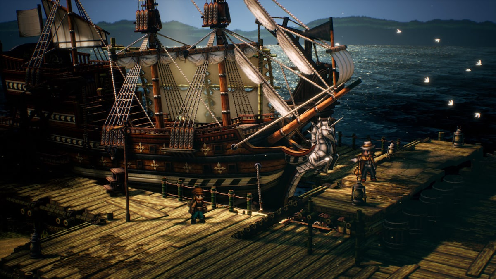

# [ART-4] 重製角色與遊園動作

> 狀態：進行中

## 內文

### 需求
主角與票票、小角、阿浪有各自可辨識外觀，角色與島嶼布景的風格一致。

### 來源
2026-10-11（Asia/Taipei）使用者要求繼續完善島嶼與小遊戲，改善簡陋美術；研究業界實例而不照抄，建立自己的風格並持續完成本批。

### 驗收條件
- [x] 主角與三位具名角色有各自外觀與身份細節
- [ ] 主角移動方向、待機及行走動作清楚且不滑步
- [x] 原生畫面可辨識角色，日夜與降低動態設定下正常

### 測試流程
1. 查看票內研究來源、參考圖與實際觀察。
2. 啟動隔離存檔的原生遊戲，操作本票相關場景，核對驗收條件與截圖。
3. 切換日夜或降低動態、重開相關畫面，確認動線、文字、互動與獎勵正常。

---

# 跟其他票的關係

- Blocks：無
- Blocked by：無
- Related：ART-3、ART-4、ART-5、ART-6、SG-14

---

# 研究與參考

[本批設計與實際查閱觀察](../../design/runtime/visual-polish.md)。學習分層材質、日夜光影、清楚操作主體與一致的物料語言，重新設計 Snapland 的海港意象；參考圖不當遊戲素材。

---

# Commit-1

問題：主角與園區角色需要更清楚的身份差異，並與紙印刷海港世界協調。

改動：為主角、票票、小角與阿浪補足可辨識外觀及場景呈現；小角以小惡魔肖像辨識，不以人類頭髮取代其身份。

驗收：原生近景、方向姿勢及角色全身 fixture 已保存；主角招呼、拍照、互動、慶祝各有一張正面姿勢圖，不等於完整動畫。主角待機與行走素材曾展示並收到步態意見，因此「行走不滑步」仍待 ART-14／ART-16 後續確認，本票不作通過宣稱。

測試與證據：原生角色識別畫面檢查完成，含 27 個角色全身 fixture 視角；根任務確認一般比例下頭部與全身可見。截圖只表達單一姿勢，日夜／降低動態畫面檢查不是玩家試玩或整套動畫驗收。

| 畫面證據 | 說明 |
| --- | --- |
| [小角身份近景](images/ART-4-kaku-portrait.png) · [票票近景](images/ART-4-ticket-portrait.png) | 角色靜態近景 |
| [主角朝前](images/ART-4-step-front.png) · [朝後](images/ART-4-step-back.png) · [朝左](images/ART-4-step-left.png) · [朝右](images/ART-4-step-right.png) | 方向動作靜態畫格 |
| [行走預覽影片](images/ART-7-walk-preview.mp4) | 使用者已看過並提出步態意見；影片仍非行走品質驗收 |
| [主角全身待機](images/ART-15-sprite-clearance-avatar-idle-front.png) · [NPC 售票員](images/ART-15-sprite-clearance-npc-ticket-first.png) · [小角降低動態](images/ART-15-sprite-clearance-npc-imp-reduced.png) | 原生全身 fixture 靜態圖，不宣稱動畫完成 |

程式交付：[Commit af3fc12](https://github.com/deadline314/Snapland/commit/af3fc12e422b7d27b47da62639171fbdc69c0241)（分支 `feature/island-first-park`；固定基準 `92e885390967bff3abbde3cf52716076124b1383`）。

### 最新輸出驗證
Windows輸出於Intel Arc B580原生GPU完成圖集、NPC、場景動畫與遮擋資源冒煙檢查，12款場景所需素材均載入，無ERROR；此檢查不代表真人試玩、完整換裝動作、每姿勢或試聽驗收。
