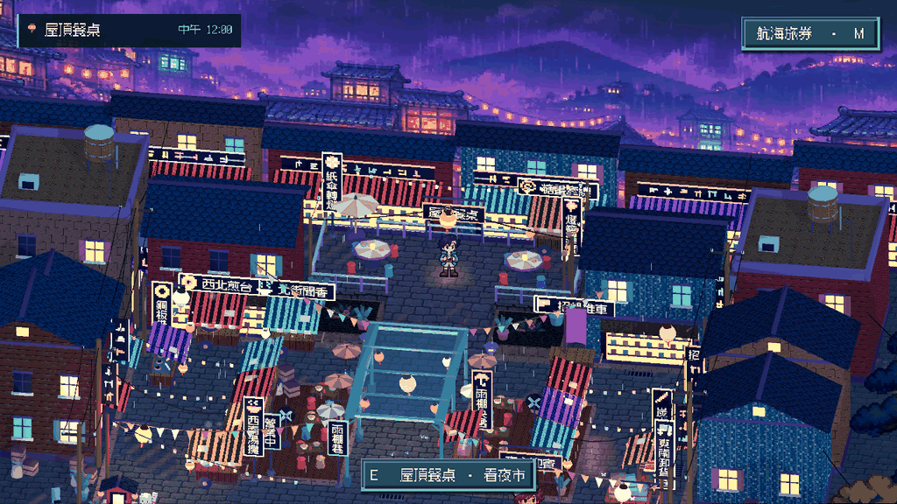

# [ART-50] 整建霓虹夜市場景

> 狀態：完成

## 內文

### 需求

霓虹夜市的攤位是純色方塊，街區外是空白的磚面，招牌與燈串缺少夜市的熱鬧感。把它整建成有攤車、燈串、招牌、蒸氣與遠景街屋的夜市。

### 來源

2026-11-27 使用者指出地圖簡陋、有方形色塊且缺少場景感；同日原生畫面顯示此區是懸浮在單色背景上的平台。

### 驗收條件

- [x] 區域地面延伸到鏡頭可見範圍之外或有完整背景，四個時段都看不到單色空白底。
- [x] 區域邊界有符合主題的收邊，平台不再像懸浮的板子。
- [x] 區域外緣是可以往外延伸的自然地面與植栽（臨海處除外），之後接上大島時不需要重做；並至少有一個不用進關卡、會對玩家產生反應的即時互動。
- [x] 鏡頭內沒有邊長超過一公尺的純色方塊或圓柱，主要設施有可辨認的造型與材質。
- [x] 至少有三種符合主題的環境動態，開啟減少動態後靜止。
- [x] 原有互動點、動線、小遊戲入口、返回迎賓大道與燈光數量限制不變。
- [x] 符合場景搭建規範，場景節點與繪製數量在該區預算內。

### 測試流程

1. 進入此區，以固定視點比對整建前後的畫面。
2. 走遍所有互動點與小遊戲入口並返回迎賓大道。
3. 切換四個時段與減少動態。

---

# 跟其他票的關係

- Blocks：無
- Blocked by：無
- Related：MAIN-53、MAIN-56、MAIN-57、ART-46、ART-48

---

# Commit-1

## 內文

夜市原本是一塊浮在深色磚面上的平台：攤位與鄰屋都是方盒子，招牌懸在半空，街區外什麼都沒有，也看不出夜市的熱鬧。

現在它是一個被大樹圍住的雨夜街區。十二款小遊戲各有自己的攤車或攤台，有輪子、推把、條紋補丁雨棚、蒸籠、湯鍋、炭火與碗盤，招牌上有各自的像素圖示與霓虹燈管；路邊攤車的直式招牌立在竿上，不會擋住後面的走道。雨棚巷兩側是木棧用餐區，有折疊桌、塑膠凳、掛著的油紙傘與電風扇。街道三面是有亮窗、鐵捲門、雨棚、霓虹店招與屋頂水塔的街屋，側巷往暗處延伸並留有遠燈；南側是矮牆與盆栽，石燈小路穿過牌樓通往迎賓大道，再往外是草地與大樹，之後可以直接接上相鄰區域。濕石板上多了會映出燈色的水窪與雨滴漣漪，電線桿之間纏著電線、燈泡串與三角旗。

會動的有搖晃的燈籠、閃爍的霓虹、飄動的旗幟與招幌、轉動的烤雞架、電風扇與屋頂大紙傘、水窪漣漪、草地上的螢火蟲與燈下的飛蛾，原有的雨絲、蒸氣與火星也對準了新的鍋爐位置。西南角神龕旁的招財貓平常慢慢招手，玩家走近就改成快速揮手；開啟減少動態後全部靜止，招財貓只在有人靠近時把手舉著。收攤時霓虹與燈籠一起變暗，街屋的窗仍亮著。

十二個小遊戲入口、其餘互動點、可走範圍、屋頂坡道與免費返回迎賓大道都沒有改變；合照取景內沒有新增遮擋。夜間、黃昏、清晨與中午各從多個站位看過，也看過減少動態與低畫質，四周都看不到空白底色。

### 測試結果

| 項目 | 結果 |
|---|---|
| 夜市場景、夜市劇情、場景規範、環境動態、畫質、區域移動、區域進度、主場景整合、啟動 | 全部通過 |
| 場景規範稽核（夜市） | 四類皆為 0 |
| 場景節點數（預算 900） | 526 → 234 |
| 單一視點繪製數（預算 800，夜間八個站位） | 545–878 → 355–466 |
| 燈光 | 同時最多 8 盞亮、2 盞有影子 |
| 執行 log | 無 ERROR |

### 截圖

