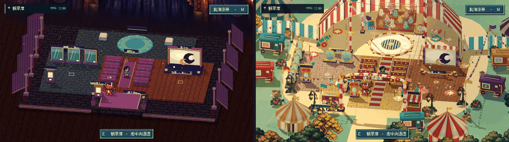

# [ART-51] 整建鏡之馬戲團場景

> 狀態：完成

## 內文

### 需求

鏡之馬戲團是浮在深色木紋上的舞台，布幕與看台是純色方塊，看不出馬戲團的帳篷與鏡子主題。把它整建成有帳篷、布幕、鏡框、看台與舞台燈的馬戲團。

### 來源

2026-11-27 使用者指出地圖簡陋、有方形色塊且缺少場景感；同日原生畫面顯示此區是懸浮在單色背景上的平台。

### 驗收條件

- [x] 區域地面延伸到鏡頭可見範圍之外或有完整背景，四個時段都看不到單色空白底。
- [x] 區域邊界有符合主題的收邊，平台不再像懸浮的板子。
- [x] 區域外緣是可以往外延伸的自然地面與植栽（臨海處除外），之後接上大島時不需要重做；並至少有一個不用進關卡、會對玩家產生反應的即時互動。
- [x] 鏡頭內沒有邊長超過一公尺的純色方塊或圓柱，主要設施有可辨認的造型與材質。
- [x] 至少有三種符合主題的環境動態，開啟減少動態後靜止。
- [x] 原有互動點、動線、小遊戲入口、返回迎賓大道與燈光數量限制不變。
- [x] 符合場景搭建規範，場景節點與繪製數量在該區預算內。

### 測試流程

1. 進入此區，以固定視點比對整建前後的畫面。
2. 走遍所有互動點與小遊戲入口並返回迎賓大道。
3. 切換四個時段與減少動態。

---

# 跟其他票的關係

- Blocks：無
- Blocked by：無
- Related：MAIN-53、MAIN-56、MAIN-57、ART-46、ART-48

---

# Commit-1

## 內文

鏡之馬戲團原本是一塊浮在深色木紋背景上的暗色舞台：布幕、看台與鏡子都是純色方塊，中央是一個圓形墊子，四周沒有地面，看不出這裡是馬戲團，更看不出鏡子的主題。

現在是林間空地上的巡迴馬戲團營地。北側是一頂朝鏡頭剖開的紅白條紋大帳篷，帳緣有扇形飾邊與一整圈彩旗，四根紅白主柱撐起燈串；帳內有木屑表演圈與紅白圈欄、中央的安全墊、空中鞦韆與兩個吊環、後方階梯看台上坐著十一隻布偶觀眾，旁邊有大鼓、戲服箱、雜耍道具、獨輪車與人體大砲。入口是掛著「鏡之馬戲團」跑馬燈招牌的大拱門，兩旁有售票亭與蒸汽風琴，紅白地毯穿過兩排長椅通到表演圈。西側鏡廊沿牆立著五面形狀各異的金框哈哈鏡與兩面立鏡，東側影子戲台換成有金柱、扇形簷幕與腳燈的小劇場。四周是草地、泥土營地、六輛篷車、八頂小帳篷、帆布圍籬、旗杆、木箱與樹林，地面一路延伸到畫面之外，外緣是自然的草地與林木。

鏡子真的會照人：走近任何一面，鏡中會出現玩家自己的身影，每面哈哈鏡把它拉長、壓扁或扭曲的方式都不同。走進表演圈，三盞彩色聚光燈會追著玩家，大鼓開始滾奏，走出去就停；經過氣球時氣球會偏向另一邊。這些都不計分、不寫入存檔。常態的環境動態有拱門的跑馬燈、微閃的燈串、隨風飄動的帳緣、旗幟與彩旗、緩慢掃動的聚光燈、擺動的鞦韆與吊環、飄落的彩紙與風琴的蒸汽。開啟減少動態後全部靜止，鏡子仍會照出玩家所在的位置。

八個互動點的代號與位置、五塊可走範圍、影子台左右燈切換、兩款小遊戲入口與免費返回迎賓大道都沒有變動。互動點說明改了兩句，配合新的鏡子與表演圈。玩家走到入口拱門或兩台小遊戲機台後方時，會像迎賓島的拱門一樣開出透視圈；影子戲台後方改成用紅絨繩圍起的後台，不能再走進去被布幕擋住。另外預留了十個小遊戲空位，地上各有一塊星形地墊與一支小旗。舞台聚光燈與路燈共十一盞，都在「最近八盞亮、兩盞有影子」的名額內；鏡廊與影子台原有的兩盞區域光保留。

以原生畫面在中午、傍晚與夜晚各從六個以上的位置（入口、鏡廊西牆與立鏡前、觀眾席走道、表演圈、影子台、內場西北與東南角、鏡廊西南角、影子台東南與東北角），凌晨從入口與表演圈檢視，共三十多張，四周都是草地、營地與樹林，沒有露出背景底色；合照取景畫面的下緣也補上草地。減少動態下相隔零點七秒的兩張畫面逐點相同，低畫質下場景完整。場景規範的自動檢查在此區沒有任何違規，純色大方塊由 8 處降為 0，並把此區的容許數鎖在 0；規範中需看畫面的項目以截圖逐節對照。以上是畫面與自動測試的檢查，不是遊戲試玩。

### 測試結果

| 項目 | 結果 |
|---|---|
| 馬戲團場景測試（地形、實走動線、影子投影、地圖；另加地標、鏡子數量與形狀、十個空位、燈數、聚光燈與大鼓反應、氣球反應、鏡中身影、減少動態） | 通過 |
| 馬戲團主線合照、哈哈鏡大頭貼、誰是假倒影、環境氛圍、畫質設定、區域旅行、區域進度、主場景整合、遊戲啟動 | 全部通過 |
| 場景規範自動檢查（純色大方塊／替代形狀影子／懸空看板／節點預算） | 8／0／0／0 → 0／0／0／0 |
| 場景節點 | 326 → 246（上限 900） |
| 單一視點繪製數 | 白天 227–248 → 160–205，傍晚 262–333，夜晚 302–379 → 240–375（上限 800） |
| 執行 log | 無新增 ERROR |

### 截圖

---
