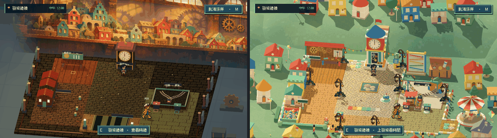

# [ART-52] 整建發條玩具城場景

> 狀態：完成

## 內文

### 需求

發條玩具城是浮在灰色空白中的磚面平台，列車與鐘樓是簡單方塊。把它整建成有齒輪、發條、積木建物與軌道的玩具城。

### 來源

2026-11-27 使用者指出地圖簡陋、有方形色塊且缺少場景感；同日原生畫面顯示此區是懸浮在單色背景上的平台。

### 驗收條件

- [x] 區域地面延伸到鏡頭可見範圍之外或有完整背景，四個時段都看不到單色空白底。
- [x] 區域邊界有符合主題的收邊，平台不再像懸浮的板子。
- [x] 區域外緣是可以往外延伸的自然地面與植栽（臨海處除外），之後接上大島時不需要重做；並至少有一個不用進關卡、會對玩家產生反應的即時互動。
- [x] 鏡頭內沒有邊長超過一公尺的純色方塊或圓柱，主要設施有可辨認的造型與材質。
- [x] 至少有三種符合主題的環境動態，開啟減少動態後靜止。
- [x] 原有互動點、動線、小遊戲入口、返回迎賓大道與燈光數量限制不變。
- [x] 符合場景搭建規範，場景節點與繪製數量在該區預算內。

### 測試流程

1. 進入此區，以固定視點比對整建前後的畫面。
2. 走遍所有互動點與小遊戲入口並返回迎賓大道。
3. 切換四個時段與減少動態。

---

# 跟其他票的關係

- Blocks：無
- Blocked by：無
- Related：MAIN-53、MAIN-56、MAIN-57、ART-46、ART-48

---

# Commit-1

## 內文

發條玩具城原本是一塊浮在灰色空白上的磚面平台：列車是幾個紅色小方塊，鐘樓是一根柱子，積木街是三個一樣的盒子，四周只有一面掛畫，夜晚沒有路燈。

現在是一座蓋在草丘上的積木小鎮。鋪面廣場用彩色積木邊石收邊，外面是一路延伸到畫面外的草地與小丘；丘上和廣場四周還有三十多棟各色積木屋、木頭玩具樹、蠟筆圍籬、鉛筆樁、風車與幾棵大樹，往南的路穿過積木城門通向迎賓大道。積木街是三棟高低不同的積木屋，旁邊有球池；維修台有木板牆、工作檯、等著修理的鐵皮機器人與一疊備用齒輪；鐘樓由積木疊成，有夜裡會亮的鐘面、玻璃罩裡的鐘擺和露出來的齒輪。廣場上有看得到齒輪的玻璃地板、彩虹地板琴、陀螺、驚奇箱與字母積木；廣場後方是彈珠軌道和蓋子掀開的玩具箱倉庫，東邊草地上有音樂盒旋轉木馬，天上飄著兩只風箏。

列車換成有鍋爐、煙囪、駕駛室、輪子與連桿的發條蒸汽車頭，後面拖兩節載著積木的貨車；行駛時輪子和連桿會轉，煙囪冒煙。軌道鋪在有枕木的道碴上，旁邊有月台和雨棚；岔道上方的號誌架掛著站況牌，兩支臂木號誌會隨岔道開關舉起對應的那一支，右線穿過一座積木隧道。岔道、走停、逐站與重置的規則和時間都沒有改。

環境動態有互相咬合慢慢轉的齒輪（維修牆、鐘樓、玻璃地板下）、鐘擺與秒針、屋側的發條鑰匙、陀螺、旋轉木馬、風車、風箏、滾動的彈珠、來回巡邏的錫兵、飄動的旗子與彩旗，以及列車。會回應玩家的有四樣：走近時轉身敬禮的錫兵、靠近就彈出來的驚奇箱、踩上去會發出音階的地板琴，以及在鐘樓上發條後全鎮齒輪加速幾秒；都不計分，也不寫入存檔。開啟減少動態後全部停在同一個靜止姿勢，地板琴仍會出聲。

夜晚積木屋的窗、鐘面與旋轉木馬的燈泡會亮，全區八盞路燈都在燈光預算內。七個互動點的代號與位置、可走範圍、阿浪的合照與返回迎賓大道都沒有變動；鐘樓的互動改為「上發條看時間」。鐘樓旁與車站東側各留了一塊鋪好的空位，給之後的小遊戲入口使用。原本的工坊掛畫不再使用。

以原生畫面在凌晨、中午、傍晚、夜晚，分別從入口、積木街、車站、鐘樓、維修台與四個角落檢視，四周都是草地、小丘與房屋，沒有露出背景底色；列車在左線與右線各跑一趟，號誌與站況牌跟著變；減少動態下相隔一秒的兩張畫面裡，齒輪、列車、旋轉木馬、錫兵與風箏都停在原位；合照畫面裡兩位主角、列車與站況牌都在框內。場景規範的自動檢查在此區沒有違規，規範中需看畫面的項目以截圖逐節對照。以上是畫面與自動測試的檢查，不是遊戲試玩。

### 測試結果

| 項目 | 結果 |
|---|---|
| 玩具城場景測試（原有動線、列車兩線、逐站、重置、地圖，另加地標、草地範圍、燈數、互動點與預留空位淨空、齒輪咬合、敬禮、驚奇箱、地板琴、號誌、減少動態） | 通過 158 / 158 |
| 玩具城合照測試（列車各停靠位置改為依實際軌道檢查取景） | 通過 56 / 56 |
| 場景規範、環境氛圍、區域旅行、區域進度、主場景整合、遊戲啟動 | 全部通過 |
| 場景規範自動檢查（純色大方塊／替代形狀影子／懸空看板／節點預算） | 0／0／0／0，維持 0 |
| 場景節點 | 419 → 195（上限 900） |
| 單一視點繪製數 | 白天 274–326 → 169–187，傍晚 354–414 → 301–336，夜晚 387–449 → 332–369（上限 800） |
| 執行 log | 無新增 ERROR |

### 截圖

---
