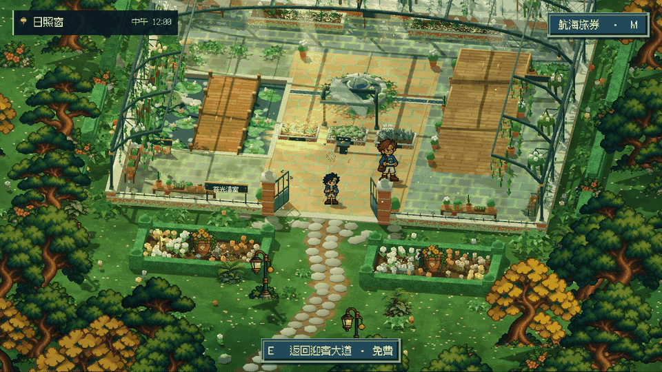

# [ART-53] 整建苔光溫室場景

> 狀態：完成

## 內文

### 需求

苔光溫室是浮在綠色空白中的淡色平台，植床與玻璃架構單薄。把它整建成有玻璃屋、植床、藤蔓、水道與苔蘚地面的溫室。

### 來源

2026-11-27 使用者指出地圖簡陋、有方形色塊且缺少場景感；同日原生畫面顯示此區是懸浮在單色背景上的平台。

### 驗收條件

- [x] 區域地面延伸到鏡頭可見範圍之外或有完整背景，四個時段都看不到單色空白底。
- [x] 區域邊界有符合主題的收邊，平台不再像懸浮的板子。
- [x] 區域外緣是可以往外延伸的自然地面與植栽（臨海處除外），之後接上大島時不需要重做；並至少有一個不用進關卡、會對玩家產生反應的即時互動。
- [x] 鏡頭內沒有邊長超過一公尺的純色方塊或圓柱，主要設施有可辨認的造型與材質。
- [x] 至少有三種符合主題的環境動態，開啟減少動態後靜止。
- [x] 原有互動點、動線、小遊戲入口、返回迎賓大道與燈光數量限制不變。
- [x] 符合場景搭建規範，場景節點與繪製數量在該區預算內。

### 測試流程

1. 進入此區，以固定視點比對整建前後的畫面。
2. 走遍所有互動點與小遊戲入口並返回迎賓大道。
3. 切換四個時段與減少動態。

---

# 跟其他票的關係

- Blocks：無
- Blocked by：無
- Related：MAIN-53、MAIN-56、MAIN-57、ART-46、ART-48

---

# Commit-1

## 內文

原本的苔光溫室是一塊淡色平台，懸在整片單色的綠底上，只有一道薄玻璃牆、幾個方盒植床和兩叢蕨；日照窗的光斑幾乎看不出來，站在入口時下半個畫面是空的。

現在它是林間空地裡的一座鑄鐵玻璃屋：磚砌牆腳、拱形屋架與屋脊、會映出天色的玻璃，屋頂朝鏡頭這一側是敞開的，裡面一覽無遺。屋內有長苔的石板地、睡蓮濕地床與木棧道、中央的圓形噴水池和兩條流動的細水道、吊籃、爬滿格架的藤蔓、育苗架與陶盆、工作桌與工具、澆水壺、接雨桶、日晷、石燈籠、蘑菇與蕨。門外是樹籬圍起的花圃、彎向迎賓大道的石板小徑和路燈，再往外四面都是樹林，地面一路鋪到畫面之外。

日照窗的三個檔位各自照亮一座植床：被照到的那一床開花、葉子發亮，百葉下有帶著塵埃的光柱，地上有一條一條的光影；另外兩床只有花苞。夜晚光柱變成月光，夜芽、苔蘚與小蘑菇會發出青綠色的光。屋裡還有從屋頂斜射下來的光束和隨風移動的樹影。

會動的東西有水面與水道、隨風擺動的吊籃、藤蔓與蘆葦、屋脊上的風向雞、花圃裡的風車、噴水池的水滴；蝴蝶、麻雀與螢火蟲沿用原本的設定。走上木棧道時，旁邊蓮葉上的青蛙會跳進水裡、留下一圈漣漪，人走遠後再爬回來；走過噴水池邊的含羞草，葉子會合起來。這些都不計分、不存檔。開啟減少動態後全部靜止，青蛙留在蓮葉上。

走過的路線、五個互動點、和票票的合照與免費返回迎賓大道都和原來一樣；屋內仍然只有兩盞補光，路燈與石燈籠只是發光體。以原生畫面在凌晨、中午、傍晚、晚上各看過入口、日照窗、濕地床、藤蔓層、夜芽庭與四個角落共 36 張，三個日照檔位、合照與減少動態也各擷取一張，都沒有露出底色。場景檢查在此區的方形色塊從 8 個降為 0。

### 測試結果

| 項目 | 結果 |
|---|---|
| 溫室場景測試 | 通過，77 項檢查 0 失敗（新增地標、三個日照檔位、減少動態與青蛙反應） |
| 溫室合照、場景規範、環境生態、島風、換區、換區進度、主場景整合、啟動 | 全部通過 |
| 場景規範稽核（此區） | 方形色塊 8 → 0，其餘三類維持 0 |
| 場景節點 | 整建前 281，整建後 240（預算 900） |
| 單一視點繪製數 | 整建前 280–545，整建後 183–308（預算 800） |
| 執行 log | 無 ERROR |

### 截圖

---
