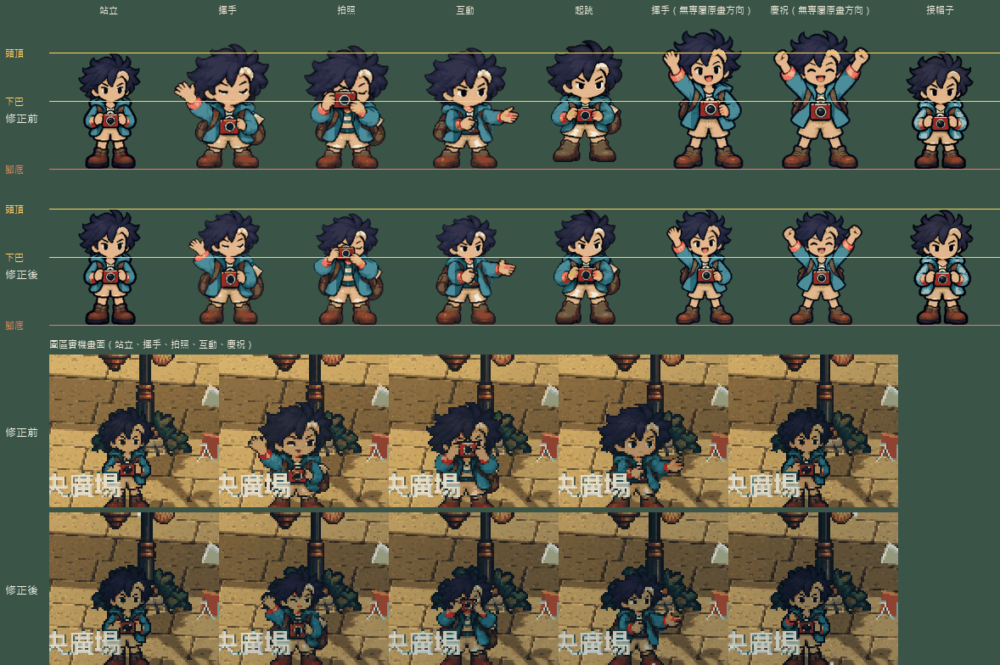

# [ART-54] 統一角色各動作的大小

> 狀態：進行中

## 內文

### 需求

主角在做不同動作時大小會變：揮手、拍照、互動時頭和身體都比站立與走路時大，朝向沒有專屬原畫的方向做動作時又換成一張更大的姿勢。讓主角、所有 NPC 以及其他會動的角色，在任何動作、方向與影格之間都維持同樣的大小，腳也維持踩在同一個位置。

### 來源

2026-11-27 使用者指出主角做不同動作時大小有時不一樣，要求完整修正，並包含所有 NPC 與可動的東西。同日量測：主角正面揮手、拍照、互動的可見面積約為站立的 1.4 到 1.5 倍；沒有專屬原畫的方向改用的姿勢高度為站立的 1.2 倍。

### 驗收條件

- [x] 主角在所有動作與八個方向之間，頭部大小與站立時相差不超過百分之四。
- [x] 主角切換動作時腳底位置不跳動，身體不上下或左右偏移。
- [ ] 三位 NPC 在站立、走路、打招呼、互動與各自的個性動作之間，頭部大小相差不超過百分之四，腳底位置不跳動。
- [x] 換髮型、帽子、服裝、膚色與種族後，上述一致性仍成立。
- [x] 園區、衣櫃、拍貼畫面與小遊戲中出現的同一個角色大小一致。
- [x] 環境小動物與其他有多張影格的活動物件，各影格之間大小一致。
- [x] 有一項自動檢查會量測每個角色、動作與方向的大小，超出容許範圍就失敗並指出是哪一個。
- [x] 站立與走路的像素原畫不被重新取樣，既有的像素穩定檢查維持通過。

### 測試流程

1. 在園區讓主角依序站立、走路、揮手、拍照、互動、慶祝與坐下，朝八個方向各做一次，觀察大小與腳底。
2. 與三位 NPC 對話並觸發各自的動作，觀察大小與腳底。
3. 換一套髮型、帽子與服裝後重複第一步。
4. 開啟衣櫃、拍貼畫面與一款有角色的小遊戲，比對角色大小。

---

# 跟其他票的關係

- Blocks：無
- Blocked by：無
- Related：ART-16、ART-17、ART-18、ART-31

---

# Commit-1

## 內文

主角的幾組動作原畫是用不同比例畫的：正面的揮手、拍照、互動與跳躍把頭畫成站立時的 1.25 到 1.36 倍，身體卻比較矮；朝向沒有專屬原畫的方向時改用的四張姿勢整張是站立的 1.2 倍；接帽子的頭大了約百分之六；跳躍的站姿還浮在地面上方 15 像素。所以一做動作，角色就忽大忽小、忽高忽低。
現在每一組動作都會對回站立時的大小：頭和站立時一樣大，腳踩在同一條地面線上，帽子、耳朵、角和換過的髮型跟著一起對齊。正面那幾組頭大身體矮的原畫是頭與身體分開調整的，所以不會為了讓頭變小而把整個人縮成矮個子。這是在角色圖產生的地方處理的，園區、衣櫃、拍貼畫面、重拍畫面與小遊戲看到的都是對齊後的角色。站立與走路的像素原畫完全沒有被動到。
三位 NPC 的正面動作本來就一致（頭部差距最多百分之三點八），腳底都在同一條線上，這次沒有改動；售票員與小惡魔側身走路時和正面站立一樣高。播報員的側身原畫把帽子畫得比較翹，整個人比正面站立高百分之四到六點五，身體本身一樣高；這是原畫比例的差別，縮放會讓身體跟著變小，要重畫側身才能解決，所以該項驗收尚未完成。環境小動物的各影格都畫在同一個像素格上，大小一致。
新增一項自動檢查：量測主角 39 組原畫與三位 NPC 所有動作的頭部大小與腳底位置，超出百分之四或兩個像素就指名失敗；原畫更新後忘記重新量測也會失敗。兩個側身姿勢（揮手、拍照）的靴子比站立時偏後 6 到 7 像素、頭的位置不變，以及坐下的原畫位置，屬於姿勢本身，列為有註明原因的例外。

### 測試結果

| 主角動作 | 頭部相對站立（修正前 → 修正後） | 站姿高度（站立 274） |
|---|---|---|
| 正面揮手 | 1.34 → 1.00 | 293 → 267 |
| 正面拍照 | 1.36 → 1.00 | 290 → 262 |
| 正面互動 | 1.35 → 1.00 | 285 → 258 |
| 跳躍（站姿） | 1.25 → 1.00，腳底由懸空 15 像素回到地面 | 282 → 265 |
| 接帽子 | 1.06 → 1.00 | 276 → 270 |
| 無專屬原畫方向的拍照 | 1.21 → 1.00 | 329 → 271 |
| 無專屬原畫方向的揮手 | 1.14 → 0.93（舉手遮住頭髮使讀數偏小，與拍照同一組比例） | 331 → 273 |
| 無專屬原畫方向的慶祝 | 1.11 → 0.92（雙手遮住頭髮使讀數偏小，與拍照同一組比例） | 326 → 268 |
| 無專屬原畫方向的互動（弓步） | 1.26 → 1.04 | 300 → 247 |
| 站立、走路、坐下、轉身、起步、停步、側身拍照 | 0.97 到 1.03，未改動 | 未改動 |
| 斜前方站立（相對正面站立） | 頭一樣大、身體畫得較高，整體高百分之五，未改動 | 288 |

| 項目 | 結果 |
|---|---|
| 角色大小檢查（主角 39 組原畫、NPC 三人、替換外觀五組、小動物） | 通過 581 項 |
| NPC 正面動作頭部相對站立 | 售票員 0.995 到 1.010、小惡魔 0.977 到 1.038、播報員 1.000 到 1.033 |
| NPC 側身高度相對正面站立 | 售票員 1.000 到 1.008、小惡魔 0.986 到 1.011、播報員 1.037 到 1.065 |
| 單張影格對齊的額外耗時 | 約 6 毫秒，是組出一張新影格所需時間的百分之三到八，只在第一次用到時發生 |
| 角色、服裝、髮型、NPC、衣櫃、介面、小遊戲與主場景相關檢查 | 通過 |
| 園區實機畫面 | 站立、揮手、拍照、互動、慶祝大小一致，腳底不動 |

### 截圖

