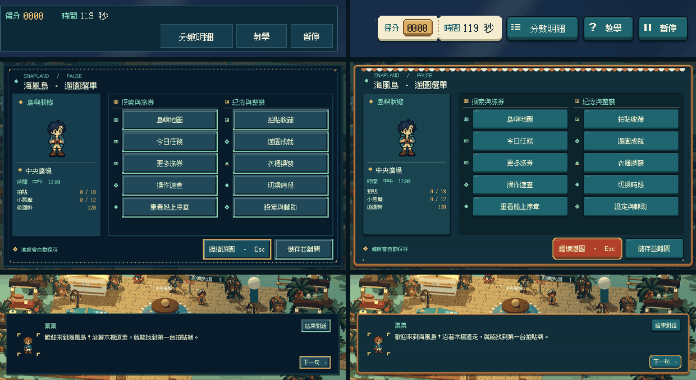

# [ART-55] 把介面改成立體的樂園風格

> 狀態：完成

## 內文

### 需求

介面是一塊塊深色的直角方框與細線邊，像工具軟體，和溫暖的海邊樂園畫面不搭，也沒有厚度。把面板、按鈕、分數列與提示改成符合遊戲風格、看得出厚度與材質的樣式，例如木牌、票券與琺瑯徽章的質感，邊角不再是生硬的直角。

### 來源

2026-11-27 使用者附小遊戲分數列的截圖，指出介面方方框框，要求改成符合遊戲風格並且立體一點。

### 驗收條件

- [x] 面板、按鈕、分數列、提示與對話框都不再是直角平面方框，邊角有圓角或切角，並有可辨認的厚度（側邊或底邊的暗面與落影）。
- [x] 按鈕在一般、滑過、聚焦、按下與停用五種狀態下外觀明顯不同，按下時看得出被壓下去。
- [x] 小遊戲的分數與時間列改成有樂園主題的造型，分數與時間一眼可讀。
- [x] 遊園選單、地圖、收藏、衣櫃、設定、教學、對話、結算與提示使用同一套樣式，夜市等區域配色仍可辨認。
- [x] 文字與底色的對比足以閱讀，最大字級與 800 × 600 視窗下不裁切、不重疊，可點選範圍不小於原本。
- [x] 鍵盤、手把與滑鼠的聚焦指示清楚；減少動態下外觀不變。
- [x] 介面繪製成本不高於改動前。

### 測試流程

1. 開啟遊園選單、地圖、收藏、衣櫃、設定、教學與一段對話，逐一比對改動前後。
2. 進入兩款不同區域的小遊戲，觀察分數列、暫停與結算。
3. 用鍵盤與滑鼠各操作一次按鈕的五種狀態。
4. 以最大字級與 800 × 600 視窗重看一次。

---

# 跟其他票的關係

- Blocks：無
- Blocked by：無
- Related：ART-20、ART-23、ART-26、ART-41

---

# Commit-1

## 內文

介面原本是深藍色的直角平面方框加細線邊，按鈕只有一條底線，分數列是一整塊深色長條，看起來像工具軟體，和樂園的木棧道、彩色屋瓦與票券完全是兩個世界。
現在整套介面改用樂園裡拿得到的東西來做：選單、對話、教學與結算是木框圍起來的深青色漆面招牌，邊角以兩像素一階切掉，上緣受光、下緣有木框厚度與落影，遊園選單頂端還垂著一排珊瑚白相間的攤棚布邊；面板裡的區塊分成浮起的漆面板與凹進去的槽，未解鎖的成就章就是空槽。按鈕是琺瑯徽章：一般狀態浮在板上，滑過時再抬高一點並變亮，按下時整個面往下沉、底邊變薄，停用時變成扁平的灰色，主要動作改用珊瑚紅；鍵盤與手把的聚焦是繞在按鈕外圈的黃銅環。小遊戲的分數與時間印在一張有撕線缺口的米色票根上，分數另外嵌在黃銅牌裡，旁邊三顆琺瑯按鈕各帶一個像素小圖示；練習與輔助的標記蓋在票根上。園區的提示也改成一張票券，白天與夜晚的場景上都讀得清楚。夜市的選單維持紫色木框與紫色攤棚布邊。地圖上的站點改成同樣的小琺瑯牌，換區時的區域名稱與園區即玩遊戲的計分牌也掛在招牌上。
以 1280 × 720 與 800 × 600、最大字級逐頁比對遊園選單、地圖、收藏、衣櫃、設定、任務、成就、時段、教學、對話、小遊戲分數列、暫停、分數明細、確認與結算，白天、夜晚與夜市各看一次，沒有裁切或重疊。按鈕尺寸與可點範圍和改動前相同（暫停鈕加寬）。介面繪製次數不高於改動前，節點數相同。

### 測試結果

| 項目 | 結果 |
|---|---|
| 介面相關測試（外殼、彈出選單、按鈕立體、收藏、自訂、小遊戲、分數列、地圖與收藏本、衣櫃、補拍、動態、小遊戲氛圍、換區、整合、啟動） | 全部通過 |
| 教學、對話、遊戲入口、照片檢視、船上序章、字體、園區即玩遊戲、遊樂場小遊戲與受影響的小遊戲畫面測試 | 全部通過 |
| 繪製次數（改動前 → 改動後） | 園區 1741 → 1740、遊園選單 1790 → 1774、設定 1784 → 1774、收藏 1815 → 1801、小遊戲分數列 149 → 149、小遊戲暫停 152 → 150 |
| 節點數（改動前 → 改動後） | 園區 2422 → 2422、遊園選單 2518 → 2518、小遊戲 548 → 548 |

### 截圖

