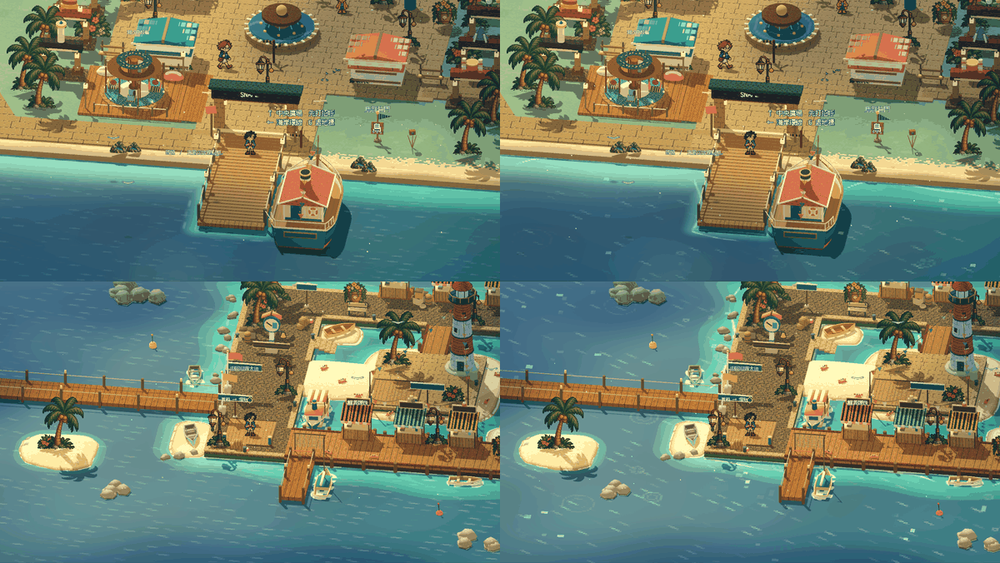

# [ART-56] 讓海面與水面有浪與波光動畫

> 狀態：完成

## 內文

### 需求

海面與各處水面只有很慢的明暗起伏，浪尖停在原地，靠岸的細浪幾乎不動，看起來像一張靜止的圖。讓海、潟湖、水池與噴泉有對應的動畫：浪往岸邊推進再退去、開闊水面的浪尖漂移生滅、波光閃爍、偶爾出現的漣漪，並且跟著島上的風一起起皺。

### 來源

2026-11-27 使用者指出海或是水可以有相對應的動畫。同日檢視：迎賓海灣的浪尖位置固定，岸浪每秒只移動約 0.2 公尺。

### 驗收條件

- [x] 靠岸處可以看到一道道浪由外往岸邊推進、變亮、拍岸後退去，沿岸各段的節奏不一致。
- [x] 開闊水面的浪尖會沿風向漂移並生滅，不是固定在原地。
- [x] 水面有成片的波光閃爍，白天、傍晚與夜晚的強度不同。
- [x] 平靜的水面偶爾出現擴散的漣漪；水池與噴泉的水面有持續的波紋。
- [x] 島上的陣風經過時，水面跟著起皺，和草地、樹木的風一致。
- [x] 開啟減少動態後所有水面靜止。
- [x] 迎賓海灣、潮汐碼頭、水池與噴泉都套用，水面的繪製數量不增加。

### 測試流程

1. 在迎賓碼頭與潮汐碼頭站定觀察十秒，看岸浪、浪尖、波光與漣漪。
2. 到迎賓廣場的噴泉與水池觀察波紋。
3. 切換四個時段，再開啟減少動態確認靜止。

---

# 跟其他票的關係

- Blocks：無
- Blocked by：無
- Related：ART-38、ART-40、ART-48

---

# Commit-1

## 內文

海面與水面只有很慢的明暗起伏，浪尖固定在原地，岸邊的細浪每秒只移動約 0.2 公尺，看起來像靜止的圖。
現在所有水面共用一套水面動態：靠岸處有一道道浪從外面推進、越靠岸越亮，拍岸後留下一片水沫再退去，沿岸各段到達的時間不同，浪線會彎曲；開闊水面的浪尖順著風向漂移並在幾秒內生滅；波光聚在湧浪受光的一面成片閃爍，夜晚隨光線變暗；平靜的水面每隔幾秒冒出一圈往外擴散的漣漪；島上的陣風經過時水面變暗並出現更多浪尖，和草地與樹的風是同一陣。水池與噴泉的水面有從中心往外擴散的波紋。迎賓海灣、潮汐碼頭、水池與噴泉都已套用，開啟減少動態後水面完全靜止。
原生檢視迎賓碼頭、噴泉與潮汐碼頭的連續畫面，並在夜晚檢視一次；水面的繪製數量與改動前相同。

### 測試結果

| 項目 | 結果 |
|---|---|
| 島嶼佈局（海灣水面參數）、潮汐碼頭、日夜光照 | 通過 |
| 島上風場、海岸互動、遊戲啟動 | 通過 |
| 減少動態下相隔一秒多的兩張畫面 | 0 個取樣點不同 |
| 水面繪製數量 | 不變（仍是單一表面） |

### 截圖

