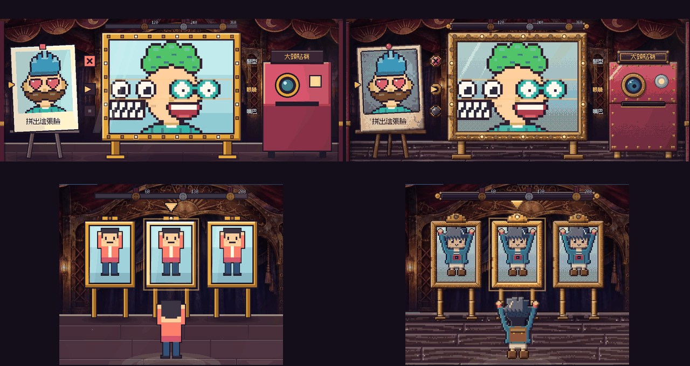

# [ART-57] 提升街機小遊戲物件的畫面精緻度

> 狀態：完成

## 內文

### 需求

街機式小遊戲的玩法物件多半是純色的幾何形狀，放在細緻的背景圖前像是貼上去的佔位圖。把已交付的街機小遊戲與共用的獎牌列、提示列提升到和背景同樣的完成度，並訂出之後每一款都要達到的畫面下限。

### 來源

2026-11-27 使用者附「整點咕咕」的截圖，指出小遊戲畫面太簡陋，是先前提過的純色色塊與貼上去的問題。

### 驗收條件

- [x] 已交付的街機小遊戲中，超過約 40 像素的面都有材質或圖樣，沒有大面積純色幾何形狀。
- [x] 物件有一致的受光方向、描邊、交接處的陰影與落在地面或檯面上的接地陰影。
- [x] 物件的色調與明暗落在背景的範圍內，裁切物件與相鄰背景並排時不顯得突兀。
- [x] 主要物件有可辨認的造型與個性，不是矩形加三角形。
- [x] 共用的獎牌列、提示列與倒數提示同樣有材質與厚度。
- [x] 街機小遊戲的製作清單中寫明畫面下限。
- [x] 玩法、計分、測試與可讀性不變。

### 測試流程

1. 逐款進場擷取回合中的畫面，裁切玩法物件與背景並排比對。
2. 各玩一回合確認判讀與操作不受影響。

---

# 跟其他票的關係

- Blocks：無
- Blocked by：無
- Related：SG-66、SG-67、SG-68、SG-69、SG-70、ART-42、ART-55

---

# Commit-1

## 內文

哈哈鏡大頭貼與誰是假倒影的照相機、畫架、鏡框、主角與假倒影都是單色方塊，舞台地板、結算卡、獎牌列、倒數橫幅和底部提示列也是平塗色塊，放在細緻的帳篷背景前像貼上去的。
現在這些物件都以粗像素材質重畫：烤漆木畫架與紙卡、磨出紅底的金箔鏡框、帶玻璃反光的鏡面、鉚釘琺瑯大頭貼機、捲角相紙、絲絨布幕、有板縫與釘頭的舞台；光從左上來，外框用加深的同色，接地處有陰影。鏡中倒影與主角換成島上旅人的小圖（刺蝟頭、青色外套、相機與背包），四種姿勢正背面都一眼可辨，假倒影吐舌、被冤枉的倒影冒汗。共用的獎牌列改成黃銅軌道與流動的填色，倒數是絲絨橫幅加金框與黃銅獎章，提示列與按鍵有厚度，回饋字有立體厚度，結算獎牌落下時揚塵並反光；鏡面與獎牌的反光、揚塵在減少動態時都不畫。
以原生畫面擷取兩款的開場、回合中、失誤與結算，物件與背景並排比對，色調落在帳篷的暗紅與暗金範圍；另擷取玩具城與溫室的三款確認共用的獎牌列與提示列正常。製作清單的畫面下限補上共用材質、抖色與反光的寫法。

### 測試結果

| 項目 | 結果 |
|---|---|
| 街機共用流程、哈哈鏡大頭貼、誰是假倒影規則測試 | 通過 3 / 3 |
| 小遊戲氛圍、小遊戲像素介面、馬戲團世界、遊戲啟動 | 通過 4 / 4 |
| 小遊戲設計資料驗證 | 0 錯誤 |
| 原生擷取（兩款各五個時刻） | 無 ERROR |

### 截圖

