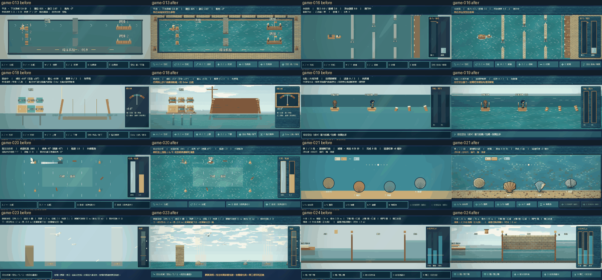
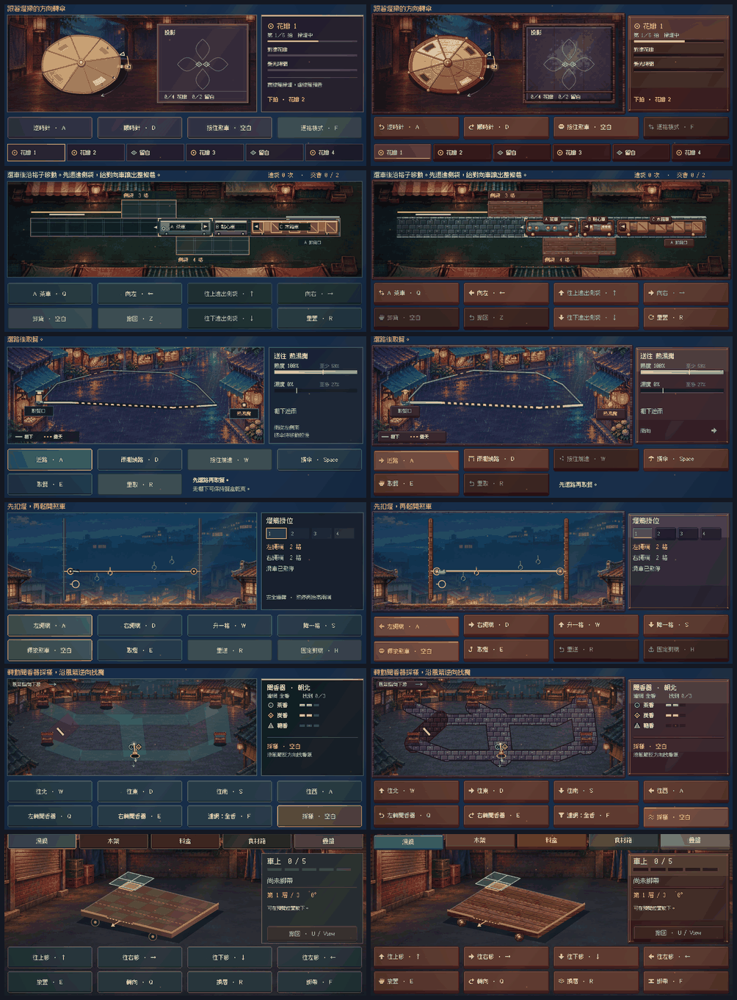
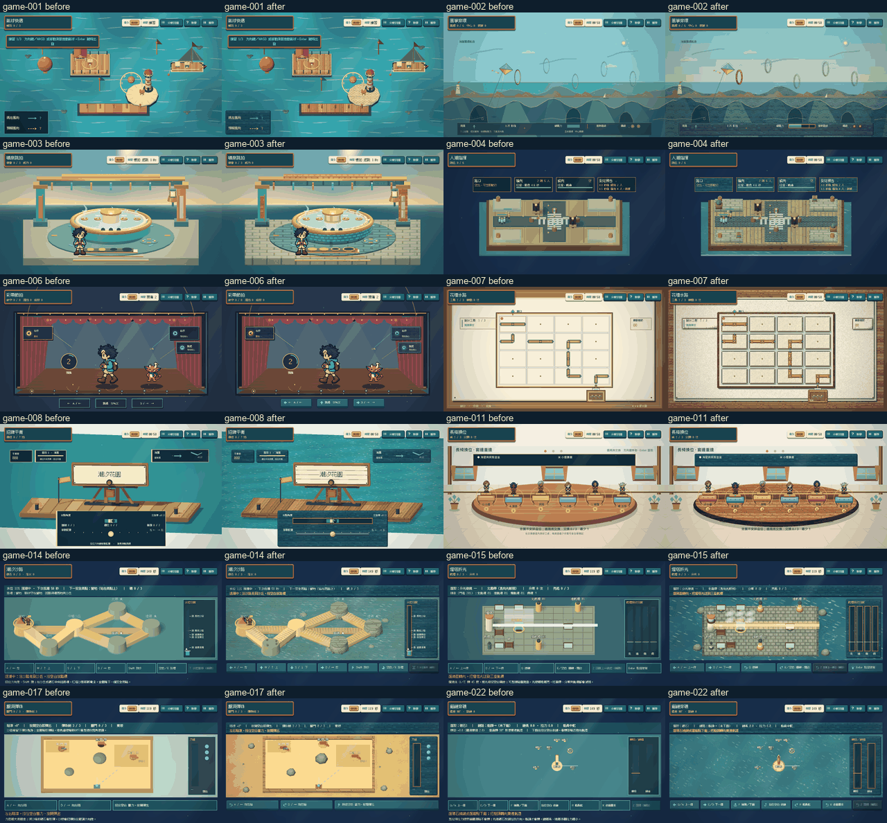
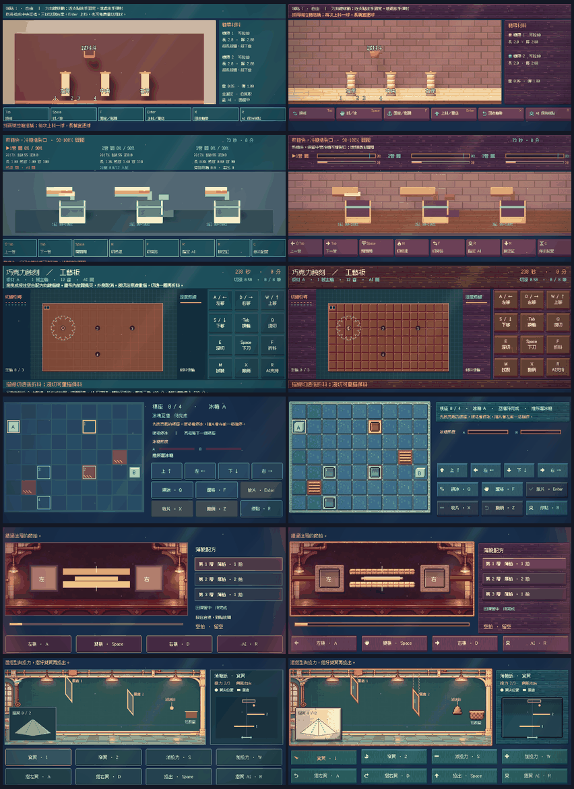

# [ART-58] 提升既有小遊戲玩法物件的畫面

> 狀態：進行中

## 內文

### 需求

迎賓、潮汐碼頭、糖果工廠與霓虹夜市的四十八款小遊戲中，不少玩法物件是純色方塊、圓形與線條，文字說明又多又小，放在繪製的背景前顯得簡陋。盤點這些小遊戲，把最顯眼的純色物件換成有材質與造型的畫法，並減少畫面上的文字負擔。

### 來源

2026-11-27 使用者附「整點咕咕」的截圖，指出小遊戲畫面太簡陋，是先前提過的純色色塊與貼上去的問題。

### 驗收條件

- [x] 盤點列出四十八款中玩法物件仍是純色幾何形狀的款項與處理結果。
- [ ] 每個區域至少完成六款的物件重繪：有材質、受光、描邊與接地陰影。
- [x] 重繪的款項畫面上常駐的說明文字不超過兩行，其餘改為圖示或收進說明頁。
- [ ] 物件的色調與背景一致，裁切並排比對時不顯得突兀。
- [x] 玩法、判定範圍、計分與既有測試不變。

### 測試流程

1. 依盤點清單逐款進場比對重繪前後。
2. 每款玩一回合確認判定與操作不變。

---

# 跟其他票的關係

- Blocks：無
- Blocked by：無
- Related：ART-21、ART-26、ART-42、ART-57

---

# Commit-1

## 內文

四十八款逐一進場截圖盤點：可接受 8 款、只有文字過多 1 款、純色幾何 17 款、純色幾何又文字過多 22 款，其中潮汐碼頭十二款全是高優先。盤點表列出每款哪裡是純色、文字擠在哪、優先度與處理狀態，作為後續各區重繪的工作清單。

潮汐碼頭先重繪八款：浪間小艇、繩結拖船、船艙配重、浮標接力、帆影追逐、貝殼聽潮、海鳥借風、潮鐘合閘。原本的水是一整片單色、船與貨箱是幾個色塊、岩柱與閘室是單色長方塊，貝殼是圓形加線條，上下還各有兩行小字說明。現在水面有會動的波紋與水面線、剖面越深越暗；石牆與岩柱是分層石塊並有潮濕水痕與海草線；船、貨箱、浮標、郵筒、救生圈、海鳥、羽毛、鳥巢、木樁都由多個零件組成，有受光面與接地陰影；側視的關卡加上有雲與遠岸的天空，取代單色背景；貝殼聽潮的水池與沙灘改成像素繪製，四種貝殼各有自己的輪廓。上方告示板只留狀態一行和最需要的提示一行，其餘規則移到告示板的懸停提示；下方按鈕換成有圖示、按下會下沉的實體按鍵，位置與文字不變。街機小遊戲與這批小遊戲現在用同一套像素畫具。

八款都以進場同一時刻比對重繪前後，並裁切物件與背景並排檢查；各款的回合腳本（固定路線打完一局）結果與重繪前相同。

### 測試結果

| 項目 | 結果 |
|---|---|
| 八款的畫面、場次、主畫面回合與原生前置測試 | 通過 32 / 32 |
| 街機六款測試 | 通過 6 / 6 |
| 像素介面、介面層級、氛圍、參與結果、主場景整合、啟動測試 | 通過 6 / 6 |
| 設計連結驗證 | 0 錯誤 |
| 執行 log | 無 ERROR |

### 截圖

---

# Commit-2

## 內文

霓虹夜市十二款（雨棚快遞到收攤套疊）全數重繪。原本這區的玩法物件多是平面線條與色塊：紙傘是平塗米色扇形、攤車是線框長方形、路線是平面折線、香氣巷道是半透明青色色帶、湯碗步道與收攤車格面是灰色平塗多邊形；每款下方都有八個純色按鈕，右側欄塞滿小字。

現在紙傘有油紙纖維、紅色傘緣與銅頭傘骨，朝燈的傘面亮、背光的暗，投影屏是木框紙屏；攤車有木板車床、銅軸車輪，車上是看得出的茶甕、點心盤與木箱，巷道是濕石板、側袋是木棧板；快遞員與雨傘是像素繪製，站點是燈籠與漆牌；燈籠繩是麻繩、絞盤柱是有銅刻度的木柱、招牌是琺瑯板；香氣巷道是有路緣的石板步道；湯碗步道與接板是木棧板；收攤車的器具各有金屬、木或釉面材質。下方按鍵十二款一致，換成有圖示、按下會下沉的漆木實體按鍵，位置與文字不變；側欄改成黃銅細框的漆面告示板與嵌入式量表，次要說明與手把提示收進懸停提示。玩法、判定與計分都沒有改。

十二款都以進場後約兩秒的同一時刻比對重繪前後，並裁切物件與背景並排檢查。這只是畫面檢查，沒有實際試玩。迎賓與糖果工廠由其他場次處理，本票維持進行中。

### 測試結果

| 項目 | 結果 |
|---|---|
| 十二款與糖畫拉線的畫面、操作與規則測試 | 通過 24 / 24 |
| 像素介面、介面層級、氛圍、參與結果、場景規範、啟動測試 | 通過 6 / 6 |
| 設計驗證（全部範圍） | 0 錯誤 |
| 執行 log | 無 ERROR |
| 每款繪製呼叫（前 → 後） | 037 70→89、038 83→90、039 102→121、040 65→67、041 145→237、042 93→102、043 84→93、044 354→350、045 331→443、046 229→158、047 136→149、048 175→102 |

### 截圖

# Commit-3

## 內文

接著重繪迎賓八款與潮汐碼頭剩下的四款，潮汐碼頭十二款至此全部完成：氣球快遞、風箏穿環、噴泉跳拍、人潮指揮、彩帶節拍、花壇水路、招牌平衡、長椅換位，以及潮汐沙路、燈塔折光、蟹洞彈珠、錨鏈穿礁。

原本這些關卡的海面、碼頭、廣場地坪、路口、沙洲、棋盤地板與沙盤都是一整片單色，礁石是灰色圓盤、光束是一條白色長方塊、風環是細線圈、山崖與天空是平塗色帶，花壇水路的格子與水管、長椅換位的桌面與座墊也都是平塗色塊。現在水面有會動的波紋，碼頭、桌台與看板有木紋與接縫，地坪、路面、岩礁與燈塔是分層石塊或卵石；礁石、燈塔、浮標、螃蟹、發射座、霧團、鐵鏈、貨船、行人的帽子與背包都由多個零件組成，有受光面與接地陰影。風箏關的天空與海面分層漸變、山崖有岩層紋理、風環是有繩結與受光面的立體圈；花壇水路的格子是帶陰影的紙片、水管是有亮面、暗面與銅箍的銅管；長椅換位的桌面有木紋、座墊有鈕扣；燈塔的光束是帶光暈的暖色光。

文字方面，潮汐碼頭四款上方告示板只留狀態一行與回饋一行，路線、航標讀數、上一顆彈珠與轉矩細節移到告示板的懸停提示；風箏關底部的第二排說明、招牌平衡的操作說明與三項計數、長椅換位的操作說明與章標規則也移到懸停提示。按鈕換成有圖示、按下會下沉的實體按鍵，位置、大小與標籤不變；儀表、計數卡、風向圖例與人潮指揮的四張卡片改成木框告示板。

十二款都以進場同一時刻比對重繪前後，並把物件與背景並排檢查。玩法、判定範圍、輸入與計分都沒有改動，各款的場次與主畫面測試（固定路線打完一局）結果與重繪前相同。迎賓的帽子救援、影子捉迷藏、泡泡拍貼、迎賓大合奏屬低優先，留待後續；糖果工廠與霓虹夜市由另一個場次處理，所以本票仍為進行中。

### 測試結果

| 項目 | 結果 |
|---|---|
| 十二款的畫面、場次、主畫面回合、模型與原生前置測試 | 通過 |
| 街機十二款與街機驅動測試 | 通過 |
| 像素介面、介面層級、氛圍、參與結果、主場景整合、啟動測試 | 通過 |
| 合計（含匯入） | 63 / 63 通過，log 無 ERROR |
| 設計連結驗證 | 0 錯誤 |

### 截圖

# Commit-4

## 內文

糖果工廠十二款（拉糖橋到熔糖抽絲）全數重繪。原本這區的小舞台背景是一整片褐色或藍灰色，糖柱、料斗、果凍、糖漿槽與棉花糖機是單色方塊與圓柱；平面款的巧克力板是單色格子、冰糖是單色方塊、夾心是平塗長條、滑翔機是灰色三角、熱槽是平塗平行四邊形；多數款上下都有三到五行小字說明與純色按鈕列。

現在小舞台後面是粉彩磁磚牆與木作檯面，糖柱是紅白相間的糖柱加黃銅頂板，料斗是紅銅鍋，送料球是條紋糖球，果凍、糖漿與糖豆有糖果光澤，高台是一層層的威化，糖漿槽是紅銅槽配黃銅框，棉花糖機是有奶油色箍條的琺瑯桶，蹺蹺板有木板接縫與黃銅端蓋，並開了日光陰影與環境遮蔽。平面款的巧克力板是一格格凸起的巧克力塊，冰糖是有亮面與陰影面的晶塊、冰面是霜面磁磚、暖格是發紅的銅板；夾心是格紋威化夾奶油餡，左右模由紅銅活塞推動；糖紙滑翔機有摺痕、糖紙條紋與地面投影，風窗是黃銅框糖玻璃、用鏈條吊在管線下；熱槽是紅銅框玻璃加熱室，原料桶是有黃銅箍的琺瑯桶；熔糖鍋有發熱線圈，糖絲有深色邊與亮面。上方告示板只留狀態一行與回饋一行，其餘規則與細部數值收進告示板或側欄的懸停提示，數值改成玻璃量條；按鈕全部換成會下沉的實體按鍵，多數附圖示，位置、大小與文字不變。玩法、判定與計分都沒有改。

十二款都以進場後約兩秒的同一時刻比對重繪前後，並裁切物件與背景並排檢查。這只是畫面檢查，沒有實際試玩。棉糖捲風的三段規則說明改放在告示板懸停提示，版面測試改為檢查這三段已收起且出現在提示裡；果凍彈床與糖漿分洪多了背景與裝飾零件，畫面測試的檢查數隨之更新。迎賓區由其他場次處理，本票維持進行中。

### 測試結果

| 項目 | 結果 |
|---|---|
| 十二款的模型、操作、畫面、場次與主畫面測試 | 通過 38 / 38 |
| 像素介面、介面層級、氛圍、場景規範、啟動測試 | 通過 5 / 5 |
| 設計驗證（全部範圍）與 Python 測試 | 0 錯誤，217 / 217 |
| 執行 log | 無 ERROR |
| 每款繪製呼叫（前 → 後） | 025 168→173、026 209→214、027 137→148、028 83→112、029 121→83、030 122→130、031 95→135、032 118→143、033 77→64、034 89→102、035 96→87、036 97→66 |

### 截圖

