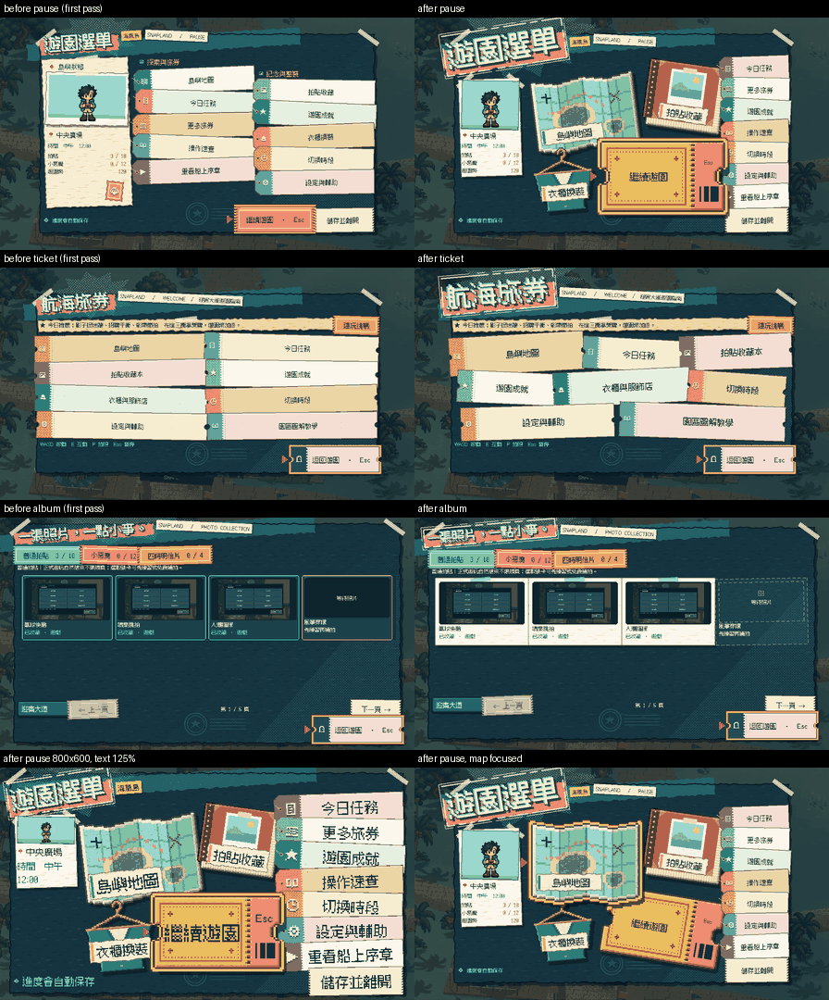

# [ART-59] 把主要介面改成拼貼風格並加強動畫

> 狀態：完成

## 內文

### 需求

ART-55 讓介面有了厚度與材質，但選單仍是整齊排列的方框按鈕，看起來像設定畫面，缺少樂園的趣味。參考使用者提供的調酒遊戲畫面：選項本身就是場景裡的物件，標籤歪斜地貼著、標題是超大的手寫感字體、撕紙標籤配色塊、網點與噴漆質感、斜向不對稱的構圖。把這種「拼貼、有態度、會動」的做法轉成 Snapland 自己的樣子：用拍貼、行李吊牌、票根、郵戳、明信片、旅行手帳這些樂園與旅行的東西來組成主要介面，並讓介面有更多進場、懸停、按下與切換的動畫。

### 來源

2026-11-27 使用者附一張調酒遊戲的選單截圖（酒瓶當選項、歪斜標籤、大字標題、撕紙色塊），說明希望有些介面能做得類似、有趣一點，符合目前遊戲風格，並且有更多動畫。

### 驗收條件

- [x] 遊園選單、航海旅券、拍貼收藏的首頁與小遊戲結算，改成拼貼構圖：選項是可辨認的旅行或樂園物件（吊牌、票根、拍貼、明信片之類），帶有角度、互相疊放，不再是整齊的方框按鈕陣列。
- [x] 每個畫面有一個大而有個性的標題，使用目前的像素字型放大並加上墨跡、郵戳或手寫感的處理，色彩與現有樂園配色一致。
- [x] 有撕紙邊、膠帶、網點或印刷紋理等質感，但文字與底色對比足以閱讀。
- [x] 開啟時物件依序飛入並落定，懸停或聚焦時物件微微抬起、轉正並有陰影變化，按下時有蓋章或彈跳回饋，切換畫面有翻頁或抽換的轉場；每段動畫不超過半秒，不延遲操作。
- [x] 開啟減少動態後所有動畫改為直接切換，構圖與功能不變。
- [x] 鍵盤、手把與滑鼠都能操作，聚焦順序符合畫面上的閱讀順序，聚焦的物件一眼看得出來；可點範圍不小於原本。
- [x] 800 × 600 視窗與最大字級下不裁切、不重疊；原有功能、按鈕名稱與滑鼠提示文字不變。
- [x] 介面繪製與記憶體成本不明顯增加，紋理只產生一次並重複使用。

### 測試流程

1. 開啟遊園選單、航海旅券與拍貼收藏，觀察進場、懸停、聚焦與按下的動畫。
2. 完成一款小遊戲看結算畫面。
3. 只用鍵盤與只用滑鼠各操作一次全部選項。
4. 開啟減少動態、最大字級與 800 × 600 視窗各重看一次。

---

# 跟其他票的關係

- Blocks：無
- Blocked by：無
- Related：ART-41、ART-55、ART-57

---

# Commit-1

## 內文

遊園選單與航海旅券原本是整齊排列的深青色方框按鈕，看起來像設定畫面，打開與切換時只有輕微淡入，沒有樂園的趣味。
現在主要選單貼在一張撕邊的深色旅行手帳頁上，四角有紙膠帶：標題用像素字放大成白字黑框、壓在珊瑚色撕紙條與網點爆炸圖上並斜斜蓋下去，旁邊貼著地名與英文小標籤。遊園選單的選項變成十一張帶顏色色塊、小圖示、鐵環與麻繩的行李吊牌，紙色各不相同、角度各自歪一點、互相疊著，右欄比左欄低半張形成斜向構圖；左邊是貼著膠帶的拍立得照片與手寫便條，記錄地點、時間與收藏數；「繼續遊園」是珊瑚色郵票。航海旅券的八個入口是兩排帶撕線與半月缺口的票根，今日推薦貼在牛皮紙便條上，連玩挑戰是黃銅色郵票。拍貼收藏的分類分頁與翻頁鈕改成各自顏色的郵票，目前分類會轉正並蓋上勾章；舊版結算視窗用同樣的手帳頁、大標題與郵票按鈕，街機小遊戲的「時間到」結算卡改成貼著膠帶、斜斜落下的撕邊卡片，分數由零往上數。
打開選單時吊牌依序從右下飛入、帶一點回彈與旋轉後落定，整組在半秒內完成；滑過或聚焦的吊牌會轉正、放大、抬起、影子變長並輕輕晃一下，外圍出現黃銅框與珊瑚色指標，一眼看得出目前選的是哪一張；按下時吊牌被壓扁、蓋上一個印章並揚起小灰塵；從選單切到旅券或收藏時整頁像手帳翻頁一樣展開。這些動畫只改變畫法，不延遲按鍵與畫面狀態；開啟減少動態時全部直接停在最後的樣子。按鈕名稱、滑鼠提示文字、聚焦順序（左欄由上而下、再右欄、最後頁尾）與原本的可點範圍都保留，吊牌畫得比可點範圍略大。
介面的繪製次數比改動前多：遊園選單畫面 1014 → 1085、航海旅券 1007 → 1068（整個畫面約多 6 至 7%），紋理都只產生一次並重複使用，節點數幾乎不變。

### 測試結果

| 項目 | 結果 |
|---|---|
| 介面外殼、彈出選單、按鈕立體、介面動態、收藏、地圖與收藏本、小遊戲分數列、失敗拍貼、園區多樣性、場景標準、整合與啟動測試 | 全部通過 |
| 資料驗證（全部範圍）與 Python 單元測試 | 0 錯誤，217 / 217 通過 |
| 繪製次數（改動前 → 改動後） | 園區 980 → 980、遊園選單 1014 → 1085、航海旅券 1007 → 1068、收藏 1036 → 1071、結算 1025 → 1057 |
| 節點數（改動前 → 改動後） | 遊園選單 2724 → 2717、航海旅券 2665 → 2676、收藏 2850 → 2857 |

### 截圖

第一版的對照圖已由下方 Commit-2 的新圖取代。

---

# Commit-2

## 內文

第一版雖然換成了紙條與吊牌，但遊園選單和航海旅券仍是兩欄等寬的條目、只歪一點點，看起來還是設定清單；標題偏小又幾乎是水平的；拍貼收藏仍是一格格深色方框，大標題還被視窗上緣切掉。
現在遊園選單的四個主要選項變成畫面上的大物件，依重要性給不同大小、各自歪 5 到 10 度、互相疊壓：摺成四折的島嶼地圖（有島、虛線航路與 X 記號）、封面貼著照片的拍貼收藏本、掛在銅衣架上的外套（衣櫃換裝），以及最大的一張遊園票（繼續遊園，票根印著 Esc）；名稱印在撕邊貼紙上或直接印在票面。其餘選項改成右側一疊窄行李吊牌，「儲存並離開」郵票接在最下面。標題放大約一倍，斜斜壓在左上角、超出紙頁邊緣，白字黑框加海綠色錯版印刷，外面套一圈斷續的橡皮章雙框；主角狀態改成用膠帶貼著的拍立得。航海旅券的八個入口改成三排大小不一、角度各異的票根，主要目的地比較大、名稱也印得比較大。拍貼收藏的照片改成貼膠帶的白色拍立得，每張依照片固定歪一個小角度、不會每次跳動，還沒拿到的位置是虛線框加相機記號；收藏頁讓出上方空間，標題完整顯示。舊版結算畫面其餘的按鈕也改成郵票，和大標題一致。
動畫沿用第一版的規則並套到新物件：開啟時大物件從四個方向依序飛入、帶回彈落定；滑過或聚焦時物件轉正、放大、浮起且影子變長，外圍出現黃銅輪廓與珊瑚色指標；按下時壓扁並蓋上印章、揚起灰塵；切換畫面時整頁翻開。所有動畫半秒內結束、不延遲操作，開啟減少動態時直接停在最後樣子。可點範圍是互不重疊的實際按鈕，畫上去的物件比可點範圍大；大物件的可點範圍都不小於旁邊的吊牌，吊牌維持原本的高度；按鍵順序是四個大物件（地圖、收藏、衣櫃、繼續遊園），再由上而下走吊牌，最後是儲存並離開。按鈕名稱與滑鼠提示文字不變。
800 × 600 視窗加最大字級下，遊園選單、航海旅券與拍貼收藏的文字與按鈕都完整、不裁切、不重疊；空間不足時標題會自動縮小、地名貼紙保留但英文小標籤省略。

### 測試結果

| 項目 | 結果 |
|---|---|
| 介面動態（含大物件不重疊、最小尺寸、圖只產生一次）、介面外殼（含聚焦順序與大物件尺寸）、收藏、主場景整合、街機、啟動測試 | 全部通過 |
| 繪製次數（第一版 → 本次，同一探針） | 園區 980 → 980、遊園選單 1085 → 1087、航海旅券 1068 → 1060、收藏 1075 → 1085、結算 1057 → 1059 |
| 節點數（第一版 → 本次） | 遊園選單 2722 → 2711、航海旅券 2681 → 2681、收藏 2862 → 2880 |
| 顯示記憶體（遊園選單開啟時） | 325 → 332 MB（約多 2%）；物件圖每種只產生一次並重複使用 |

### 截圖

