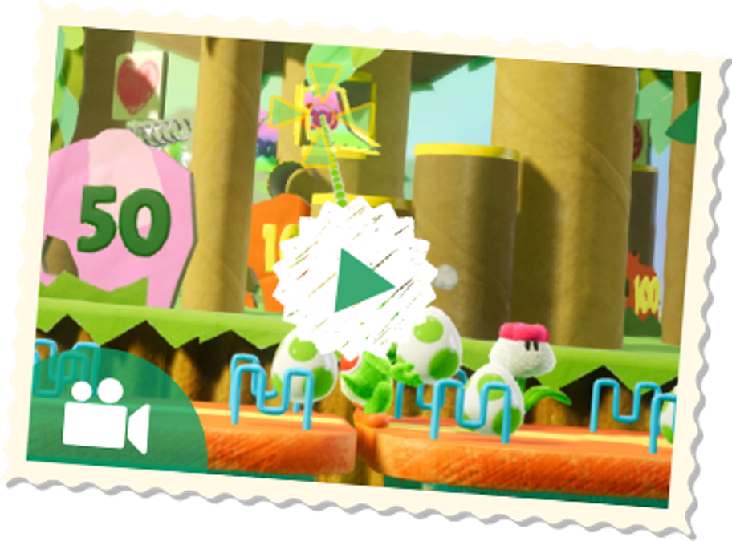
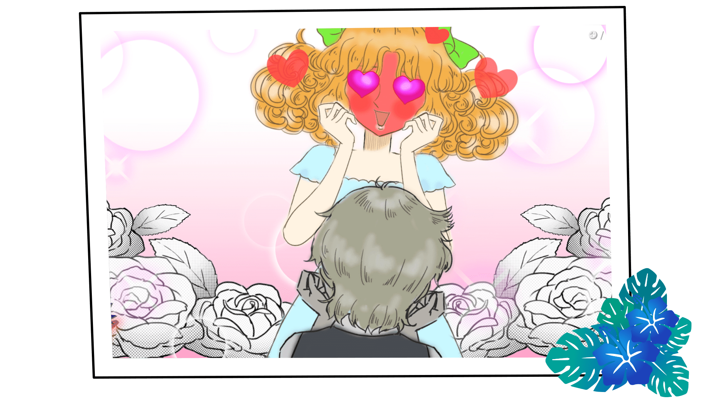
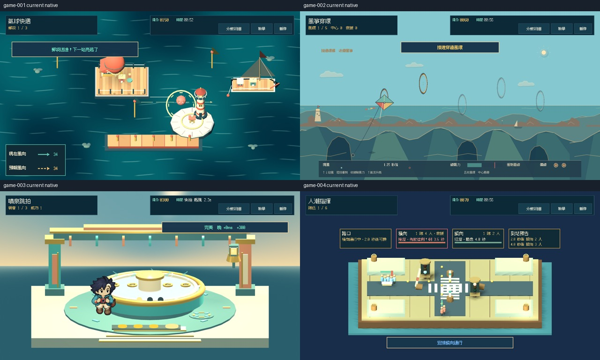
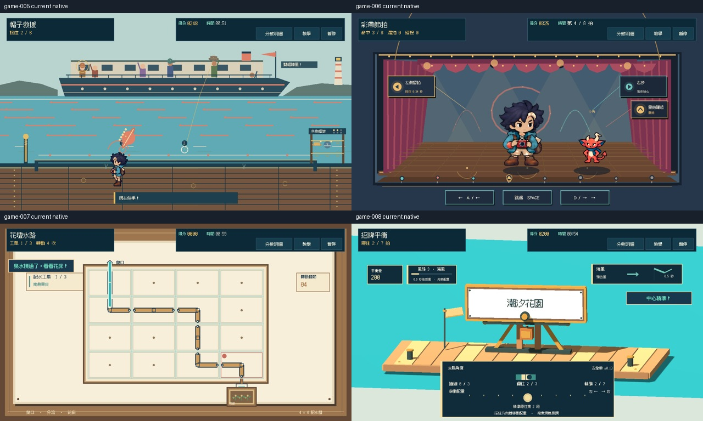
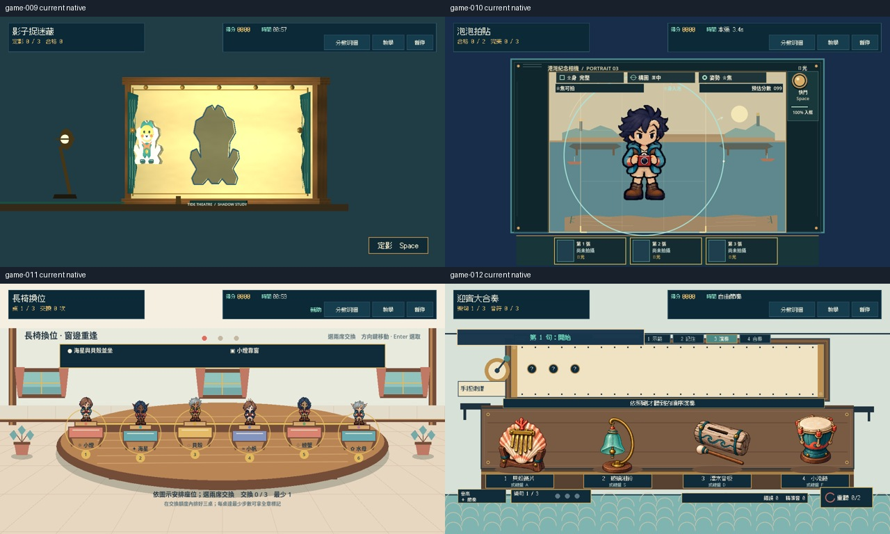
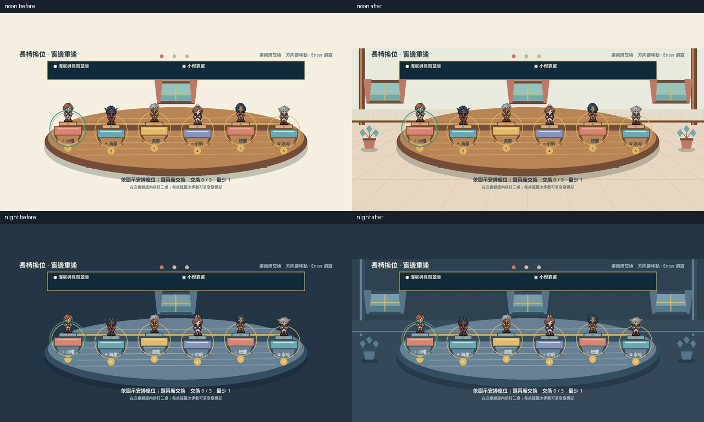
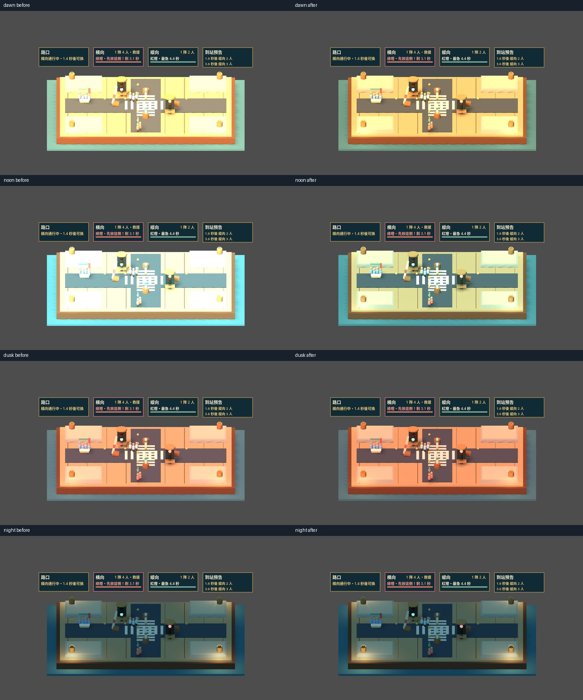

# [ART-5] 重製十二款小遊戲美術

> 狀態：完成

## 內文

### 需求
十二款小遊戲有符合玩法的完整場景、角色道具與目標視覺，消除空背景與純幾何佔位感。

### 來源
2026-10-11（Asia/Taipei）使用者要求繼續完善島嶼與小遊戲，改善簡陋美術；研究業界實例而不照抄，建立自己的風格並持續完成本批。

### 驗收條件
- [x] 十二款遊戲均有主題場景與具體道具、清楚的操作目標
- [x] 各款遊戲的視覺變化符合玩法且不遮住命中範圍
- [x] 十二款原生操作與成功結果均有畫面證據

### 測試流程
1. 查看票內研究來源、參考圖與實際觀察。
2. 啟動隔離存檔的原生遊戲，操作本票相關場景，核對驗收條件與截圖。
3. 切換日夜或降低動態、重開相關畫面，確認動線、文字、互動與獎勵正常。

---

# 跟其他票的關係

- Blocks：無
- Blocked by：無
- Related：ART-3、ART-4、ART-5、ART-6、ART-19、ART-21、SG-14

---

# 研究與參考

[本批設計與實際查閱觀察](../../design/runtime/visual-polish.md)。學習分層材質、日夜光影、清楚操作主體與一致的物料語言，重新設計 Snapland 的海港意象；參考圖不當遊戲素材。

---

# Commit-1

問題：小遊戲需要各自清楚的場景、目標與道具，避免空背景讓操作對象難以辨識。

改動：十二款小遊戲各自配置符合玩法的場景與道具，並整理結果拍貼畫面，使目標保持清晰。

驗收：原生自動輸入逐一啟動十二款遊戲並進入成功結果；所有路線和結果檢查通過。這是自動化驗收，並非玩家試玩成功。

| 畫面證據 | 說明 |
| --- | --- |
| [遊戲 01](images/ART-5-game-01.png) · [結果 01](images/ART-5-result-01.png) | 原生靜態畫面 |
| [遊戲 05](images/ART-5-game-05.png) · [結果 05](images/ART-5-result-05.png) | 原生靜態畫面 |
| [遊戲 09](images/ART-5-game-09.png) · [結果 09](images/ART-5-result-09.png) | 原生靜態畫面 |

全十二款路線與對應結果截圖：[01](images/ART-5-game-01.png)／[結果](images/ART-5-result-01.png)、[02](images/ART-5-game-02.png)／[結果](images/ART-5-result-02.png)、[03](images/ART-5-game-03.png)／[結果](images/ART-5-result-03.png)、[04](images/ART-5-game-04.png)／[結果](images/ART-5-result-04.png)、[05](images/ART-5-game-05.png)／[結果](images/ART-5-result-05.png)、[06](images/ART-5-game-06.png)／[結果](images/ART-5-result-06.png)、[07](images/ART-5-game-07.png)／[結果](images/ART-5-result-07.png)、[08](images/ART-5-game-08.png)／[結果](images/ART-5-result-08.png)、[09](images/ART-5-game-09.png)／[結果](images/ART-5-result-09.png)、[10](images/ART-5-game-10.png)／[結果](images/ART-5-result-10.png)、[11](images/ART-5-game-11.png)／[結果](images/ART-5-result-11.png)、[12](images/ART-5-game-12.png)／[結果](images/ART-5-result-12.png)。

程式交付：[Commit b1a7637](https://github.com/deadline314/Snapland/commit/b1a76372a84756bb40f1e4682d3751d966d68aa5)（分支 `feature/island-first-park`；固定基準 `92e885390967bff3abbde3cf52716076124b1383`）。

### 最新輸出驗證
Windows輸出於Intel Arc B580原生GPU完成圖集、NPC、場景動畫與遮擋資源冒煙檢查，12款場景所需素材均載入，無ERROR；此檢查不代表真人試玩、完整換裝動作、每姿勢或試聽驗收。

### 程式與證據提交
分支：feature/island-first-park。更新至最新main後的本票提交：[53a9dc3](https://github.com/deadline314/Snapland/commit/53a9dc3e15be759e647209c623aaef72c61918f0)。

# Commit — 2026-10-24 完成十二款現行場景驗收

重新逐款檢視現行畫面後，長椅換位仍像浮在空白上，人潮正午也過亮。現在棋桌置於有地板透視、牆裙、側柱、海景窗和盆栽的候客室，原六席、完整人物、規則與操作位置保留。人潮按時段分配主光與補光，正午的衣服與石台較易辨識，夜間保留原本照明。均為呈現調整，沒有改分數、資格、計時或收藏；候客室是 2.5D 布景，不當新增實體 3D 地圖。

十二款各自的場景、目標、道具與實際成功流程均重新核對，所有選用的原生程序均 exit 0、0 ERROR。原生腳本透過正常鍵鼠、按鈕與模型規則完成回合，站位可由驗收取景配置；不是真人試玩或整島步行。原有六方研究與圖例延續使用，另重看手工世界、Nintendo 小遊戲圖例及官方光影文件，採用與拒收理由記在[本輪美術紀錄](../../design/runtime/visual-polish.md)。

| 範圍 | 實際結果 |
|---|---|
| 十二款現行場景 | 各有原生遊玩與成功結果；三頁總覽及代表原圖已查看，完整擷取附檔 |
| 長椅正式 Main | 鍵盤三桌最短解 750 分及普通／小惡魔收藏、暫停與確認重試；輔助降低動態指標私人回合不改正式進度，23.28 秒通過 |
| 長椅獨立尺寸 | 800×450、1280×720、1920×1080 的日／夜全身畫面均看過，兩端座位實際指標選取通過；定位抽樣修正前 13／36、修正後 36／36。正式 Main 原本有外層縮放，不把獨立檢視的裁切冒稱正式 Main 錯誤 |
| 人潮光影 | 同一人物狀態四時段前後比較；正午場景近純白像素 54,726→5,683，夜間整張畫面與原版逐像素相同。偏暗候選拒收 |
| 人潮正式 Main | 最新照明下正常鍵盤完成六隊、430 分與小惡魔資格，80.34 秒通過；固定模擬擷取，不作即時 FPS 結論 |
| 局部檢查 | 六組既有局部通過，最終光影再驗通過；共通小遊戲 84 案例 96.10 秒通過。初次本地 90 秒超時保留，使用既有本地倍率 2（上限 180 秒），案例、判定與分數未變 |
| 真正 Linux 成品 | 最新來源逐檔雜湊一致；輸出與原生十二入口初始繪製／資源檢查通過、0 ERROR。這是成品啟動與資源驗收，不是十二款成品完整通關或 Windows 驗收 |

[長椅 Main 原生錄影](images/ART-5-final-20261024-bench-main.mp4)（23.133 秒、347 格、15 FPS） · [人潮固定模擬擷取](images/ART-5-final-20261024-crowd-main-fixed.mp4)（80.2 秒、1,203 格、15 FPS；不是正常速度影片） · [全部成功路線與完整擷取](images/ART-5-final-20261024-game-captures.zip) · [來源前後、尺寸／光影與原始失敗](images/ART-5-final-20261024-sources-and-diagnostics.zip) · [精確範圍、版本及逐檔雜湊](images/ART-5-final-20261024-verification.json)。兩段影片已完整解碼並查看抽格，不宣稱連續觀看；Dummy 音訊不當試聽。

本票依十二款場景、具體道具、目標及原生成功畫面的原驗收範圍結案。角色整套動畫、換裝與全島品質各依原票驗收。
