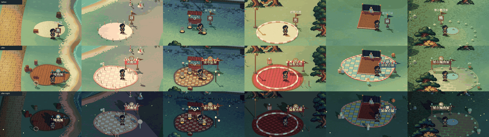

# [ART-60] 讓主題區即玩場地看起來像遊樂設施

> 狀態：完成

## 內文

### 需求

MAIN-61 在六個主題區放了十二款地圖上的即玩小遊戲與十二處小互動，玩法可用，但場地看起來像臨時擺放：平平的沙色圓盤、細長的小木牌只寫一個字、場地名稱和標題文字互相疊在一起、周圍空曠沒有布置。讓每個場地像該區真的有人搭起來的小遊樂設施：有符合主題的地墊或圍欄、立體的招牌、幾件道具點綴，遠遠就看得出「這裡可以玩」，近看也和周圍的地面、樹木、建築融合。

### 來源

2026-11-28 MAIN-61 交付後的畫面驗收：場地太小、太素，地面是單色圓盤，標示太細，與 scene-building-standards 的「不要平色塊、不要貼上去的感覺」不符。使用者長期要求地圖上的東西要有立體感、和區域風格一致、不能像貼上去的貼圖。

### 驗收條件

- [x] 十二個即玩場地各有符合主題區風格的地面處理（例如碼頭木棧、糖果條紋地墊、夜市磁磚、馬戲團帳篷地毯、玩具積木地板、溫室苔石），邊緣和周圍地面自然銜接，不是單色圓盤。
- [x] 每個場地有一塊立體、看得懂的招牌（遊戲名稱與一個圖示），從正常鏡頭距離可辨認；場地文字與提示、分數、評語互不重疊。
- [x] 每個場地周圍有兩到四件符合主題的小道具點綴，影子和地面一致，不漂浮、不穿插。
- [x] 十二處小互動的大小、影子與材質和周圍一致，不像獨立貼上的圖片。
- [x] `scene standards tests` 違規數不增加；各主題區節點與繪製數量在預算內；遊戲流程、提示距離、最佳紀錄與存檔不變。
- [x] 白天與夜晚各看一次，夜間場地仍看得出位置。

### 測試流程

1. 依序走到六個主題區的每個即玩場地，從遠處與近處各看一次，白天與夜晚各一次。
2. 每區玩一款，確認提示、倒數、分數與評語都清楚且不重疊。
3. 試每處小互動。

---

# 跟其他票的關係

- Blocks：無
- Blocked by：無
- Related：MAIN-61、ART-46、ART-58

---

---

# Commit-1

## 內文

原本主題區的十二個即玩場地只是平平的沙色或粉色圓盤，旁邊插一根細木牌寫一個字，名稱標題飄在半空，比賽結束時分數、評語會和名稱、觀眾喊聲疊在一起。
現在每個場地都鋪上該區的地面：碼頭是木棧板、糖果工廠是粉白格子糖磚、夜市是赤陶花磚、馬戲團是紅色格紋地毯配銅邊、玩具城是藍黃拼接地墊、溫室是帶苔的石板；外形不是正圓，碰到水邊或不能走的地方會自動往內收，外圈有一道收邊條（木條、糖果條紋、石條、銅條）壓住草地。
每個場地有一座立體招牌：兩根柱子、寫著完整遊戲名稱的看板、斜屋頂、上方一枚有遊戲圖示的圓徽、三顆獎牌燈和小旗，屋簷一排小燈泡讓夜裡也找得到。迎賓區五款也換成同樣的招牌。
場地外圍各放三件主題小道具（貨箱、木桶、救生圈、糖果罐、棒棒糖、燈籠柱、板凳、圍欄柱、鼓台、積木塔、花盆、澆水壺等），避開招牌、互動點與水邊，同款道具合併繪製。
比賽中的倒數、分數與評語會自動升高，避開遊戲自己的喊聲、點單泡泡與招牌文字；分數與評語之間也拉開距離。
十二處小互動逐一看過大小與影子，都是實體造型、影子貼地；發條陀螺原本底下的沙色圓盤換成玩具城的地墊。

### 測試結果

| 項目 | 結果 |
|---|---|
| 主題區即時小遊戲、迎賓區即時小遊戲、場景規範測試 | 通過，場景規範違規數未增加 |
| 六個主題區世界、島嶼佈局、環境動態、主場景整合、啟動測試 | 通過 |
| 原生畫面：十二個場地白天、夜晚，迎賓區五個場地，十二處小互動，三個場地的結算畫面 | 已逐張檢視 |
| 主題區節點（含小遊戲與小互動） | 197～336 → 215～356，預算 900 |
| 主題區場地畫面繪製數 | 白天 218～356 → 252～387；夜晚 208～628 → 240～673，預算 2200 |
| 實際手動遊玩 | 未做；回合流程由自動測試的模擬玩家跑完銅牌與金牌 |

### 截圖

