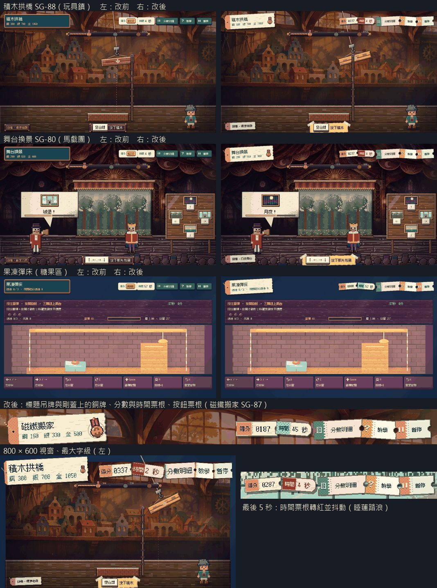

# [ART-61] 把小遊戲畫面的方框介面改成拼貼風格

> 狀態：完成

## 內文

### 需求

街機小遊戲進行中的介面仍是平的藍綠方框加橘邊：左上的標題與獎牌板、分數明細／教學／暫停按鈕、分數與時間票、下方的變體標籤與按鍵提示列。使用者明確不喜歡方框介面。改成與遊園選單相同的拼貼語言（吊牌、票根、膠帶、郵戳、紙片），帶角度與厚度，並有輕量的進場與數值變化動畫，同時不遮擋遊戲畫面。

### 來源

2026-11-28 盤點 SG-80、SG-87、SG-88 截圖時發現小遊戲畫面仍是方框；使用者先前要求介面不要方框、要立體且符合遊戲風格，並提供調酒遊戲選單作為「有趣一點、更多動畫」的參考（ART-59）。

### 驗收條件

- [x] 標題與獎牌、分數、時間、按鈕、變體標籤與按鍵提示都改成拼貼物件，不再是平面方框；文字對比足以閱讀。
- [x] 分數增加、時間將盡、拿到獎牌時有短動畫（不超過半秒），減少動態時直接切換。
- [x] 介面不遮擋任何小遊戲的遊玩區；各遊戲回饋橫幅維持各自的位置。
- [x] 800 × 600 與最大字級下不裁切、不重疊；按鈕名稱、滑鼠提示、可點範圍與鍵盤／手把操作不變。
- [x] 紋理只產生一次並重複使用，小遊戲畫面的繪製成本不明顯增加。

### 測試流程

1. 各主題區各玩一款街機小遊戲，看進場、得分、倒數與結算前的介面。
2. 開啟減少動態、最大字級與 800 × 600 視窗各看一次。
3. 只用鍵盤、只用滑鼠各操作一次按鈕。

---

# 跟其他票的關係

- Blocks：無
- Blocked by：ART-59
- Related：ART-55、ART-58

---

# Commit-1

## 內文

小遊戲進行中的介面還是平的藍綠方框：左上標題板、分數與時間票、三顆按鈕、下方的變奏標籤與按鍵提示列，跟遊園選單的拼貼風格對不上。
現在標題是一張斜掛的行李吊牌（打孔、麻繩、彩色帶），街機遊戲拿到的獎牌用圖釘別在吊牌尾端，未得牌時是一圈虛線空位；分數與時間是兩張朝不同方向歪的票根；分數明細、教學、暫停是三張帶圖示的小票根，滑過或鍵盤選到時會抬起、上金邊；按鍵提示改成兩端貼膠帶的牛皮紙條，變奏寫在左下角的小吊牌上；各遊戲的提示橫幅改成貼膠帶的深色紙條，位置與寬度不變。
進場時吊牌與票根從上方落下，分數增加時分數票根彈一下，最後 5 秒時間票根轉紅並每秒抖一下，拿到新獎牌時獎牌像蓋章一樣壓下來，每段都在半秒內；減少動態時直接顯示結果。標題吊牌依文字長度裁切，比原本的標題板窄，高度不變，遊玩區沒有被多擋。
在玩具鎮、馬戲團、花園、迎賓、糖果、夜市各開一款遊戲原生截圖比對改前改後，並看 800 × 600 與最大字級、練習標記、倒數最後幾秒與剛拿到銅牌的畫面。

### 測試結果

| 項目 | 結果 |
|---|---|
| 小遊戲介面階層、像素介面小遊戲、主畫面整合、遊戲啟動 | 通過 |
| 街機驅動、積木拱橋、磁鐵搬家、舞台換景、睡蓮踏浪、烤串、果凍、棉花糖、帽子、招牌平衡、迎賓小遊戲 | 通過 |
| 介面動態、小遊戲氣氛、焦點生命週期、島上入口、像素外殼（一般優先權 142 秒） | 通過 |
| 原生截圖 7 款遊戲（含 800 × 600 最大字級） | 無 ERROR；文字不裁切、標題與右側票根不重疊 |
| 繪製呼叫（積木拱橋／磁鐵搬家／果凍彈床） | 73→112、130→171、112→152；畫面維持 120–144 FPS |
| 節點數 | 每款遊戲多 6 個（2684→2690） |

### 截圖

