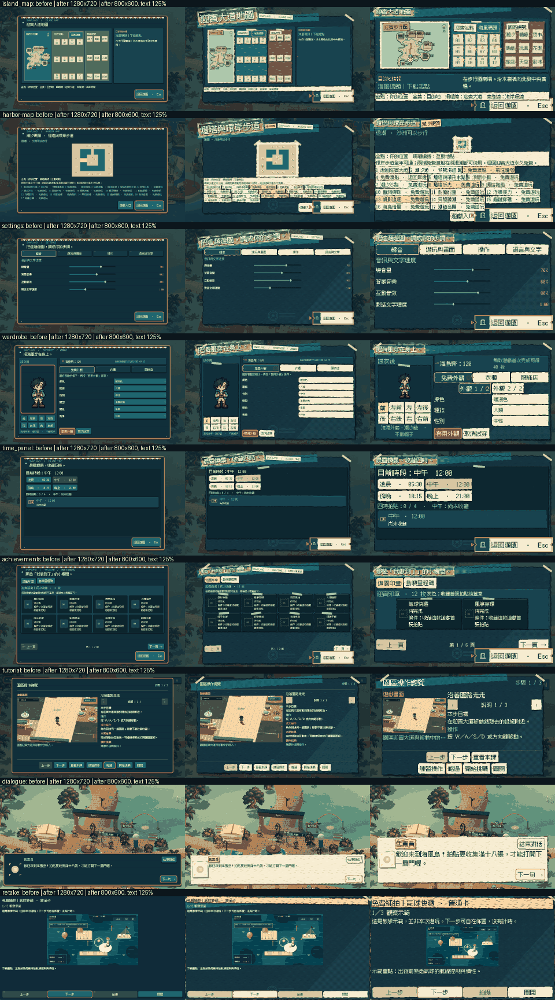

# [ART-62] 把地圖與設定類面板改成拼貼風格

> 狀態：完成

## 內文

### 需求

遊園選單、航海旅券、收藏冊與小遊戲畫面已改成拼貼語言，但從選單點進去的其他面板仍是舊的藍綠方框：島嶼地圖、各主題區地圖、設定與輔助、衣櫃、時段切換、教學圖鑑、成就章冊、對話框與補拍面板。玩家一點進去風格就斷掉。把這些面板改成同一套拼貼語言：地圖像攤開的手繪導覽圖貼在手帳上，設定像貼滿標籤的行李卡，衣櫃像衣架與吊牌，時段像轉盤或日曆撕頁，對話框像對白紙片。

### 來源

2026-11-28 驗收 ST-12 時看到主題區地圖仍是舊方框；使用者先前要求介面不要方框、要立體、更有趣並有更多動畫（ART-59 參考圖）。

### 驗收條件

- [x] 島嶼地圖與主題區地圖改成紙本導覽圖風格：紙張質感、手繪感的道路與區塊、貼紙式標記（你的位置、目的地、怪盜、委託、島上活動），圖例改成小標籤；地圖內容與所有標記不變。
- [x] 設定與輔助、衣櫃、時段切換、教學圖鑑、成就章冊、對話框、補拍面板改用相同的拼貼元素（紙片、膠帶、吊牌、郵戳、斜放），不再是平面方框。
- [x] 開啟時有翻開或飛入動畫，切換分頁有翻頁，按下有蓋章回饋，每段不超過半秒；減少動態時直接切換。
- [x] 按鈕名稱、滑鼠提示文字、可點範圍、鍵盤與手把操作、關閉行為不變；800 × 600 與最大字級不裁切、不重疊，文字對比足以閱讀。
- [x] 紋理只產生一次並重複使用，開關面板不會讓節點或記憶體持續增加。

### 測試流程

1. 從遊園選單依序打開每個面板，用滑鼠與鍵盤各操作一次。
2. 在島嶼地圖與一個主題區地圖確認所有標記與圖例。
3. 開啟減少動態、最大字級與 800 × 600 視窗各看一次。

---

# 跟其他票的關係

- Blocks：無
- Blocked by：無
- Related：ART-59、ART-61、ST-12、MAIN-62

---

# Commit-1

## 內文

遊園選單與航海旅券已是拼貼風格，但點進島嶼地圖、主題區地圖、設定、衣櫃、時段、成就章冊、操作速查、教學、對話框與補拍面板，又回到藍綠方框與木框招牌，風格一進門就斷掉。
現在這些面板都放在同一張手帳紙上：大字標題蓋章斜貼在頁首，返回鍵是票根。面板裡的按鈕變成歪斜的米色紙吊牌（打孔、毛邊、硬陰影），選中的分頁留深色並蓋上郵戳，按下時吊牌壓平並印上紅色戳記；資訊卡片變成貼膠帶的撕邊紙片，成就印章改成齒孔郵票，已蓋章的印紅色並加消印。島嶼地圖是三張貼在頁上的紙：摺過的米色導覽圖（淡彩海面、手繪墨線海岸、鉛筆虛線小路、加墨邊的迎賓大道）、站點卡與園區總覽卡，各自頂端貼著標籤條；你的位置、目的地、怪盜、委託小旗、島上活動都墊上白色貼紙底與陰影；圖例改成一張紙條。主題區地圖把原本的平面圖當作印刷小圖貼在米色導覽紙上，四角膠帶，地點編號改成一排小紙標籤。對話框是一張撕邊的米色對白紙片，說話者名字是金色貼紙，頭像是貼膠帶的拍立得。教學與補拍面板改成同一張手帳紙。
開啟時面板滑入、從一頁切到另一頁會翻頁，切換設定、衣櫃、成就分頁或教學步驟時有一張紙頁掃過（約 0.26 秒），補拍面板翻開進場；減少動態時直接切換。按鈕名稱、提示文字、可點範圍與鍵盤操作不變，紙張紋理每種顏色只產生一次並重複使用。
以原生截圖比對 9 個面板改前改後，並看 800 × 600 與最大字級；800 × 600 時長標題會放平並略縮，不再超出視窗上緣，地圖圖例畫在返回票根的金邊之上不被遮住。

### 測試結果

| 項目 | 結果 |
|---|---|
| 像素介面外殼、收藏、自訂、小遊戲、按鈕深度 | 通過 |
| 旅遊收藏介面、主題區旅行、居民委託、島上活動、怪盜 | 通過 |
| 衣櫃介面、島上對話、教學面板與分頁、補拍面板、補拍主流程 | 通過 |
| 主畫面整合、主線劇情整合、劇情執行、島嶼版面、介面動態、遊戲啟動 | 通過 |
| 原生截圖 9 個面板（1280 × 720、800 × 600 最大字級） | 無 ERROR；文字不裁切、不重疊 |
| 反覆開關 6 個面板 4 輪 | 節點數固定 2668（改前 2667）；材質記憶體每輪增加與改前相同 |
| 繪製呼叫（島嶼地圖／設定／衣櫃） | 1200→1290、1025→1072、1063→1176 |

### 截圖

