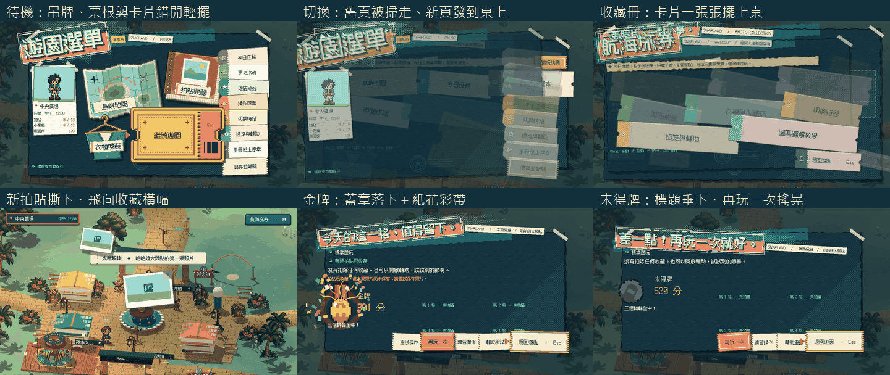

# [ART-63] 讓介面物件更有生命感與慶祝動畫

> 狀態：完成

## 內文

### 需求

介面已全面改成拼貼風格，但物件落定後就靜止不動，取得東西的瞬間也只是數字改變。使用者希望介面更有趣、有更多動畫。讓拼貼物件在待機時有輕微的生命感，並把「拿到東西」的時刻做成值得開心的演出：拍貼像貼紙一樣撕下來貼進收藏冊，拿到獎牌時蓋章與紙花，畫面之間像在桌上抽換卡片。

### 來源

2026-11-28 使用者再次要求介面更有趣、更多動畫（延續 ART-59 的參考圖方向）；協作 session 指定由拼貼介面這條線負責。

### 驗收條件

- [x] 待機時吊牌、票根與卡片有輕微擺動或呼吸，旁邊的膠帶與吊繩跟著動；幅度小、節奏錯開，不會讓文字難讀。
- [x] 取得拍貼時有「撕下貼上」的演出：貼紙從畫面飛向收藏冊或選單上的收藏物件並貼上，收藏數字跳動。
- [x] 小遊戲結算拿到獎牌時有蓋章、紙花或彩帶的慶祝，獎牌越高越熱鬧；失敗時有好笑但不嘲諷的小動畫。
- [x] 選單之間切換時，舊畫面的物件像被收走、新畫面的物件像被擺上桌，不只是整頁淡入淡出。
- [x] 每段演出不超過一秒、不阻擋操作，可用任何按鍵跳過；減少動態時改為直接顯示結果。
- [x] 不使用新的圖片檔；紋理只產生一次；待機動畫在畫面關閉時停止，不增加節點與記憶體。

### 測試流程

1. 打開遊園選單、航海旅券與收藏冊，各停留十秒觀察待機動畫。
2. 玩一款小遊戲分別拿到銅、金與失敗，看結算慶祝。
3. 取得一張新拍貼，看貼上演出與數字跳動。
4. 在選單之間來回切換；開啟減少動態再做一次。

---

# 跟其他票的關係

- Blocks：無
- Blocked by：無
- Related：ART-59、ART-61、ART-62

---

# Commit-1

## 內文

拼貼介面的物件落定後就完全靜止，拿到拍貼只是數字改變，獎牌結算只有一個縮放，選單之間切換是整頁翻頁淡入，畫面缺少「活著」與「值得開心」的感覺。
現在遊園選單、航海旅券、收藏冊與結算頁上的吊牌、票根、印章、地圖／相簿／衣架／旅券卡片和大字標題，會以各自錯開的 2 到 4 秒節奏輕輕擺動或呼吸（吊牌從打孔處、卡片從膠帶處擺，最多約 1.5 度，被指到的那張會停下來方便閱讀），貼在上面的膠帶與吊繩跟著一起動；整頁共用一個時鐘，頁面關閉或隱藏時立刻停下並放平。
新拍貼入冊時，結算照片會從原位翹起一角撕下、拋物線飛向左上的園區橫幅並壓扁貼上（約 0.8 秒），橫幅隨即彈一下，再浮出「+1 拍貼 · 共 N 張」；同時拿到多張會間隔排隊飛，島上活動的紀念貼紙也會飛向橫幅。
小遊戲拿到獎牌時，結算卡上的獎牌像印章一樣重重蓋下、壓扁並留下一圈紅色印痕，接著噴出紙花：銅牌 10 片、銀牌 18 片加 2 條彩帶、金牌 30 片加 5 條彩帶；遊戲內的「時間到」卡片也會從落下的獎牌噴出同樣的紙花。沒拿到獎牌時，標題條往下垂、空獎牌在緞帶上晃著垂下、「再玩一次」印章搖一搖；遊戲內的結算卡則是右邊膠帶鬆開、整張卡掛在左邊膠帶上晃一下，好笑但不嘲諷。
選單之間切換時，舊頁的物件依序飛回原處、整張紙被往左下掃開淡出（0.28 秒，不攔截任何點擊與焦點），新頁從右側滑入、物件一張張發到桌上。
每段演出都在一秒內，任何按鍵或點擊都會直接跳到結果（按鍵照常生效）；開啟減少動態時不產生任何演出節點，直接顯示最終結果。演出不使用新的圖片檔，飛行貼紙重用畫面上已有的照片，紙花全部由程式即時畫出。

### 測試結果

| 項目 | 結果 |
|---|---|
| 介面動態（新增：頁面時鐘隱藏即停、貼紙排隊飛到最後狀態並可跳過、獎牌等級紙花數、減少動態立即完成且不加節點、五次開關節點數與紋理數不變） | 通過 |
| 像素介面外殼、收藏、小遊戲；小遊戲 HUD 層級；街機驅動；旅遊收藏介面 | 通過 |
| 主畫面整合、遊戲啟動 | 通過 |
| 原生截圖（1280 × 720）：遊園選單反覆開關 5 次 | 節點數每輪固定 2802，孤兒節點 0 |
| 繪製呼叫（遊園選單、旅券切換掃頁中、金牌紙花） | 1104、1160（掃頁時兩頁同在）、1126；貼紙飛行時 1004（未飛行 997） |

### 截圖

