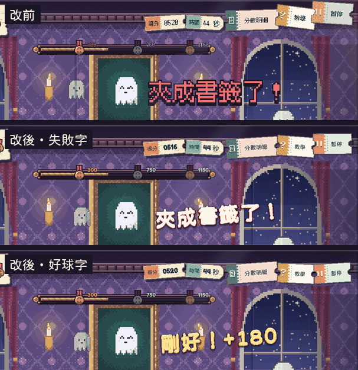

# [ART-64] 建立全遊戲一致的字體系統與文字演出

> 狀態：完成

## 內文

### 需求

使用者覺得字體與表現形式很簡陋：小遊戲失敗與回饋字（例如「夾成書籤了！」「好燙！」）是低解析度的粉紅像素字加重陰影，看起來廉價；吊牌與 HUD 用細的通用黑體；各畫面的字級、描邊與粗細不一致。要建立一套符合可愛像素／拼貼遊樂園風格的字體系統，讓每個畫面自動套用，並讓文字本身有生命感：回饋字彈跳登場、分數滾動、計時器到尾聲會跳動、對話逐字出現。

### 來源

2026-11-28 使用者回饋「字體跟表現形式還有美術做的很簡陋」，要求參考成熟遊戲的字體處理，不要有湊數感；協作 session 指派為字體與文字演出這條線。

### 驗收條件

- [x] 有一份字體規格，定義文字角色（標題、內文、數字、像素、回饋字等）各自的字體、字級、描邊陰影與動態，並記錄參考了哪些遊戲。
- [x] 新字體全部為 OFL 授權、取自官方發行版本，授權與來源檔雜湊有紀錄；繁體中文常用字完整涵蓋，總字型記憶體維持合理。
- [x] 所有畫面透過共用設定取得字體，不需逐一指定；HUD、選單、地圖、對話、說明、拍貼與收藏說明字的字體一致。
- [x] 小遊戲失敗與回饋字改為圓胖字、雙色描邊、微傾斜，並以彈跳壓扁方式登場；所有街機小遊戲自動使用新樣式。
- [x] 分數變化時數字滾動並有輕微跳動，計時器在最後幾秒會脈動。
- [x] 對話文字逐字出現，每字輕彈、標點處停頓，可按鍵直接顯示全文。
- [x] 減少動態或無畫面環境下，以上演出直接顯示最終結果，不影響測試。
- [x] 最小視窗尺寸下文字仍清楚可讀。

### 測試流程

1. 開啟遊戲依序看主選單、遊園 HUD、地圖、收藏冊、對話與教學畫面，確認字體一致且清楚。
2. 玩一款街機小遊戲並故意失敗，看回饋字的登場；拿分時看分數滾動，最後幾秒看計時器跳動。
3. 觸發一段對話，看逐字出現與標點停頓，按鍵跳過。
4. 開啟減少動態再做一次，文字直接顯示；把視窗縮到最小，文字仍可讀。

---

# 跟其他票的關係

- Blocks：無
- Blocked by：無
- Related：ART-61、ART-62、ART-63

---

# Commit-1

## 內文

原本全介面用 12px 像素字放大到 14–40px，筆畫粗細不一；小遊戲的回饋字是粉紅像素字疊兩層深色陰影；吊牌、HUD 與面板的字級、描邊各自為政。

現在全遊戲預設改用圓體（jf open 粉圓 2.1 改作，OFL），標題用加粗的同一字體，分數與時間用圓胖數字（Fredoka Bold 改作，OFL）；兩款只把行高改成介面原本量好的 4:3 並依 OFL 改名，版面高度不變。像素字保留給招牌類情境。舊存檔的像素字設定讀成圓體，設定中可改「易讀字型」。所有畫面從共用設定取字，不逐一指定。

街機回饋字改成圓胖字、深墨外描邊加主色內描邊、微傾斜，字一個個彈出、伸長後壓扁再回彈；失敗是奶油白配珊瑚邊，好球是向日葵黃配橘邊，所有街機遊戲自動套用。小遊戲分數上升時數字滾動，結算卡數字跳動，計時器最後五秒每秒脹一下。對話逐字出現、每字輕彈，逗號、句號與刪節號處停頓，按鍵先顯示整句且不再逐字彈。減少動態或無畫面時全部直接顯示結果。

以同一組原生截圖場景比對改前改後十個畫面（園區 HUD、暫停、設定、對話、地圖、收藏冊、教學、街機失敗字、好球字、結算卡），另在 800×450 看過教學、HUD 與結算卡，文字清楚可讀。字體規格與參考整理在設計文件「字體系統與文字演出」。

### 測試結果

| 項目 | 結果 |
|---|---|
| 受影響 Godot 套件（啟動、字體、教學、HUD、對話、像素介面 7 項、街機 4 項） | 通過 18 / 19；在地化套件的「高 RTL 暫停選單」在未修改的 main 上同樣失敗，非本票造成 |
| rebase 後落地檢查（場景標準、演出提示、對話、字體） | 通過 4 / 4 |
| 字體檢查 | 52 / 52 |
| 資料驗證（verify_design all） | 0 錯誤 |
| Python 單元測試 | 通過 217 / 217 |

### 截圖

