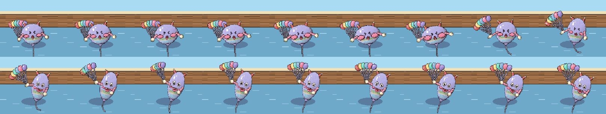

# [ART-65] 建立大型角色部件骨架

> 狀態：完成

## 內文

### 需求
異空間的看守演員與之後的大型角色需要連續、流暢的動作。使用者不喜歡只用兩三張差分輪播的動畫；大型角色要能做出預備、出招、過頭、收招、受擊退縮與不靜止的待機，同時保留像素格線與拼貼風格。

### 來源
2026-11-28 主持對話交辦異空間設計；規格見 `design/01-park/other-space.md` 第 7 節。

### 驗收條件
- [x] 大型角色由多個分層像素部件組成，各有樞紐點與父部件，旋轉後仍在同一像素格線上
- [x] 招式由關鍵姿勢與緩動組成，含預備、過頭與收招；附屬部件晚到晚停
- [x] 身體擠壓伸展保持面積，快速動作有拖影，減少動態時不畫拖影
- [x] 受擊有後縮、衰減震盪與短暫亮色閃光
- [x] 待機任何一秒內都有可見變化；減少動態時待機靜止
- [x] 同一時刻算兩次結果相同；相鄰畫面沒有超過門檻的跳動；無畫面環境可執行
- [x] 第一位看守演員（倒倒）用這套骨架完成待機、吹氣衝刺、彩紙抖動、亮相與受擊
- [x] 原生截圖含一串連續畫格，確認動作流暢

### 測試流程
1. 執行骨架規則測試與場景檢查
2. 以原生截圖擷取倒倒的待機與招式連續畫格
3. 逐格檢查動作沒有跳格、像素大小一致、外框不是純黑

---

# 跟其他票的關係

- Blocks：MAIN-66
- Blocked by：無
- Related：MAIN-66

---

# Commit-1

## 內文

大型角色過去只能用幾張整身差分輪播，動作一格一格跳，待機也常常整個停住。
現在有共用的部件骨架：角色拆成多塊有樞紐點的像素部件，招式由關鍵姿勢加緩動組成，中間每個畫面即時算出；先蓄力壓扁、出招拉長、過頭再彈回，手臂、尾巴繩與氣球晚到晚停，快速甩動時會沿方向拉出拖影，被拍到時會後縮晃兩下並閃一下亮光。待機有呼吸、搖擺、各部件不同步的擺動與眨眼，任何一秒都在動；減少動態時待機靜止、不畫拖影與晃動，但招式的預備仍看得到。整個骨架先畫在一像素一格的小畫布再放大，轉動的部件不會出現大小不一的像素；子部件跟著身體被壓扁的位置走，但不被拉成斜長條，氣球永遠朝上浮。
第一位看守演員「倒倒」（鏡面氣球惡魔，肚子映著倒過來的大道，手上拿著劇團的六顆氣球）用十九個部件完成待機、吹氣衝刺、彩紙抖動、亮相與害羞五種動作。原生擷取每 1/30 秒一格的衝刺，36 格逐格看過：蓄力、衝出、甩回、回位連續沒有跳格，第一版發現手臂被身體壓扁拉成橫條、氣球垂在身後，已修正後重拍。

### 測試結果

| 項目 | 結果 |
|---|---|
| 部件骨架規則（同刻同圖、相鄰畫面位移上限、各招至少六成畫面不同、預備與過頭、尾巴晚停、面積、拖影、受擊、待機每秒都動、減少動態） | 通過 |
| 場景檢查（八個區域） | 通過，違規數未增加 |
| 設計資料驗證 | 5 範圍通過 |
| Python 單元測試 | 217 / 217 |
| 原生擷取 | 5 張動作定格與 36 格衝刺連續畫格，無 ERROR |

### 截圖

