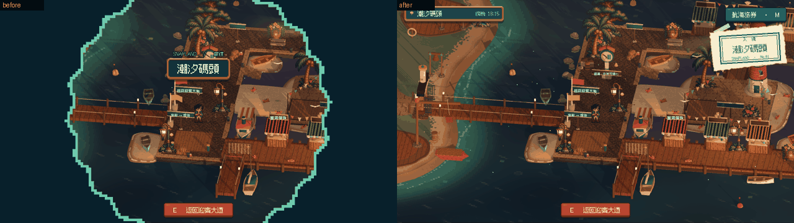

# [ART-66] 把換區大標題改成入境章

> 狀態：完成

## 內文

### 需求
從地圖或閘門快速移動時，畫面會在主角頭上掛一塊寫著區名的大招牌，每次換區都出現，和場景裡的路牌搶視線。改成換區遮罩不帶文字；第一次踏進某個主題區時，在畫面角落蓋一枚入境章，之後再來不再演出。

### 來源
2026-11-28 美術與演出稽核，見 `design/runtime/art-direction-audit.md`。

### 驗收條件
- [x] 快速移動的遮罩關上與打開時畫面上沒有區名、標語等任何文字
- [x] 第一次走進或快速移動到某個主題區時，畫面右上角蓋下一枚寫著區名的入境章，約兩秒後淡出，不擋住主角與互動提示
- [x] 同一區第二次以後進入不再出現入境章；重開遊戲後仍記得已蓋過的區
- [x] 迎賓大道不蓋章；舊存檔讀取正常，沒有入境紀錄時視為都還沒蓋
- [x] 減少動態開啟時入境章直接出現再淡出，沒有壓扁回彈
- [x] 區名仍顯示在左上角地點名牌、島嶼地圖、收藏冊分區與暫停選單

### 測試流程
1. 從迎賓大道用地圖快速移動到潮汐碼頭，遮罩上沒有文字，打開後右上角蓋下「潮汐碼頭」入境章
2. 回迎賓大道再走路進潮汐碼頭，沒有入境章
3. 第一次走進霓虹夜市，出現入境章；重開遊戲再進夜市，不再出現

---

# 跟其他票的關係

- Blocks：無
- Blocked by：無
- Related：無

---

# Commit-1

## 內文

原本每次從地圖或閘門快速移動，遮罩打開時都在主角頭上掛一塊「SNAPLAND / 前往」加區名的大招牌，第十次換區也一樣，和場景裡的路牌搶視線；走路進區則沒有任何表示。
現在換區遮罩只剩票孔形的開合，不帶任何文字。第一次踏進一個主題區（走路或快速移動都算）時，右上角航海旅券下方會滑進一張貼著膠帶的票卡，區域的入境章壓扁回彈地蓋上去、濺出一圈印泥點，停約兩秒後抬起淡出；每區的印泥顏色不同。蓋過的區記在存檔，之後再來只更新左上角地點名牌。減少動態時票卡直接出現再淡出。
原生截圖確認快速移動到潮汐碼頭時遮罩無字、打開後蓋下「潮汐碼頭」章，走路進糖果工廠蓋下「糖果工廠」章；測試確認第二次到港不再蓋章、重開遊戲後紀錄仍在。

### 測試結果

| 項目 | 結果 |
|---|---|
| 區域移動、介面動態測試 | 通過 2 / 2 |
| 場景規範檢查 | 通過，違規數未增加 |
| 資料驗證 | 0 錯誤 |
| Python 單元測試 | 通過 217 / 217 |
| 原生截圖 log | 無 ERROR |

### 截圖

