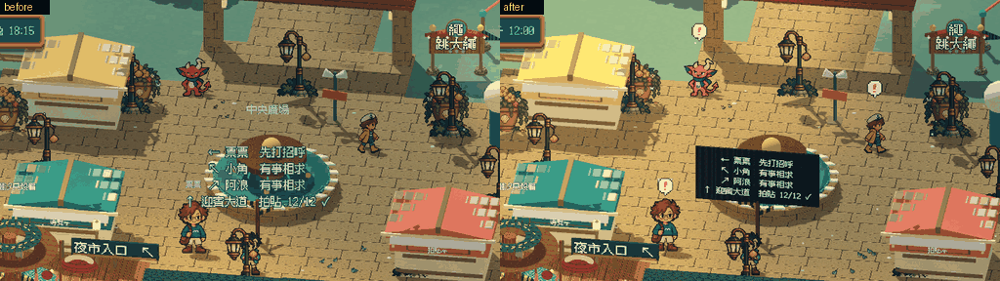

# [ART-67] 收掉廣場上浮空的委託清單文字

> 狀態：完成

## 內文

### 需求
迎賓廣場噴泉上方浮著四行白字（某某先打招呼、有事相求、拍貼進度），加上地名與方向浮空字，像除錯文字疊在玩家看到的第一個畫面正中。委託與方向提示改成場景裡看得懂的實體提示，廣場上不再有整段浮空文字。

### 來源
2026-11-28 美術與演出稽核，見 `design/runtime/art-direction-audit.md`。

### 驗收條件
- [x] 迎賓廣場任何時段都看不到成段的浮空委託清單
- [x] 有委託的角色頭上有清楚的小圖示，靠近時才顯示一行說明
- [x] 前往各區的方向改由場景中的路牌或地面標示表達
- [x] 原本能從清單得知的資訊（誰有事、拍貼進度）在任務頁或地圖仍查得到

### 測試流程
1. 開新存檔走到迎賓廣場，噴泉上方沒有浮空文字清單
2. 有委託的角色頭上看得到圖示，走近後出現一行說明
3. 打開任務頁，委託與進度仍完整

---

# 跟其他票的關係

- Blocks：無
- Blocked by：無
- Related：無

---

# Commit-1

## 內文

迎賓廣場噴泉上方浮著四行沒有底板的白字（誰要先打招呼、誰有事相求、拍貼進度），旁邊還有浮空的「中央廣場」地名，像除錯文字疊在玩家看到的第一個畫面正中；委託角色頭上的提示又小到看不清。
現在路標的方向與進度寫在一塊固定在路標柱頂的深色木紋看板上，看板下緣坐在柱頂，只在走近路標時出現，全島共用同一塊看板。票票、小角、阿浪還有事找玩家時，頭上會有奶油底、珊瑚色驚嘆號的像素對話泡泡，走近時換成原本的互動標記與下方一行「E 和某某說話」，委託開始或完成後泡泡消失。浮空的「中央廣場」拿掉，地點由左上角名牌顯示。看板上的進度資訊與任務頁都保持原樣。
原生截圖確認中午與晚上廣場上沒有浮空清單，三位角色頭上的泡泡清楚可見。島嶼本體節點數仍在 2700 的預算內。

### 測試結果

| 項目 | 結果 |
|---|---|
| 島嶼佈局、建物遮擋測試 | 通過 2 / 2 |
| 場景規範檢查 | 通過，違規數未增加 |
| 資料驗證 | 0 錯誤 |
| 劇情整合測試 | 失敗；未含本票改動的基準版本在同一台滿載機器上也失敗，失敗點都是 1.5 秒的走位與開啟對話期限，交由 CI 判定 |

### 截圖

