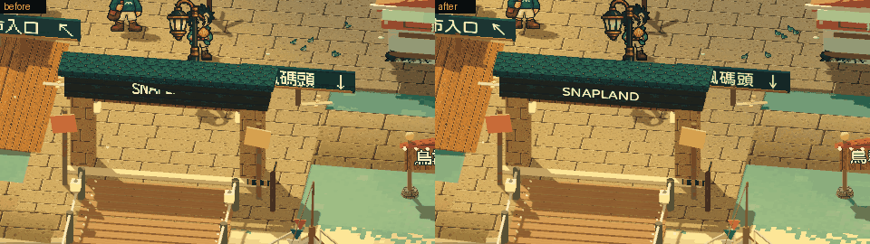

# [ART-68] 讓碼頭拱門招牌完整露出

> 狀態：完成

## 內文

### 需求
迎賓碼頭入口拱門上的園區招牌被自己的屋簷擋住，只看得到前幾個字母；這是玩家下船後第一眼的地標。

### 來源
2026-11-28 美術與演出稽核，見 `design/runtime/art-direction-audit.md`。

### 驗收條件
- [x] 從預設鏡頭看，碼頭拱門招牌的字完整可讀，不被屋簷或其他物件遮住
- [x] 四個時段招牌都受光、夜晚可辨認
- [x] 場景檢查違規數不增加

### 測試流程
1. 站在迎賓廣場南側與碼頭步道上，看拱門招牌的字是否完整
2. 切換中午與晚上各看一次

---

# 跟其他票的關係

- Blocks：無
- Blocked by：無
- Related：無

---

# Commit-1

## 內文

迎賓碼頭入口拱門的園區招牌字掛在橫樑後方，被往前伸出的簷口擋住，從預設鏡頭只看得到「SNA」，這是下船後第一眼的地標。迎賓大道與倒影大道的拱門也是同一種做法。
現在三座拱門的名字都漆在橫樑正面、簷口下方，不再轉向鏡頭，像真正的門楣招牌一樣貼在建物上；字仍受光，晚上也看得清楚，主角走到拱門後方時照舊淡出。
原生截圖確認中午與晚上從廣場與碼頭步道看「SNAPLAND」完整可讀。

### 測試結果

| 項目 | 結果 |
|---|---|
| 建物遮擋測試 | 通過 |
| 場景規範檢查 | 通過，違規數未增加 |
| 資料驗證 | 0 錯誤 |

### 截圖

