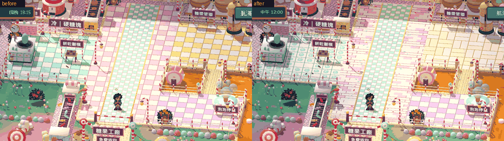

# [ART-69] 替糖果工廠地面加上材質變化

> 狀態：完成

## 內文

### 需求
糖果工廠從入口到廠房的地面幾乎都是同一種大格粉彩棋盤格，大面積沒有變化，看起來像未完成的預設貼圖。

### 來源
2026-11-28 美術與演出稽核，見 `design/runtime/art-direction-audit.md`。

### 驗收條件
- [x] 步道、廣場與攤位區的地面各有不同的糖果主題鋪面，棋盤格只留在少數重點地墊
- [x] 鋪面邊緣與交界有散落的小糖粒、包裝紙等細節打散直線
- [x] 地面受時段色調影響
- [x] 場景檢查違規數不增加，單一畫面繪製數在預算內

### 測試流程
1. 快速移動到糖果工廠，從入口走到廠房中央
2. 中午與晚上各截圖一次，確認地面分區清楚、沒有整片相同格子

---

# 跟其他票的關係

- Blocks：無
- Blocked by：無
- Related：無

---

# Commit-1

## 內文

糖果工廠的大道、材料實驗區、管道走廊與泡泡停泊區四塊地面都是同一種大格棋盤格，只換顏色，從入口到廠房一整片沒有變化，像未完成的預設貼圖。
現在每區鋪法不同：大道是奶油色錯縫糖霜磚夾雜粉紅磚，材料實驗區是嵌著薄荷糖豆的方磚，管道走廊是檸檬色編籃紋；棋盤格只留在中央的薄荷步道與泡泡停泊區兩塊重點地墊。大面積鋪面另有柔和的深淺斑塊，地面邊緣與步道兩側散落彩色糖粒和偶爾一張糖果紙，全部是同一批次繪製、位置固定。地面照舊受時段色調影響。
原生截圖確認中午與晚上從工廠入口看，各區地面分得清楚，沒有整片相同格子。

### 測試結果

| 項目 | 結果 |
|---|---|
| 糖果工廠場景測試 | 通過 |
| 場景規範檢查 | 通過，違規數未增加 |
| 資料驗證 | 0 錯誤 |

### 截圖

