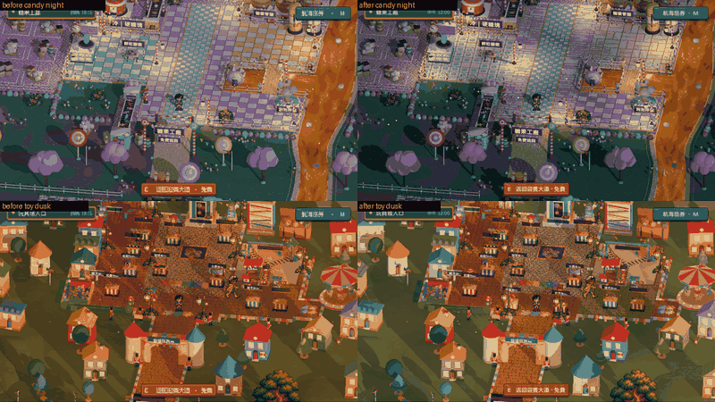

# [ART-70] 讓主題區晚上看起來像晚上

> 狀態：完成

## 內文

### 需求
糖果工廠、發條玩具城與鏡之馬戲團在晚上幾乎和中午一樣亮，路燈下沒有光圈，夜晚失去氣氛；玩具城傍晚則整片偏泥褐，玩具原色看不出來。

### 來源
2026-11-28 美術與演出稽核，見 `design/runtime/art-direction-audit.md`。

### 驗收條件
- [x] 三區晚上的環境明顯變暗偏冷，路燈、窗戶與招牌有暖色光與光圈
- [x] 晚上主要動線、互動點與角色仍可辨認
- [x] 玩具城傍晚保留玩具的原色，暖色只落在天空與陰影
- [x] 燈具數量遵守同時最多八盞亮、兩盞有影子的預算

### 測試流程
1. 分別快速移動到三區，切換中午、傍晚與晚上各截圖
2. 比較同一視點，晚上與中午差異明顯，主角仍清楚

---

# 跟其他票的關係

- Blocks：無
- Blocked by：無
- Related：無

---

# Commit-1

## 內文

糖果工廠、發條玩具城與鏡之馬戲團各自的空氣色調在任何時段都把環境光往亮粉或暖奶油色拉，晚上島上原本的藍暗環境光被沖淡，三區夜晚和中午差不多亮，路燈下看不到光圈；玩具城傍晚整片偏泥褐，玩具的顏色被壓掉。
現在三區晚上只保留一點自己的色相，環境光與月光變暗偏冷，路燈比島上其他地方亮一些，地面出現暖色光圈；玩具城傍晚的環境光與陽光往白色拉，紅藍黃的房子保留原色，暖色只在天空與陰影。燈的數量與「同時最多八盞亮、兩盞有影子」的預算不變。
原生截圖逐區比較中午、傍晚與晚上：晚上明顯變暗，主要動線、攤位與角色仍看得清楚。

### 測試結果

| 項目 | 結果 |
|---|---|
| 糖果工廠、玩具城、馬戲團場景測試 | 通過 3 / 3 |
| 主題區光線融合測試 | 通過 |
| 場景規範檢查 | 通過，違規數未增加 |
| 資料驗證 | 0 錯誤 |

### 截圖

