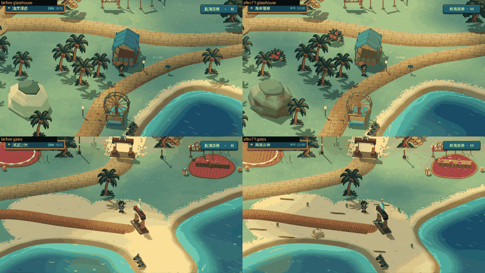

# [ART-71] 打散迎賓島東側的大片空地

> 狀態：完成

## 內文

### 需求
迎賓島東側往溫室的路與湖畔沙洲有大片空草地與沙地，只有零星椰子樹、一顆平面著色的八角白石與一根孤立路牌，看起來沒做完。

### 來源
2026-11-28 美術與演出稽核，見 `design/runtime/art-direction-audit.md`。

### 驗收條件
- [x] 兩處空地加入成群的小尺度地面細節（草叢、花叢、貝殼、浮木等），位置大小有變化但重開一致
- [x] 八角白石換成有紋理、有接地陰影的岩塊
- [x] 至少一處加入一個會吸引玩家走過去看的小景點
- [x] 重複小件用批次繪製；場景檢查違規數不增加

### 測試流程
1. 站在往溫室的路上與湖畔沙洲各截圖中午與晚上
2. 畫面中沒有大片無細節的空地

---

# 跟其他票的關係

- Blocks：無
- Blocked by：無
- Related：無

---

# Commit-1

## 內文

迎賓島東側往溫室的草地與潟湖沙洲有大片空地：草地上只有零星椰子樹和一顆像八角柱、顏色發白的岩石，沙洲上只有一根閘門路標。岩石發白是因為頂點顏色被當成線性色讀取，原本設定的灰綠色被提亮成近乎白色。
現在島上的八座岩脊輪廓凹凸不平，顏色由潮濕的深色岩腳漸亮到岩肩，頂上長著苔草，草帽和岩石合成一個網格。溫室旁草地多了五處開花灌木與兩片花叢。潟湖沙洲散落浮木、貝殼與海草，西北側空沙地有一座插著小旗的半完成沙堡，吸引玩家走過去看。小件併入既有的批次繪製，島嶼節點數仍在 2700 的預算內。
原生截圖確認中午與晚上兩處都沒有大片無細節的空地，岩石有材質與接地陰影。

### 測試結果

| 項目 | 結果 |
|---|---|
| 島嶼佈局（含節點預算）、海岸自由遊玩測試 | 通過 2 / 2 |
| 場景規範檢查 | 通過，違規數未增加 |
| 資料驗證 | 0 錯誤 |
| 島嶼形狀測試 | 失敗；見 Commit-2 |

### 截圖

# Commit-2

## 內文

島嶼形狀測試在主線上回報海岸距離與海岸線差 0.27 公尺（上限 0.25）。逐版回推後確認從幽幽旅館把島往南加長那一版開始失敗：島變大後固定取樣點整批移位，落在碼頭灣西角與潟湖沙嘴尖端兩個很尖的海岸轉角旁，距離場在尖角處的內插誤差剛好超過上限；與 Commit-1 的佈景無關，以 Commit-1 之前的程式碼重跑結果相同。
兩個尖角各多一個控制點、修得略圓，海岸線移動不到一公尺，碼頭灣、旅館堤道與潟湖沙洲的形狀不變。測試容差維持 0.25 公尺，全部取樣點的最大誤差降為 0.11 公尺。

### 測試結果

| 項目 | 結果 |
|---|---|
| 島嶼形狀、島嶼佈局測試 | 通過 2 / 2 |
| 場景規範檢查 | 通過，違規數未增加 |
