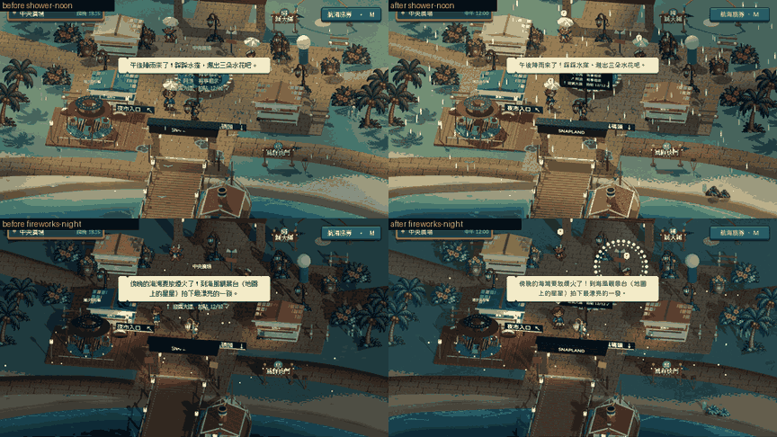

# [ART-72] 加強陣雨與煙火事件的演出

> 狀態：完成

## 內文

### 需求
島上的陣雨開始後幾乎看不到雨絲、地面不會變濕；海灣煙火事件開始時天空沒有任何預兆，事件的氣氛主要靠一句提示文字。

### 來源
2026-11-28 美術與演出稽核，見 `design/runtime/art-direction-audit.md`。

### 驗收條件
- [x] 陣雨時看得到斜雨絲，地面變暗並有反光與水窪漣漪，雨停後逐漸變乾
- [x] 煙火事件開始時海灣上空有試放的小火花或光點，讓玩家知道往哪看
- [x] 粒子數量在每區預算內，減少動態時雨絲與火花減量或靜止

### 測試流程
1. 在迎賓廣場觸發陣雨，兩秒內看得到雨與地面變化
2. 晚上觸發煙火事件，開始時海灣方向有可見的預兆

---

# 跟其他票的關係

- Blocks：無
- Blocked by：無
- Related：無

---

# Commit-1

## 內文

島上陣雨開始後只看得到零星幾條細雨絲，地面也不會變濕；海灣煙火從觀景台附近發射，玩家在廣場時天空毫無動靜，只有一句提示文字。原因之一是煙火的繪製範圍只圍住觀景台，觀景台以外放的煙火會被直接略過不畫。
現在陣雨的雨絲更長、更亮、斜著落下，雲一聚起來就開始下；下雨時島上的石板、木板、沙灘與草地會跟著變暗並帶反光，雨停後約十八秒慢慢變乾，水窪漣漪照舊。玩家不在觀景台時，煙火事件的前三發改在畫面邊緣、朝觀景台方向的低空炸開，用天空指路；在觀景台時照舊從潟湖發射。粒子總數仍在每區預算內，減少動態時雨絲隱藏。
原生截圖確認陣雨開始兩秒半就看得到雨與變暗的地面，晚上在廣場觸發煙火時，右上方朝觀景台的方向出現試放的煙火。

### 測試結果

| 項目 | 結果 |
|---|---|
| 島上事件、環境粒子測試 | 通過 2 / 2 |
| 場景規範檢查 | 通過，違規數未增加 |
| 資料驗證 | 0 錯誤 |

### 截圖

