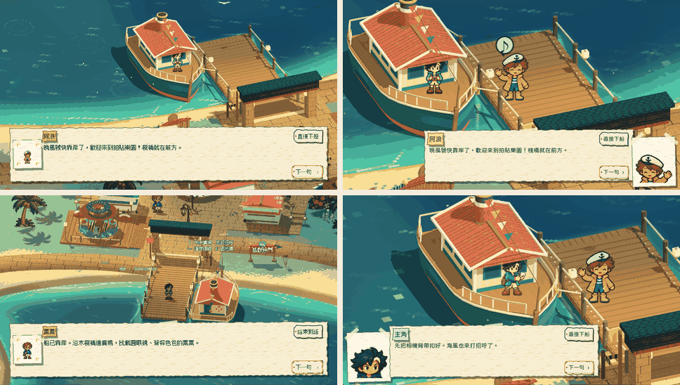

# [ART-73] 把對話字幕板改成拼貼胸像便條

> 狀態：完成

## 內文

### 需求

島上對話仍是一條橫跨全畫面的奶油色長方形，左邊只有一張小小的頭像。這正是使用者不想要的「方框介面」，也和拼貼風格的場景演出脫節。改成貼在說話者那一側的拼貼便條：

- 大一點的胸像，每句可換表情；說話時輕輕上下晃，換人時換邊
- 說話者名字貼在一張拼貼名牌上
- 便條邊緣用撕紙或膠帶的拼貼樣式，不再有滿版長方形
- 便條靠向說話者在畫面上的那一側

略過與下一句的按鈕仍要清楚好按。

### 來源

2026-11-28 主導 session 看過 ST-14 截圖後提出：字幕板仍是長而平的奶油色方框配小頭像，正是使用者抱怨的方框介面。

### 驗收條件

- [x] 對話時看不到橫跨全畫面寬度的長方形底板；便條有撕紙或膠帶邊。
- [x] 胸像明顯比現在的頭像大，同一角色的不同台詞可以顯示不同表情；說話時胸像會輕晃，降低動態時不晃。
- [x] 名字以拼貼名牌呈現。
- [x] 便條靠向說話者那一側，換人說話時跟著換邊；主角說話時靠向主角。
- [x] 略過與下一句按鈕在 800×600、1280×720、1920×1080 與 1.25 倍文字下都完整可見、可點。
- [x] 劇情演出的停頓、默劇節拍與鏡頭推近照常運作，便條不遮住被推近的角色。

### 測試流程

1. 新存檔走完晚風號與上岸導覽，逐句截圖，比對便條位置、胸像與名牌。
2. 在三種視窗尺寸與 1.25 倍文字下各走一段對話，點擊略過與下一句。
3. 開啟降低動態，確認胸像不晃。

---

# 跟其他票的關係

- Blocks：無
- Blocked by：無
- Related：ART-64、ST-13、ST-14、ST-15

---

# Commit-1

## 內文

島上對話原本是一條橫跨整個畫面的奶油色長方形，左邊只有一張很小的頭像，正是使用者不想要的方框介面。
現在對話改成一張撕紙便條，約佔畫面三分之二寬，旁邊貼著一張大胸像照片：取角色上半身，頭部微微探出照片上緣。便條靠向說話者在畫面上的那一側，主角回話時換到另一邊，胸像也跟著左右翻轉，讓對話像一來一回。胸像依每句的動作或表情泡泡換表情，例如招呼時揮手、冒汗時托下巴；說話時胸像會輕輕晃，降低動態時不晃。名字貼在一張依角色上色的拼貼名牌上。略過與下一句按鈕都在便條上，三種尺寸與 1.25 倍文字下完整可見；劇情的停頓、默劇與鏡頭推近照常運作，便條不再擋住被推近的角色。這是腳本驅動的原生畫面檢查與自動測試，不是人工試玩。

### 測試結果

| 項目 | 結果 |
|---|---|
| 島嶼對話（便條不滿版、胸像大小、左右換邊、在畫面內、說話晃動與降低動態） | 通過 |
| 像素介面外殼與小遊戲、主場景整合、NPC 對話停住、演出提示、晚風號整合 | 通過 6 / 6 |
| 原生 1280×720；800×600 降低動態 1.25 倍文字；1920×1080 1.25 倍文字 | 晚風號七拍、上岸導覽、暫停重播與略過通過 |
| 設計資料驗證 | 5 個範圍 0 錯誤 |

### 截圖

