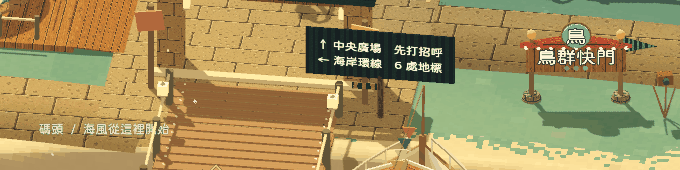

# [ART-75] 把招牌與拱門標題改成標題字

> 狀態：完成

## 內文

### 需求

園區裡的拱門、路標、主題區大名與攤位招牌，標題和地上的小說明用同一種細字，招牌看起來不像招牌。要讓這些標題用 ART-64 的加粗標題字，地上的說明與角色名牌維持內文字，分出層次。

### 來源

2026-11-28 字體與文字演出後續（ART-64 收尾盤點）；協作 session 指派。

### 驗收條件

- [x] 拱門名稱、路標牌標題、主題區大名、園區閘門名稱與攤位招牌使用加粗標題字。
- [x] 地面說明、狀態字與角色名牌維持內文字。
- [x] 切換易讀字型或語系時，招牌跟著換；招牌文字不超出牌面。

### 測試流程

1. 在迎賓大道看拱門、路標牌與攤位招牌。
2. 走到各主題區閘門看區名。
3. 切換易讀字型再看一次。

---

# 跟其他票的關係

- Blocks：無
- Blocked by：無
- Related：ART-64、ART-68

---

# Commit-1

## 內文

拱門、路標牌、主題區大名、園區閘門與攤位招牌的標題和地上說明用同一種細字，招牌不像招牌。
現在這些標題改用加粗標題字，地面說明、狀態字與角色名牌維持內文字；切換易讀字型或語系時一起換。攤位、碼頭等由各區道具檔產生的看板標題本次未改，維持內文字。

### 測試結果

| 項目 | 結果 |
|---|---|
| 字體檢查（含招牌標題用標題字） | 54 / 54 |
| 迎賓、夜市世界與場景標準 | 通過 |

### 截圖

