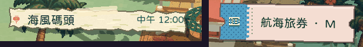

# [ART-77] 把左上地點牌與旅券鈕改成拼貼吊牌

> 狀態：完成

## 內文

### 需求

遊園畫面左上的地點牌（「中央廣場／中午 12:00」）是平的深色方框，右上的「航海旅券 · M」是平的按鈕，正是使用者不喜歡的方框介面。要改成拼貼風格：地點牌像一張貼著膠帶、邊緣撕過的紙片，旅券鈕像掛著的票根吊牌，待機時輕輕擺動，字體清楚好讀。

### 來源

2026-11-28 使用者不喜歡方框介面（記憶：介面不要方框、要立體且符合遊戲風格）；協作 session 盤點遊園畫面上仍是平面方框的疊層後指派。

### 驗收條件

- [x] 左上地點牌改成撕邊紙片加膠帶，地點與時間清楚可讀。
- [x] 右上旅券鈕改成票根或吊牌，滑過、聚焦與按下有回饋，點擊範圍不縮小。
- [x] 待機有輕微擺動；減少動態時靜止。
- [x] 最小視窗下兩者不超出畫面、不互相重疊。

### 測試流程

1. 進入遊園，看左上地點牌與右上旅券鈕。
2. 滑鼠移到旅券鈕上、用鍵盤聚焦並按下。
3. 開啟減少動態，把視窗縮到 800×450 再看。

---

# 跟其他票的關係

- Blocks：無
- Blocked by：無
- Related：ART-59、ART-62、ART-63、ART-64

---

# Commit-1

## 內文

遊園畫面左上的地點牌是平的深色方框，右上的「航海旅券 · M」是平按鈕。
現在地點牌是一張撕邊奶油色紙片，地點、時間與收藏數改用紙上可讀的深色墨水；旅券鈕是藍色色帶的票根，沿用選單吊牌的滑過、聚焦與按下回饋，點擊範圍不變，待機時跟選單一樣輕輕擺動，減少動態或隱藏 HUD 時靜止。1280×720 與 800×450 都看過，兩者不出界、不重疊。

### 測試結果

| 項目 | 結果 |
|---|---|
| 啟動、像素介面殼層、介面設定、介面動態、選單記憶體、場景標準 | 通過 6 / 6 |

### 截圖

