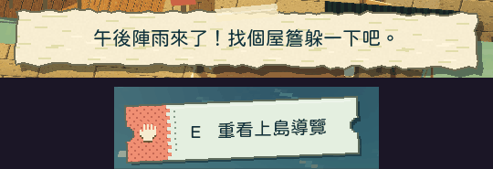

# [ART-78] 把提示訊息與互動提示改成拼貼紙片

> 狀態：完成

## 內文

### 需求

畫面上方的提示訊息（例如「午後陣雨來了！…」）是一個素面奶油色方框，下方的互動提示（「E 返回迎賓大道」）是一條平的紅色長條，看起來像系統對話框。要改成拼貼風格：提示訊息像貼上去的便條，互動提示像一張按鍵貼紙，出現時有小小的貼上動作。

### 來源

2026-11-28 使用者不喜歡方框介面（記憶：介面不要方框、要立體且符合遊戲風格）；協作 session 盤點遊園畫面上仍是平面方框的疊層後指派。

### 驗收條件

- [x] 上方提示訊息改成撕邊便條加膠帶，出現時有貼上的動作，文字清楚。
- [x] 下方互動提示改成按鍵貼紙樣式，按鍵與動作文字分得清楚。
- [x] 減少動態時直接顯示；不遮住角色與主要場景。

### 測試流程

1. 在園區觸發一則提示訊息（例如天氣事件）。
2. 走到可互動的地點看互動提示。
3. 開啟減少動態再看一次。

---

# 跟其他票的關係

- Blocks：無
- Blocked by：無
- Related：ART-59、ART-62、ART-63、ART-64

---

# Commit-1

## 內文

上方提示訊息是素面奶油色方框，下方互動提示是一條平的紅色長條，像系統對話框。
現在提示訊息是一張撕邊便條，每則訊息出現時貼上並輕彈一下；互動提示是珊瑚色按鍵貼紙，色帶上有手的圖示，按鍵與動作文字分開，出現時有貼上動作，滑過、聚焦與按下沿用選單貼紙的回饋，點擊範圍不變。減少動態時直接顯示。

### 測試結果

| 項目 | 結果 |
|---|---|
| 啟動、主場景整合、像素介面殼層、介面動態、選單記憶體、場景標準 | 通過 6 / 6 |

### 截圖

