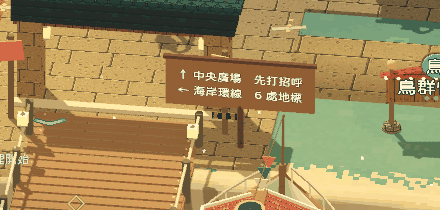

# [ART-79] 把碼頭深色路標牌改成拼貼看板

> 狀態：完成

## 內文

### 需求

碼頭旁指向中央廣場與海岸環線的路標牌是一塊黑色長條，和拼貼遊樂園的畫面格格不入。要改成像木頭看板或貼滿紙片的公告牌，字仍清楚好讀。

### 來源

2026-11-28 使用者不喜歡方框介面（記憶：介面不要方框、要立體且符合遊戲風格）；協作 session 盤點遊園畫面上仍是平面方框的疊層後指派。

### 驗收條件

- [x] 碼頭路標牌改成符合拼貼遊樂園風格的看板，不再是黑色長條。
- [x] 箭頭與目的地文字清楚可讀，白天與夜晚都看得清楚。
- [x] 符合場景建置規範，違規數不增加。

### 測試流程

1. 從碼頭上岸，看路標牌。
2. 切換到夜晚再看一次。

---

# 跟其他票的關係

- Blocks：無
- Blocked by：無
- Related：ART-59、ART-62、ART-63、ART-64

---

# Commit-1

## 內文

碼頭旁指向中央廣場與海岸環線的路標牌是一塊黑色長條，和拼貼遊樂園格格不入。
現在它是暖色木紋看板，頂上加一條深色木頭頂蓋，字改成奶油色配深褐描邊，箭頭與目的地清楚可讀；看板仍跟著走近的路標移動，使用受光的木頭材質，會跟著時段明暗變化。頂蓋在場景建立時只產生一次。

### 測試結果

| 項目 | 結果 |
|---|---|
| 啟動、主線劇情整合、海港世界 | 通過 3 / 3 |
| 場景標準（換成木頭材質後重跑） | 通過 |

### 截圖

