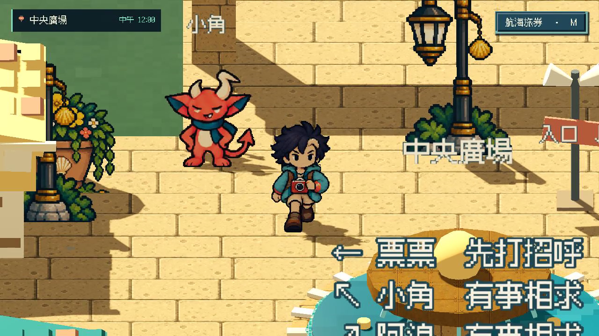
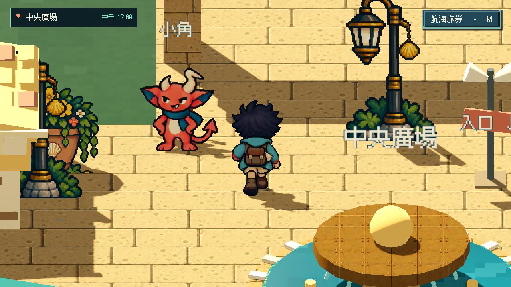
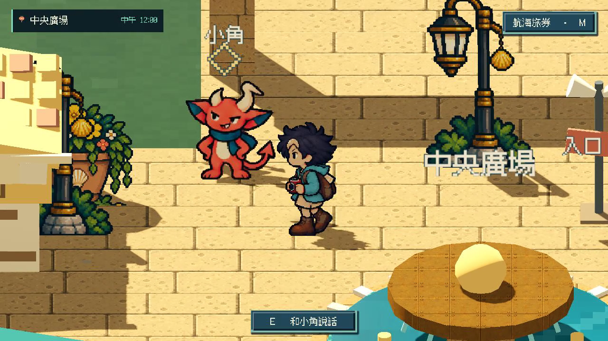
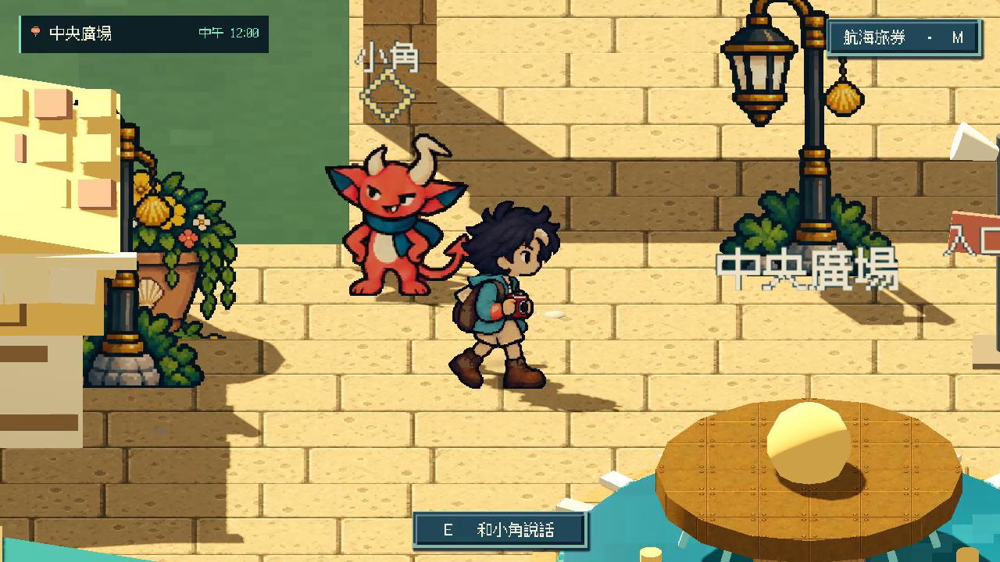
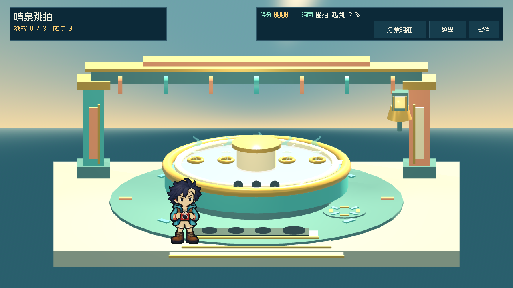

# [ART-7] 製作細緻像素角色與動作

> 狀態：完成

## 內文

### 需求
島上角色使用細緻、高像素的 HD-2D 美術，保留使用者肯定的海港色彩與有個性的角色表情。換裝在島上可見，加入多方向步行、招呼、拍照、互動與慶祝動作。

### 來源
2026-10-11 使用者肯定兩張角色素材，尤其新版角色更有個性；要求高像素與更多動作。Nintendo Splatoon 開發者訪談強調角色行為與世界概念的一致性；不照抄其角色。研究與使用者選圖存入本票相關設計與圖片。

### 驗收條件
- [x] 島上角色細節來自高解析像素素材，具清楚髮型、眉眼與服裝輪廓。
- [x] 四方向步行及招呼、拍照、互動、慶祝可在原生畫面觀察。
- [x] 衣服、帽子與膚色改變可在島上與衣櫃預覽辨識。
- [x] 日夜與降低動態下角色仍清楚，換裝不改移動碰撞。
- [x] 素材缺失有可辨識安全預設，實際打包後素材可用。

### 測試流程
1. 原生視窗走四方向，觀察步態與新動作。
2. 切換不同外觀與服飾，檢查島上及預覽一致。
3. 打包版本檢查角色素材與日夜畫面。

---

# 跟其他票的關係
- Blocks：無
- Blocked by：無
- Related：MAIN-8、ART-8、ART-4

---

# 開始與研究

固定基準：4c320b9d6eef219d5ea90a9b96cb09ad7a68b3a5。研究與使用者選圖見 [本批設計](../../design/runtime/wardrobe.md) 與 [提示詞指南](../../design/runtime/art-prompt-guide.md)。

---

# Commit-1

問題：島上人物及換裝需要更清楚的高解析像素細節和可辨識的動作。

改動：加入多方向角色姿勢與招呼／拍照／互動／慶祝的正面單格姿勢，以及基礎外觀顏色和帽子預覽。四種動作姿勢不是動畫；目前服飾以換色呈現，尚非完整分層服裝。

驗收：原生角色姿勢與基礎外觀／帽子預覽已檢查；不宣稱四種動作已形成動畫或服飾已具完整分層。素材封裝與缺失素材安全回退尚未完成，因此最後一項保持未驗收；完整動作與服裝分層由 ART-17／ART-18 跟進。

測試與證據：原生全身姿勢 fixture 共 27 視角通過，其中包含三位 NPC 多姿勢及主角八方向待機、行走／拍照／招手／慶祝姿勢；根任務查看正常頭部與全身比例。這些是靜態構圖檢查，不是完整待機組或四種動作動畫。素材封裝未驗收。

| 畫面證據 | 說明 |
| --- | --- |
| [角色細節](images/ART-7-character-approved.png) · [畫廊臉部](images/ART-7-gallery-face.png) · [髮型](images/ART-7-gallery-hair.png) | 原生靜態畫面 |
| [拍照動作](images/ART-7-action-photo.png) · [互動](images/ART-7-action-interact.png) · [招呼](images/ART-7-action-wave.png) · [慶祝](images/ART-7-action-celebrate.png) | 動作靜態畫格 |
| [角色行走預覽影片](images/ART-7-walk-preview.mp4) | 使用者已看過並提出步態意見；不作通過宣稱 |
| [主角全身待機](images/ART-15-sprite-clearance-avatar-idle-front.png) · [行走姿勢](images/ART-15-sprite-clearance-avatar-walk-front_right-5-of-8.png) · [招手姿勢](images/ART-15-sprite-clearance-avatar-wave.png) | 原生全身靜態 fixture；不作動畫完成證據 |

程式交付：[Commit 6eb5644](https://github.com/deadline314/Snapland/commit/6eb5644eae2d10cfc15c7b05be9ead4cb9915b83)（分支 `feature/island-first-park`；固定基準 `4c320b9d6eef219d5ea90a9b96cb09ad7a68b3a5`）。

主角招呼、拍照、互動及慶祝目前各為单張姿勢；完整動作集合由 ART-17 追蹤。服裝目前主要換色，服裝輪廓和分層同步由 ART-18 追蹤，沒有用靜態姿勢或換色視為完整動畫／服裝。

### 最新輸出驗證
Windows輸出於Intel Arc B580原生GPU完成圖集、NPC、場景動畫與遮擋資源冒煙檢查，12款場景所需素材均載入，無ERROR；此檢查不代表真人試玩、完整換裝動作、每姿勢或試聽驗收。

### 程式與證據提交
分支：feature/island-first-park。更新至最新main後的本票提交：[02ac052](https://github.com/deadline314/Snapland/commit/02ac052d402584fa3dc2e9a4371ed7616faa4ffd)。

# Commit-2 — 2026-11-02 完成基本動作與輸出資源驗收

## 內文

四方向步行、招呼、拍照與互動已能在原生視窗觀察，勝利返回島嶼也會使用既有八格跳躍完整慶祝，再回到待機。正常速度以真實噴泉輸入通關並從結算返回；四分之一速度另檢查既有動作與三款髮型的服飾同步。

移除主角主圖集的隔離副本仍能顯示完整可辨識人物。正式 Linux 成品從自己的目錄啟動，沒有借用原始專案或編輯器快取，角色、三位 NPC、場景與附件資源均成功載入。

### 測試結果

| 項目 | 結果 |
|---|---|
| 四方向原生步行 | 實際按鍵移動及方向檢查通過，正常影片與四張解碼格實際查看 |
| 四種原生動作 | 招呼、拍照、互動姿勢與慶祝均觀察八格來源；正常／真實四分之一速度 exit 0、0 ERROR |
| 缺少主圖集 | 新隔離副本實際刪除圖檔及匯入側檔，四方向均顯示 64×96 完整安全人物；實際查看四圖，exit 0、0 ERROR |
| Linux 正式輸出 | Godot 4.7.2 官方樣板、內嵌資源的 241,399,984 bytes ELF；匯入與輸出 exit 0、0 ERROR |
| 成品原生啟動 | 26.34 秒、12 款實際繪製截圖、角色與三位 NPC 來源資源檢查通過，exit 0、0 ERROR |
| 打包動作與衣帽 | 88 組姿勢逐像素符合原始專案，慶祝完整八格後回待機；開發測試檔沒有進入遊戲包 |
| 版本一致 | 全部 1,059 份建置輸入與目前正式程式／資源雜湊相同 |

程式版本：[bb6d311](https://github.com/deadline314/Snapland/commit/bb6d3118f7676617d8f124e98ee7a6bc4a2797d5)。[正常速度原生影片](images/ART-17-celebration-20261102-normal-v3.mp4) · [真實四分之一速度](images/ART-17-celebration-20261102-quarter.mp4) · [建置與檢查結果](images/ART-7-release-20261102-review.json) · [建置雜湊、原始日誌、12 張成品截圖與可重播資源檢查](images/ART-7-release-20261102-replay.zip)。

本票完成基本人物、可觀察動作與安全打包範圍。先前已勾選的日夜、衣櫃與移動碰撞沿用原驗收紀錄；本輪沒有將十二入口資源冒煙稱為完整玩法、真人試玩或試聽。完整主角／三位 NPC 動作及完整服飾品質仍由 ART-17／ART-18 原條件驗收，沒有因本票完成而代為勾選。

