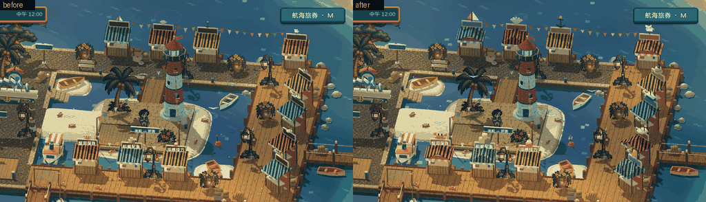

# [ART-80] 讓碼頭攤位一眼看出在玩什麼

> 狀態：完成

## 內文

### 需求
潮汐碼頭十二個攤位是同一個方盒加條紋遮陽篷，沿碼頭等距排開；遠處攤位的招牌是空白黑板，字只在走近時出現，看起來像沒做完。

### 來源
2026-11-28 美術與演出稽核第二輪，見 `design/runtime/art-direction-audit.md`。

### 驗收條件
- [x] 每個攤位的招牌上方立著代表玩法的大圖示，從遠處就看得到，走近時照舊出現名稱
- [x] 攤位輪廓至少三種，不再是十二個相同方盒
- [x] 四個時段招牌圖示都受光、夜晚可辨認
- [x] 場景檢查違規數不增加，碼頭節點數在預算內

### 測試流程
1. 快速移動到潮汐碼頭，從抵達點看整排攤位
2. 中午與晚上各截圖，遠處攤位招牌有圖示、攤位外形有變化

---

# 跟其他票的關係

- Blocks：無
- Blocked by：無
- Related：無

---

# Commit-1

## 內文

潮汐碼頭十一個攤位是同一個方盒加斜條紋遮陽篷，招牌是深色空板，名字只在走近時出現；招牌上的小圖示約半公尺寬，從抵達點看不出來，整排攤位像沒做完的同一個物件。
現在每塊招牌漆成攤位自己的顏色，上方的玩法圖示（帆船、貝殼、船錨、海鷗、螃蟹、木箱、浮標、鐘）放大到將近兩倍，從碼頭另一頭就看得出每攤在玩什麼；走近時名稱照舊出現在招牌上。攤位屋頂輪流採用斜遮陽篷、人字屋頂與尖帳篷三種，相鄰攤位外形不同。
原生截圖確認中午與晚上從抵達點看整排攤位，圖示清楚、招牌不再是空白黑板。

### 測試結果

| 項目 | 結果 |
|---|---|
| 潮汐碼頭場景測試 | 通過 |
| 場景規範檢查 | 通過，違規數未增加 |
| 資料驗證 | 0 錯誤 |

### 截圖

