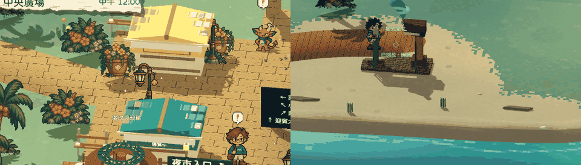

# [ART-81] 修正島上小件顏色偏淡

> 狀態：完成

## 內文

### 需求
島上多組批次繪製的小件（海草、草叢、花苞、池畔石、碼頭釘）顏色比設定的淡一截、偏灰白，草地與花叢失去飽和度。

### 來源
2026-11-28 美術與演出稽核第二輪，見 `design/runtime/art-direction-audit.md`。

### 驗收條件
- [x] 這些小件的顏色與設定的色值一致，不再發白
- [x] 整體畫面沒有因此變得過暗或過飽和
- [x] 場景檢查違規數不增加

### 測試流程
1. 在迎賓廣場與溫室旁草地各截圖中午與晚上
2. 與改前比較，花叢與海草顏色接近設定色

---

# 跟其他票的關係

- Blocks：無
- Blocked by：無
- Related：無

---

# Commit-1

## 內文

迎賓島上二十多組批次繪製的小件（樹葉、花瓣、草叢、池畔石與蘆葦、海草、噴泉磚、碼頭釘、攤亭屋瓦與流蘇、棧道接縫）用畫好的色值上色，但材質把這些顏色當成已轉換過的值讀取，結果每一種都比設定的淡一截、偏灰白。主題區的批次另有自己的轉換，沒有這個問題。
現在迎賓島這些批次改用會自行轉換色值的材質，草叢與海草回到深淺不同的草綠，花與屋瓦恢復飽和，石頭不再發白；主題區與用雕塑工具做的物件維持原樣，不會被轉兩次。ART-71 在沙洲上手動轉換的貝殼、浮木與海草一併改回只轉一次。
原生截圖確認中午與晚上廣場、溫室旁草地與潟湖沙洲的小件顏色接近設定色，整體沒有變得過暗。

### 測試結果

| 項目 | 結果 |
|---|---|
| 島嶼佈局、建物遮擋測試 | 通過 2 / 2 |
| 場景規範檢查 | 通過，違規數未增加 |
| 資料驗證 | 0 錯誤 |

### 截圖

