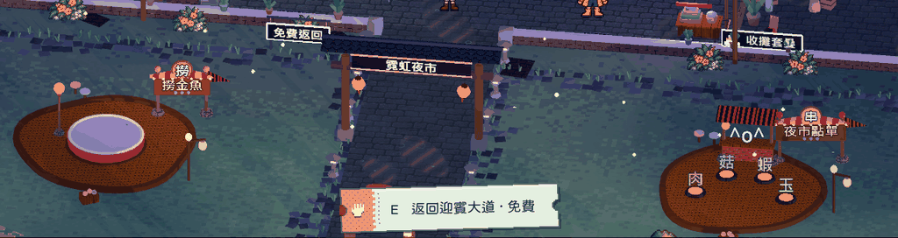

# [ART-82] 讓夜市門外攤位立在地面上

> 狀態：完成

## 內文

### 需求
霓虹夜市門外的撈金魚與點單攤放在平面的紅白格子圓地墊上，像貼在地上的貼紙。

### 來源
2026-11-28 美術與演出稽核第二輪，見 `design/runtime/art-direction-audit.md`。

### 驗收條件
- [x] 兩個攤位下方是木板地台，外圈有一道凸起的木框，旁邊有燈籠柱、小板凳與水果箱等配件
- [x] 攤位與地面之間有接地陰影，不再像平貼
- [x] 互動點周圍保持淨空，場景檢查違規數不增加

### 測試流程
1. 走到霓虹夜市門口，傍晚與晚上各截圖
2. 兩個攤位看起來立在地上

---

# 跟其他票的關係

- Blocks：無
- Blocked by：無
- Related：無

---

# Commit-1

## 內文

霓虹夜市門外的撈金魚與夜市點單兩攤，腳下是紅白格子的圓形薄墊，邊緣幾乎沒有高度，從抵達點看像貼在地上的貼紙。
現在兩攤腳下改成暖色木板地台，外圈有一道高出地面約十五公分的深色木框，框外有一圈接地陰影；地台本身仍與地面同高，玩家和玩法物件的腳不會陷進去。原本的燈籠柱、小板凳與水果箱留在地台旁。
原生截圖確認中午與傍晚兩攤看起來立在地上，木紋看得出來，不再是平貼的格子墊。

### 測試結果

| 項目 | 結果 |
|---|---|
| 主題區即玩小遊戲、霓虹夜市場景測試 | 通過 2 / 2 |
| 場景規範檢查 | 通過，違規數未增加 |
| 資料驗證 | 0 錯誤 |

### 截圖

