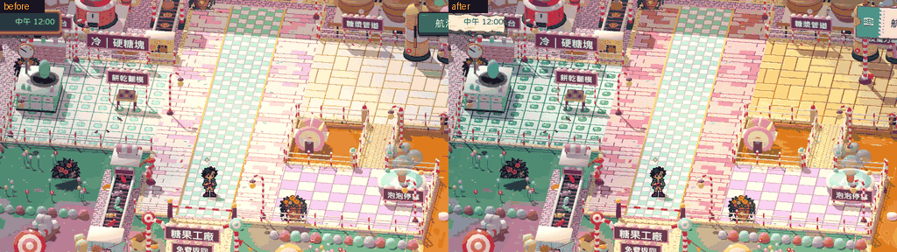

# [ART-83] 提高糖果工廠鋪面的對比

> 狀態：完成

## 內文

### 需求
糖果工廠新鋪面中午偏淡，奶油色磚與粉色、檸檬色磚之間明度差不足，畫面發白。

### 來源
2026-11-28 美術與演出稽核第二輪，見 `design/runtime/art-direction-audit.md`。

### 驗收條件
- [x] 中午各區鋪面的磚與磚之間有明顯明度差，接縫看得見
- [x] 晚上不因此過暗
- [x] 場景檢查違規數不增加

### 測試流程
1. 快速移動到糖果工廠，中午與晚上各截圖
2. 與改前比較，地面不再泛白

---

# 跟其他票的關係

- Blocks：無
- Blocked by：無
- Related：無

---

# Commit-1

## 內文

糖果工廠三區的新鋪面都以接近白色的奶油色為底，中午陽光一照，錯縫磚、糖豆方磚與編籃紋都泛白，磚與磚之間幾乎看不出差別。
現在三區改用中明度的底色：大道是淡玫瑰磚夾深玫瑰磚，材料實驗區是淡薄荷底嵌深薄荷糖豆，管道走廊是蜂蜜色編籃夾焦糖色木條；接縫顏色跟著加深。中央薄荷步道與泡泡停泊區兩塊重點地墊保持原樣。
原生截圖確認中午各區地面不再泛白、磚縫清楚，晚上也沒有過暗。

### 測試結果

| 項目 | 結果 |
|---|---|
| 糖果工廠場景測試 | 通過 |
| 場景規範檢查 | 通過，違規數未增加 |
| 資料驗證 | 0 錯誤 |

### 截圖

