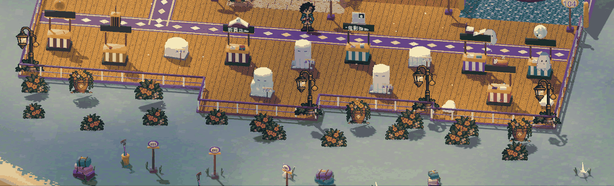

# [ART-84] 讓旅館前廊罩布攤點有高低變化

> 狀態：完成

## 內文

### 需求
幽幽旅館前廊八個白色罩布攤點大小與形狀幾乎相同，成兩列排開，像重複貼上的同一個物件。

### 來源
2026-11-28 美術與演出稽核第二輪，見 `design/runtime/art-direction-audit.md`。

### 驗收條件
- [x] 罩布下透出至少三種不同家具輪廓，高低不同
- [x] 擺放位置不等距、朝向有變化，重開後一致
- [x] 互動點周圍保持淨空，場景檢查違規數不增加

### 測試流程
1. 快速移動到幽幽旅館，從前廊中央截圖
2. 尚未開放的罩布攤點外形有明顯差異

---

# 跟其他票的關係

- Blocks：無
- Blocked by：無
- Related：無

---

# Commit-1

## 內文

幽幽旅館前廊替尚未到貨的街機保留的攤位，每個都是同一個白色方箱罩著布，大小形狀相同，成兩列排開，像同一個物件重複貼上。
現在罩布下依序藏著三種舊家具：矮木箱、高高的衣櫥與高背扶手椅，布色在四種淡色間輪替，朝向本來就略有不同；每塊罩布照舊有一雙打瞌睡的眼睛，衣櫥的眼睛長在高處，像站著打盹的幽靈。攤位位置由玩法決定，沒有移動；街機到貨後罩布照舊換成正式攤位。
原生截圖確認前廊的罩布攤點高低外形各不相同，不再像重複的方箱。

### 測試結果

| 項目 | 結果 |
|---|---|
| 幽幽旅館場景測試 | 通過 |
| 場景規範檢查 | 通過，違規數未增加 |
| 資料驗證 | 0 錯誤 |

### 截圖

