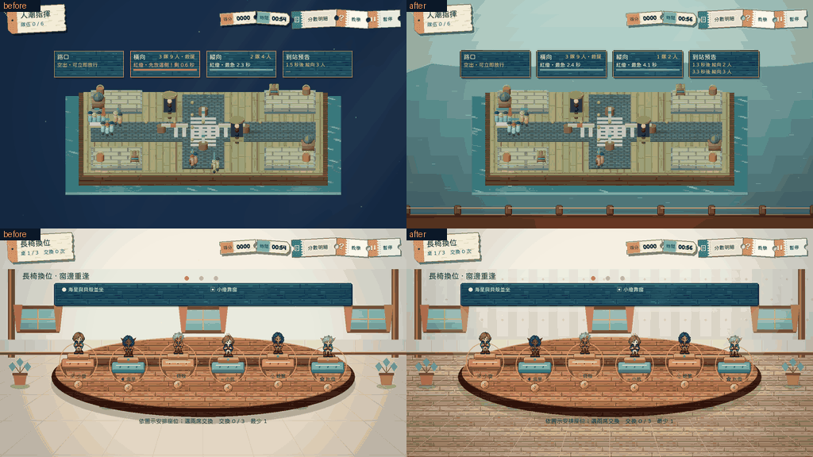

# [ART-86] 打磨迎賓區小遊戲的背景

> 狀態：完成

## 內文

### 需求
迎賓區十二款小遊戲依畫面標準（不用大片純色、要有受光面與陰影面、背景至少遠中近三層並有輕微環境動態）逐款截圖評分後，最弱的兩款背景是人潮指揮（棋盤浮在一整片深藍底色上）與長椅換位（整面米白牆與地板沒有材質）。把這兩款的背景補到標準。

### 來源
2026-11-29 美術稽核第三輪（已上線小遊戲的畫面打磨，一區一張），見 `design/runtime/art-direction-audit.md`。

### 驗收條件
- [x] 人潮指揮的棋盤四周是港灣景色：遠山與燈塔、近處海面、前景碼頭木棧，不再是單一深藍底色
- [x] 海面有緩慢漂移閃爍的波光，減少動態時靜止
- [x] 長椅換位的牆面有壁紙紋路與由上往下的明暗，地板是木板材質並由遠到近變暗
- [x] 長椅換位窗口的陽光在地板上留下暖色光區，光中有飄動的微塵，減少動態時靜止
- [x] 遊戲物件、文字位置與玩法不變

### 測試流程
1. 開人潮指揮與長椅換位，遊玩中各截圖一張
2. 對照畫面標準檢查背景層次、材質與動態

---

# 跟其他票的關係

- Blocks：無
- Blocked by：無
- Related：ART-58

---

# Commit-1

## 內文

人潮指揮的路口模型浮在一整片深藍底色上，四周什麼都沒有；長椅換位的牆面與地板是整片米白，只有幾條線。
現在人潮指揮的模型四周是港灣：上方是天色與兩層遠山和燈塔，中間是由淺到深的海面，海上波光會緩慢漂移閃爍，下緣是有繩欄與木樁的碼頭木棧，天色隨時段變化。長椅換位的牆面改成由亮到暗的壁紙條紋，地板改成木板材質並往前變暗，兩扇窗的陽光在地板留下暖色光區，光裡有微塵飄動。減少動態時波光與微塵都靜止。遊戲物件、文字與玩法都沒有變。
原生截圖確認兩款遊玩中的背景都有遠中近層次與材質，迎賓其他十款評分達標，結果記在美術稽核文件第三輪。

### 測試結果

| 項目 | 結果 |
|---|---|
| 長椅換位、人潮指揮畫面測試 | 通過 2 / 2 |
| 資料驗證 | 0 錯誤 |

### 截圖

