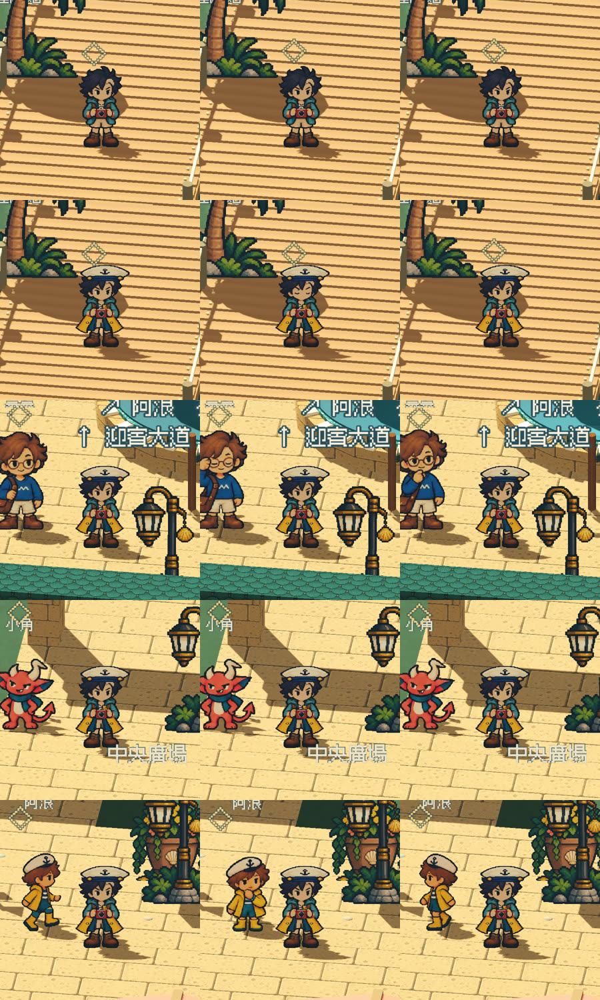

# [ART-9] 建立元件動畫與角色待機

> 狀態：完成

## 內文

### 需求
背景物件、建築、植栽、服飾及角色依材質、用途與個性有合理動畫或效果；建立可統一管理部件的動畫機制，避免靜態擺設與全部同步晃動。每位角色有呼吸與各自節奏的待機行為。

### 來源
2026-10-11 使用者追加：每個部件需要合理動畫、飄盪或效果；參考至少超過五個來源，比較並整合各方優點。本批查閱 Godot 動畫與共享風場、Unity 2D 骨架、Fortnite 植栽、Dead Cells 像素動作流程、Aseprite 動畫標記及無障礙動態指引，實際觀察與選用原因存於設計文件與票內參考。

### 驗收條件
- [x] 研究包含至少六個來源，記錄實際內容與採用或不採用原因。
- [x] 主要場景的植栽、旗幟、棚布、燈與水面有符合用途的動態或效果，結構與碰撞穩定。
- [x] 主角與三位具名角色的完整呼吸循環及不同待機節奏均經原生動畫檢視；現有 capture fixture 僅覆蓋部分姿勢與角色視角。
- [x] 完整分層服飾在動畫中保持臉部、帽子定位與腳部落地清楚；目前是基礎外觀換色，完整服裝同步由 ART-18 跟進。
- [x] 共用管理可新增部件，切換降低動態後效果受控，重新進入場景正常。
- [x] 原生畫面看過動畫前後，保存截圖與短錄影；局部驗證與打包資源檢查通過。

### 測試流程
1. 原生視窗停留觀察主廣場、碼頭、迎賓大道與三位角色。
2. 行走、換装與互動，檢查局部動態及碰撞。
3. 切換降低動態、日夜與重啟，檢查動態設定與資源釋放。

---

# 跟其他票的關係
- Blocks：無
- Blocked by：無
- Related：ART-3、ART-4、ART-7、ART-8

---

# 開始與研究

固定基準：abcb00bf3db53ae8ace3a54dcca5368fe6d83e4e。已讀七個來源的實際內容與選用比較見 [部件動畫研究](../../design/runtime/component-animation.md)，未播放的影片不算已觀看。

---

# Commit-1

問題：場景部件和角色需要依材質與性格呈現不同節奏，並能控制動態幅度。

改動：加入可共用管理的環境動態與角色姿勢呈現，並連動降低動態設定；本輪驗收不把有限原生姿勢視角等同全角色動畫集。

驗收：局部動態、遮擋場景、降低動態及重新進入的檢查通過。角色全身 capture fixture 的 27 視角已通過，但不證明完整 idle 循環或全角色素材集；原生影片審閱、局部打包與資源封裝仍待完成。

測試與證據：原生場景截圖包含旗幟、植栽和三位角色全身姿勢 fixture；27 視角中包含降低動態 NPC 畫格和還原視角。角色的八方向待機與四種動作僅代表各自靜態姿勢；影片未用來證明整套動態。場景遮擋位置是審查設定，不是遊戲試玩。

| 畫面證據 | 說明 |
| --- | --- |
| [旗幟近景 01](images/ART-9-flag-01.png) · [旗幟近景 02](images/ART-9-flag-02.png) · [植栽近景](images/ART-9-foliage-01.png) | 原生靜態畫面 |
| [阿浪近景](images/ART-9-npc-announcer-close.png) · [小角近景](images/ART-9-npc-imp-close.png) · [票票近景](images/ART-9-npc-ticket-close.png) | 角色身份靜態近景 |
| [NPC 售票員第一格](images/ART-15-sprite-clearance-npc-ticket-first.png) · [小角降低動態格](images/ART-15-sprite-clearance-npc-imp-reduced.png) · [主角全身待機](images/ART-15-sprite-clearance-avatar-idle-front.png) | 原生 clearance fixture 靜態畫面；未覆蓋完整待機動畫 |
| [動態預覽影片](images/ART-9-10-motion.mp4) | 影片已保存，尚未完成影片審閱及包裝驗收 |

程式交付：[Commit 572fa25](https://github.com/deadline314/Snapland/commit/572fa25ee797dcfd08a52af501c9e84768e9fc96)（分支 `feature/island-first-park`；固定基準 `abcb00bf3db53ae8ace3a54dcca5368fe6d83e4e`）。

### 最新輸出驗證
Windows輸出於Intel Arc B580原生GPU完成圖集、NPC、場景動畫與遮擋資源冒煙檢查，12款場景所需素材均載入，無ERROR；此檢查不代表真人試玩、完整換裝動作、每姿勢或試聽驗收。

### 程式與證據提交
分支：feature/island-first-park。更新至最新main後的本票提交：[fb0ba75](https://github.com/deadline314/Snapland/commit/fb0ba7566ebe5820662fce4c4ce6b54b58c931b5)。

# Commit — 2026-11-06 角色各自的呼吸節奏與臉部不被提示遮擋

固定開始 SHA：`dc94ff6`；分支：`feature/gracious-archimedes-nmdgcm`。

## 問題

三位 NPC 的待機原畫都以 3 FPS 循環，票票與阿浪同為 8 格，同時出現會以完全相同的節奏同步呼吸，不符合「各自的待機節奏」。原生近景也發現島上互動提示（◇）固定在 2.1 單位高，正好蓋在主角與票票的臉上。

## 改動

- NPC 活動層依個性給呼吸速度：票票沉穩約 3.0 秒一個呼吸、阿浪約 2.6 秒、小角好動約 1.9 秒；原畫與宣告的 FPS 不變，只作用於循環的站立／待機格。
- 每個角色第一次出現時從自己的呼吸位置開始，避免同時吸氣；之後動作結束都回到第一格中立姿勢，接回待機不跳姿。
- 互動提示預設浮在 2.85 單位，高於 2.4 單位的角色頭頂；低矮設施保留各自的較低高度。
- 新增原生待機審閱：在實際 Main 依序近景觀察主角、主角穿長背心戴帽、三位 NPC 各 10 秒，逐幀記錄顯示的待機格以量測節奏。

## 驗收

| 項目 | 結果 |
|---|---|
| 呼吸節奏（原生 30 FPS 固定時鐘逐幀量測） | 每個待機姿勢停留：票票 11–12 幀、小角 8–9 幀、阿浪 10 幀，與設定的 3.03／1.91／2.56 秒循環一致，三者彼此不同；修改前票票與阿浪同為 10 幀 |
| 主角待機 | 8 個正面待機姿勢依原畫的長短停留（含眨眼）完整循環；換上長背心與水手帽後循環相同，臉、帽子位置與雙腳接地清楚 |
| NPC 待機小動作 | 錄製期間出現票票開心、小角得意／跳舞、阿浪好奇與巡走，結束後回到站姿 |
| 臉部不被遮擋 | 主角、票票、小角、阿浪的互動提示都在頭頂之上；新增配置檢查四個角色點位的提示高於角色頭頂 |
| 局部測試 | NPC 全部 9 組、元件動畫、故事、島嶼配置、對話、海岸、遊戲入口、主場景整合全部通過；新增呼吸節奏與錯開起始的檢查 |
| 降低動態與重新進入 | 既有 NPC 測試：降低動態恢復原始站姿、恢復後繼續；場景移除與重新註冊正常 |
| Linux 輸出 | 釘選範本輸出成功；輸出檔啟動與關閉 exit 0、0 ERROR |

原生錄影使用軟體繪製與固定時鐘、腳本放置鏡頭；不是 GPU 實機或真人試玩。已實際查看 15 張近景與影片中的四位角色。

[逐幀量測](images/ART-9-breath-20261106-measurement.json) · [原生近景影片](images/ART-9-breath-20261106-native.mp4) · [輸出建置](images/ART-9-breath-20261106-release-build.json) · [輸出檔啟動紀錄](images/ART-9-breath-20261106-release-smoke.log) · [設計說明](../../design/runtime/component-animation.md)

