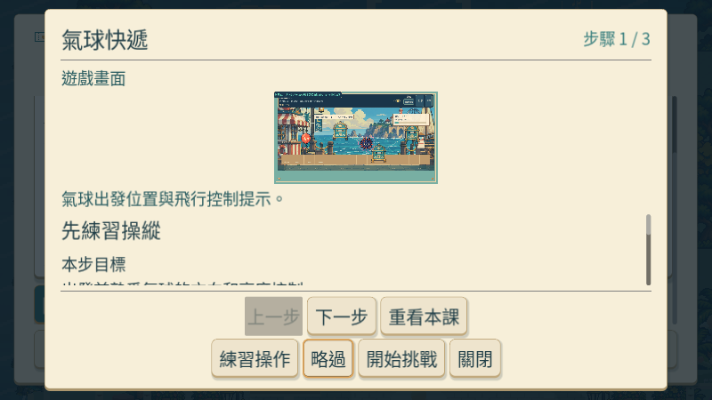
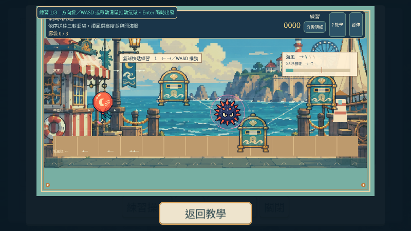

# [MAIN-10] 提供截圖教學與重看入口

> 狀態：進行中

開始基準：`64fcf8cbd313ba350c7165a2e4ec914398a8f943`；分支：`feature/island-first-park`。

## 內文

### 需求
建立可跳過、可重看的完整圖文教學，涵蓋遊園及十二款小遊戲。以實際遊戲截圖說明目標、控制、關鍵規則、計分與成功範例；首次教學和練習期間不消耗正式回合時間，遊玩畫面減少重複長提示。

### 來源
2026-10-12（Asia/Taipei）使用者要求全面重新審閱 UI 和小遊戲，提升目標、計分及操作手感；先廣泛 survey，減少遊戲當下提示，提供含截圖的完整教學。使用者授權自行決定設計，強調循序完善、細節有主次且不雜亂，以可面向大眾的品質驗收。

### 驗收條件
- [ ] 至少六個跨不同方向的教學與可用性來源有實際閱讀紀錄、採用理由及圖例。
- [ ] 遊園與十二款遊戲各有對應實際畫面的截圖教學，按鍵、目標、分數與結果說明符合當前版本。
- [ ] 首次能學習並練習，既有玩家能跳過及隨時重看；教學不讓角色移動或回合倒數穿透。
- [ ] 使用鍵盤和滑鼠逐章操作，首次、重看、跳過、返回和重開皆正常；保存原生畫面與測試。

### 參考資料與實際觀察

[研究紀錄](../../design/runtime/ui-quality-survey.md)包含 Nintendo 規則／Tips／練習分離、Apple 的分步上手與跳過、Microsoft 的情境說明／輸入／難度／時間限制、W3C 操作目標大小等不同方向。採用可略過、可重看、圖文分步及練習不影響收藏；網頁原則不等同本遊戲已通過無障礙认证。

[實際遊戲圖例](../Snapland-art/images/ART-21-ref-mario-party.png)與[畫面比較](../../design/runtime/ui-visual-review.md)用於分離教學和正式遊玩資訊。教學中的示範截圖必須取自本遊戲當前原生版本，不能用參考作品或生成示意圖代替。

### 測試流程
1. 查看本票研究紀錄與圖例，核對採用的原則和原生前後比較。
2. 使用隔離存檔實際操作本票完整流程，核對各項驗收條件。
3. 核對重試、返回、重開與相關設定，保存原生截圖、影片和受影響測試摘要。

---

# 跟其他票的關係

- Blocks：無
- Blocked by：無
- Related：ART-20、ART-21、SG-15

---

# Commit-1

## 問題
遊玩畫面堆放長提示，玩家難以重看完整規則；小視窗的截圖太小，閱讀教學時也需要保留目前回合。

## 改動
新增遊園與十二款小遊戲各三步的圖文教學，可跳過、重看、練習及從暫停返回。截圖可點擊或按 Enter 放大；返回或 Esc 保留閱讀位置與鍵盤焦點。遊玩中重看教學先暫停，玩家自行繼續。

## 驗收
獨立候選版本實際使用鍵盤和滑鼠逐章操作十三份教學，保存 59 張原生畫面；涵蓋 800 像素視窗、降低動態、截圖放大與返回，以及本局暫停、練習與返回。教學文字／圖片／焦點檢查與主流程通過；故意缺圖時顯示安全替代並指出檔案位置。這是教學介面驗收，不是十二款遊戲品質或通關驗收。小遊戲正在更換獨立場景，三款的新畫面與新規則會於各玩法票更新教學，故本票暫維持進行中。

### 測試结果
- 十三份教學、39 個步驟的圖片與按鈕檢查通過；主流程與教學介面測試通過，無脚本／引擎錯誤。
- 原生 59 張截圖，實際點擊與按鍵驗證；點擊缺圖示範的測試產生預期警告，不把它當成資源已正常載入。
- 主 Session 檢視完整截圖放大及各遊戲第一步總覽；其餘步驟的文字版面與導航由原生檢查逐項確認。
- 跨票最小改動：原生驗收的滑鼠座標與輸入完整派送，修正按鈕明明可見卻點不到的問題；保留原有驗收斷言。
- 分支：`feature/island-first-park`；[交付分支](https://github.com/deadline314/Snapland/tree/feature/island-first-park)。

### 截圖與影片

[原生教學操作影片](images/MAIN-10-native-tutorial.mp4)
