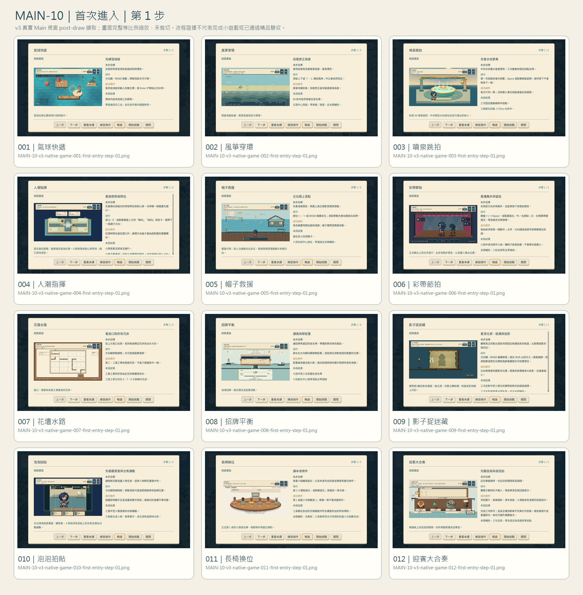
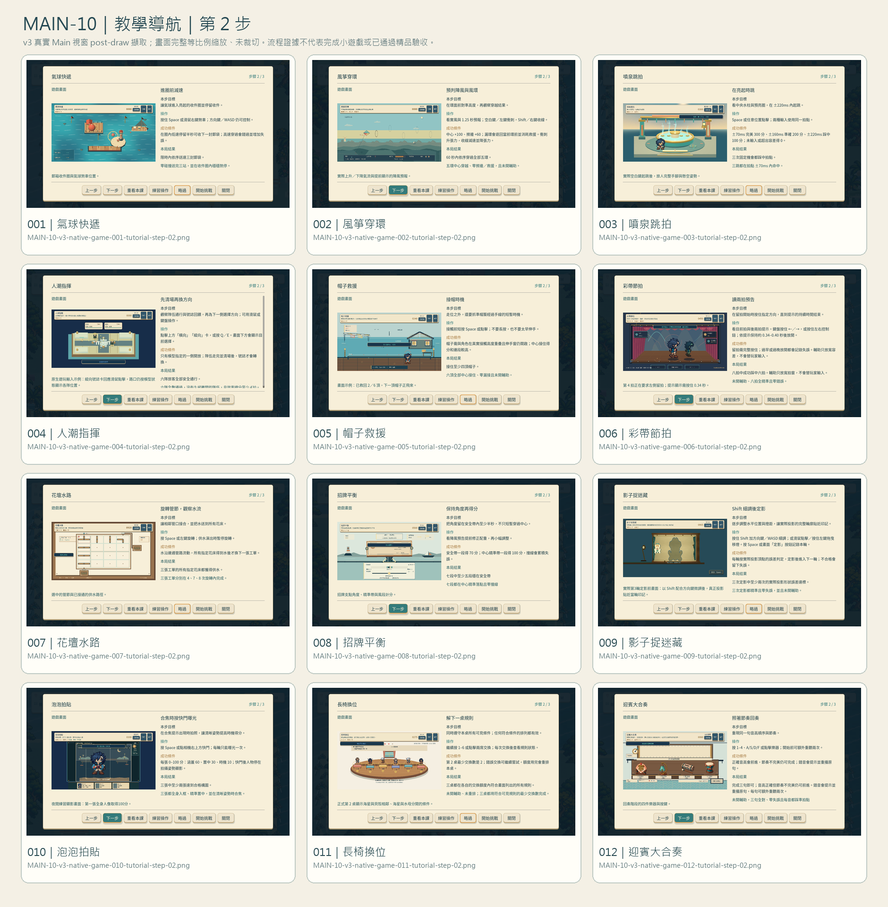
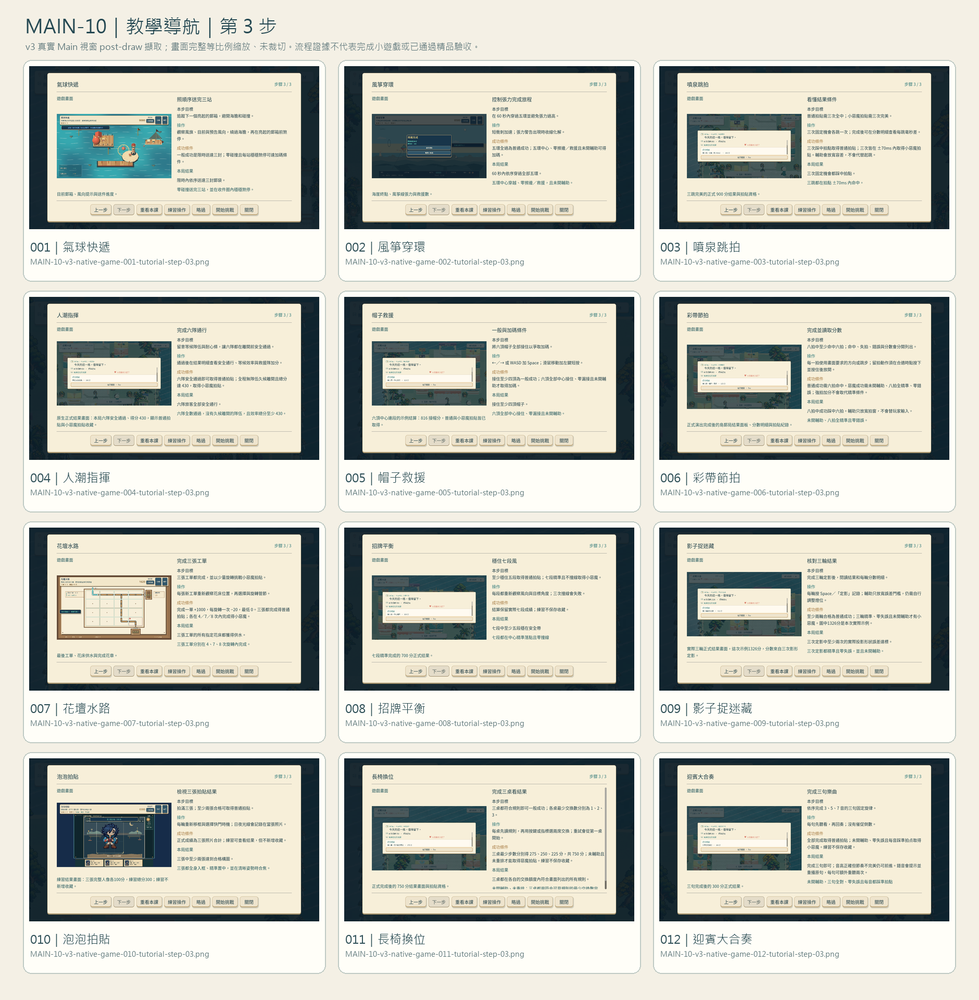
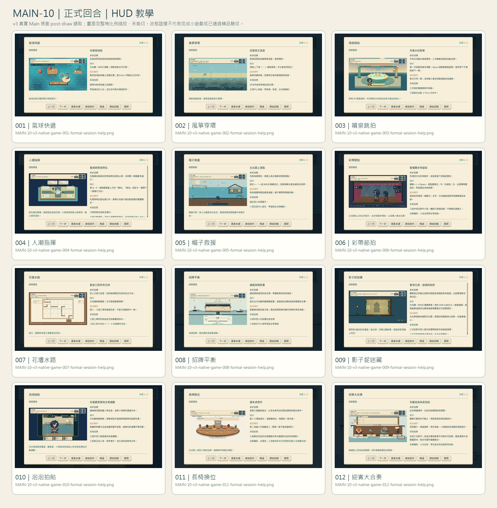
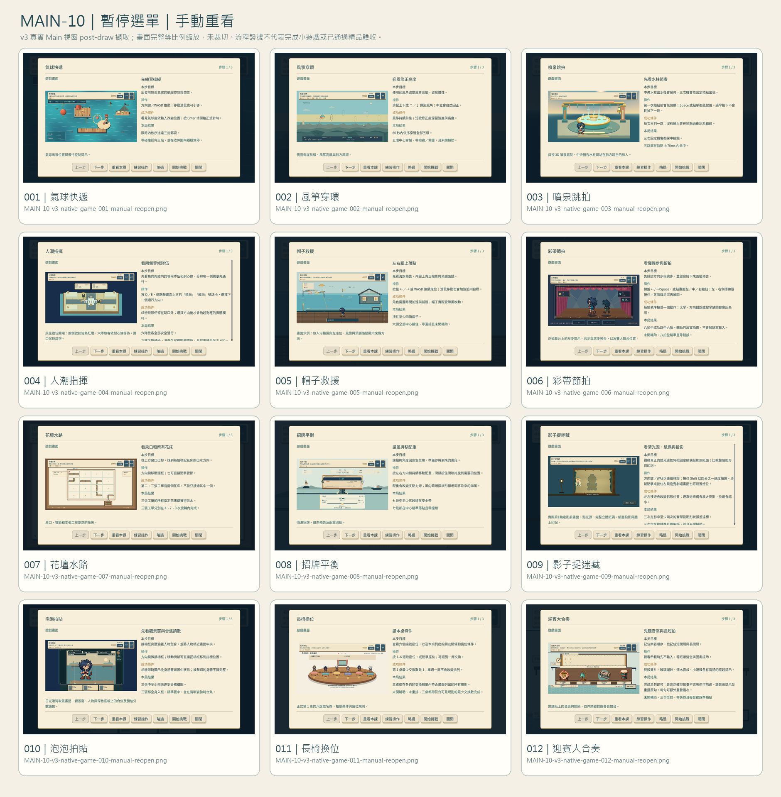
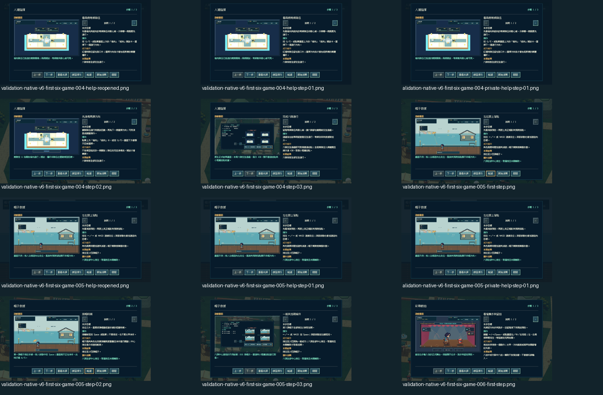
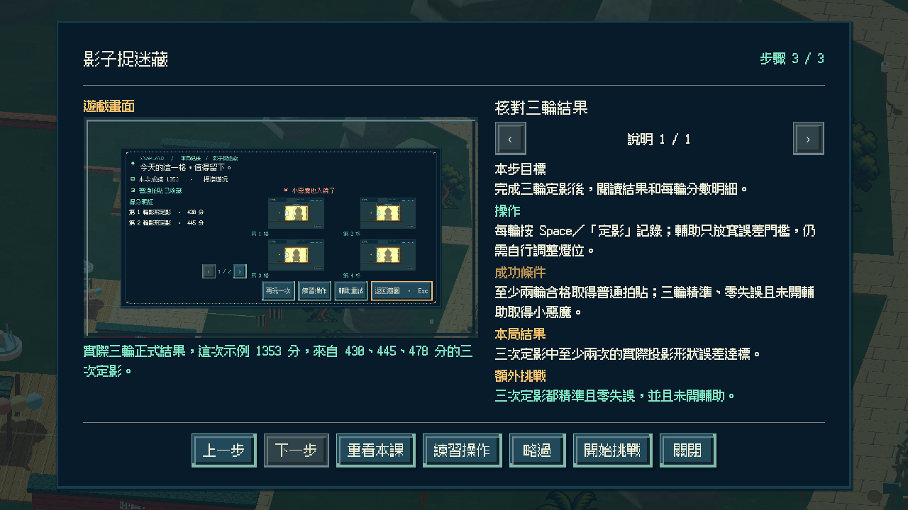
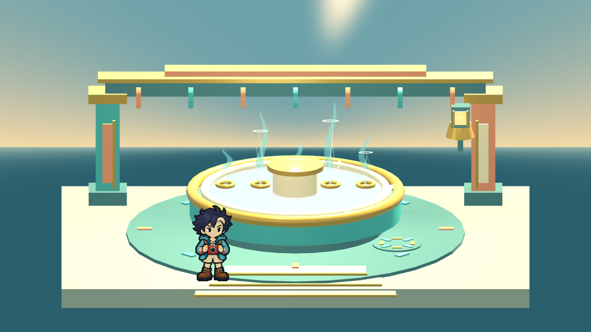
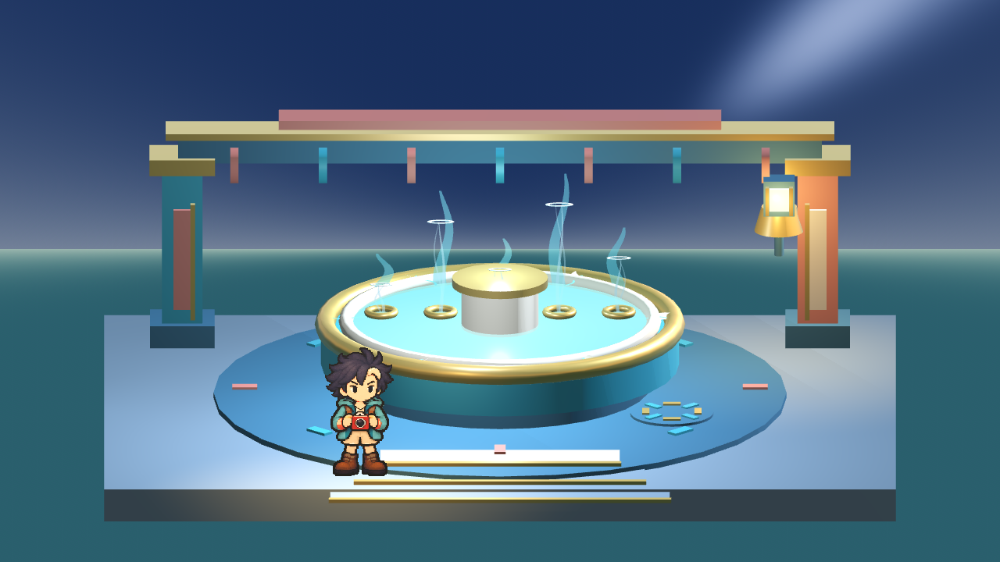

# [MAIN-10] 提供截圖教學與重看入口

> 狀態：完成

開始基準：`64fcf8cbd313ba350c7165a2e4ec914398a8f943`；分支：`feature/island-first-park`。

## 內文

### 需求
建立可跳過、可重看的完整圖文教學，涵蓋遊園及十二款小遊戲。以實際遊戲截圖說明目標、控制、關鍵規則、計分與成功範例；首次教學和練習期間不消耗正式回合時間，遊玩畫面減少重複長提示。

### 來源
2026-10-12（Asia/Taipei）使用者要求全面重新審閱 UI 和小遊戲，提升目標、計分及操作手感；先廣泛 survey，減少遊戲當下提示，提供含截圖的完整教學。使用者授權自行決定設計，強調循序完善、細節有主次且不雜亂，以可面向大眾的品質驗收。

### 驗收條件
- [x] 至少六個跨不同方向的教學與可用性來源有實際閱讀紀錄、採用理由及圖例。
- [x] 遊園與十二款遊戲各有對應實際畫面的截圖教學，按鍵、目標、分數與結果說明符合當前版本。
- [x] 首次能學習並練習，既有玩家能跳過及隨時重看；教學不讓角色移動或回合倒數穿透。
- [x] 使用鍵盤和滑鼠逐章操作，首次、重看、跳過、返回和重開皆正常；保存原生畫面與測試。

### 參考資料與實際觀察

[研究紀錄](../../design/runtime/ui-quality-survey.md)包含 Nintendo 規則／Tips／練習分離、Apple 的分步上手與跳過、Microsoft 的情境說明／輸入／難度／時間限制、W3C 操作目標大小等不同方向。採用可略過、可重看、圖文分步及練習不影響收藏；網頁原則不等同本遊戲已通過無障礙认证。

[實際遊戲圖例](../Snapland-art/images/ART-21-ref-mario-party.png)與[畫面比較](../../design/runtime/ui-visual-review.md)用於分離教學和正式遊玩資訊。教學中的示範截圖必須取自本遊戲當前原生版本，不能用參考作品或生成示意圖代替。

### 測試流程
1. 查看本票研究紀錄與圖例，核對採用的原則和原生前後比較。
2. 使用隔離存檔實際操作本票完整流程，核對各項驗收條件。
3. 核對重試、返回、重開與相關設定，保存原生截圖、影片和受影響測試摘要。

---

# 跟其他票的關係

- Blocks：無
- Blocked by：無
- Related：ART-20、ART-21、SG-15

---

# Commit-1

## 問題
遊玩畫面堆放長提示，玩家難以重看完整規則；小視窗的截圖太小，閱讀教學時也需要保留目前回合。

## 改動
新增遊園與十二款小遊戲各三步的圖文教學，可跳過、重看、練習及從暫停返回。截圖可點擊或按 Enter 放大；返回或 Esc 保留閱讀位置與鍵盤焦點。遊玩中重看教學先暫停，玩家自行繼續。

## 驗收
獨立候選版本實際使用鍵盤和滑鼠逐章操作十三份教學，保存 59 張原生畫面；涵蓋 800 像素視窗、降低動態、截圖放大與返回，以及本局暫停、練習與返回。教學文字／圖片／焦點檢查與主流程通過；故意缺圖時顯示安全替代並指出檔案位置。這是教學介面驗收，不是十二款遊戲品質或通關驗收。小遊戲正在更換獨立場景，三款的新畫面與新規則會於各玩法票更新教學，故本票暫維持進行中。

### 測試结果
- 十三份教學、39 個步驟的圖片與按鈕檢查通過；主流程與教學介面測試通過，無脚本／引擎錯誤。
- 原生 59 張截圖，實際點擊與按鍵驗證；點擊缺圖示範的測試產生預期警告，不把它當成資源已正常載入。
- 主 Session 檢視完整截圖放大及各遊戲第一步總覽；其餘步驟的文字版面與導航由原生檢查逐項確認。
- 跨票最小改動：原生驗收的滑鼠座標與輸入完整派送，修正按鈕明明可見卻點不到的問題；保留原有驗收斷言。
- 分支：`feature/island-first-park`；[遠端提交 cbbcd29](https://github.com/deadline314/Snapland/commit/cbbcd29)。

### 截圖與影片

[原生教學操作影片](images/MAIN-10-native-tutorial.mp4)

# Commit-2

## 問題

第一次進入新遊戲時，玩家需要知道教學如何開始、略過、重看，以及離開後如何繼續遊玩。只檢查教學頁面，無法確認這些操作在遊玩時會不會卡住或讓回合時間繼續流逝。

## 改動

第一次選擇「開始遊玩」會先看到三步圖解；玩家可以開始挑戰或略過。之後再進入同一遊戲會直接開始，教學仍可從遊玩中的說明按鈕或暫停選單重看。玩家也可以在私人練習中查看說明，關閉後回到暫停畫面，並透過確認操作離開、返回園區及再次進入。

保存了 72 張實際遊玩畫面及六張總覽，並附上影片。測試中會把角色直接移到每個站點以節省移動時間，其他操作由鍵盤和滑鼠完成；不會直接改分數、結果或收藏。存檔比對只看照片、成就、任務、外觀、已穿戴物品、服飾、金幣、平台待送成就及教學已讀標記，沒有逐項檢查完整存檔。

## 驗收進度

十二款的首次教學、略過或開始、遊玩中說明、暫停、回看、私人練習與返回流程均通過本次原生檢查。影片為 1280×720、60 FPS，共 4,150 幀、69.1667 秒；程式以結束碼 0 完成，十二款均有通過標記，沒有引擎或腳本錯誤。Root 已看完六張總覽、三張指定原尺寸畫面，並實際播放影片檢查流程；這份有限範圍的流程畫面證據沒有發現阻擋操作的問題。

這不代表十二款都已完整遊玩、完成結果驗證或達到最終美術品質。教學頁內的遊戲截圖仍含舊版遊玩介面，需再更新成目前介面。Root 的審閱只接受這次生命週期流程與所看畫面的表現；完整驗收仍待上述更新及其餘項目完成。本票維持進行中，原有驗收框不變。

### 測試結果

| 項目 | 結果 |
|---|---|
| 十二款流程 | 首次教學、略過或開始、遊玩中說明、暫停重看、離開確認、私人練習說明及重進流程通過；本次未完成十二款遊戲本身 |
| 原生畫面 | 72 張 1280×720 畫面與六張 3×4 總覽；逐張 SHA-256 見[證據清單](../../design/runtime/MAIN-10-v3-native-evidence-manifest.md) |
| 影片 | [原生生命週期流程影片](images/MAIN-10-lifecycle-v3-native.mp4)；4,150 幀、60 FPS、69.1667 秒，Root 已播放並檢查指定畫面 |
| 回歸測試 | 教學已讀／存檔測試與主畫面整合測試通過；v2 的三次迎賓大合奏錯誤已由 SG-27 修正提交 `7719b26`，v3 未再出現 |
| 完整遊玩與介面更新 | 未完成；教學頁截圖仍須更新為目前遊玩介面，並需後續完成完整遊戲與視覺驗收 |

### 畫廊

測試方式及範圍：[原生生命週期檢視](../../design/runtime/tutorial-lifecycle-native-review.md)；逐張來源與雜湊：[證據清單](../../design/runtime/MAIN-10-v3-native-evidence-manifest.md)。

### 提交

分支：`feature/island-first-park`；[遠端交付提交](https://github.com/deadline314/Snapland/commit/53addabd32fb0cf7437836280cb549325a94341d)。

# Commit-3

## 內文

教學仍顯示舊介面，部分排隊方向、桌面配置和計分範例也與現在玩法不同。現在遊園與十二款教學共三十九張圖均來自當前原生畫面；十一份結果範例由實際正式輸入完成結算後取得。噴泉跳躍、接通水路、第三輪投影、第二張桌面與大合奏示範，均另選能看清當步操作的實際畫面。

讀教學時保留完整 3D 光影並停止重複繪製靜止舞台；明確切換時段仍更新畫面，繼續後恢復原本政策。噴泉、招牌與影子舞台逐像素核對暫停畫面和凍結時鐘；暫停中切到夜晚再回中午，亦還原相同原畫面。暫停時的水流立即停住，繼續後正常播放。

[六方教學研究與參考原圖](../../design/runtime/tutorial-current-sources.md)及[六方暫停渲染研究](../../design/runtime/paused-subviewport-rendering.md)記錄實際讀到的內容和採用界線。流程已整理到使用者指南。研究影片未觀看，Dummy 音訊不作試聽結論。

### 測試結果

| 項目 | 結果 |
|---|---|
| 當前教學來源 | 39 張完整 1280×720 原生圖；11 份真實正式結果；來源、分數、存檔觀察與雜湊可追溯 |
| 遊園操作 | 獨立程序 32.57 秒；三步鍵鼠、分頁、放大／返回／焦點、略過、重開與角色輸入隔離通過 |
| 十二款操作 | 兩個新程序／存檔分別測 1–6 與 7–12；221.76 秒與 194.64 秒，各款原 60 秒、每程序原 360 秒界線不變；全部完成，exit 0／0 ERROR |
| 流程範圍 | 首次三步、全部五類文字實際分頁讀取、開始或略過、正式遊玩重看、凍結 90 幀、恢復、手動重開、確認離開、私人練習重看與重進；進度未被練習改寫 |
| 原生證據 | 本輪 72 張遊戲流程、5 張遊園流程，七張總覽均已檢視，另檢視原尺寸結果教學與三舞台日夜圖；不是十二款單一連續程序或影片全程觀看 |
| 暫停舞台 | 舊版基準 31.64 秒、新版 30.81 秒；三舞台完整像素／時鐘／日夜刷新／原更新政策恢復均通過；不以不同 UI 的整幀計數推算硬體效能百分比 |
| 局部回歸 | 教學資料／圖片、已讀、主流程、39 步×三視窗×字體放大分頁、81 個迎賓案例、噴泉視圖與時序、水管真實暫停整合均有成功執行紀錄 |
| 新匯入 | 21.49 秒、exit 0／0 ERROR；最終 1,193 個來源與驗證專案逐檔雜湊一致，匯入後更新的五個文字來源另列 |

實際 UI 操作驗收與來源圖分開。新版測試曾抓到 800×450 文字超出、過期的開始按鈕搜尋和分頁裁切判斷問題，修正後再跑；失敗執行保留原狀，不列為成功。本票完成圖文教學與重看入口；不以此作十二款最終玩法、美術、NPC 動畫或玩家試玩認可。

[驗收與逐檔雜湊](images/MAIN-10-current-20261020-verification.json) · [全部程序結果](images/MAIN-10-current-20261020-native-acceptance.json) · [真實教學來源](images/MAIN-10-current-20261020-source-manifest.json)

### 畫面

