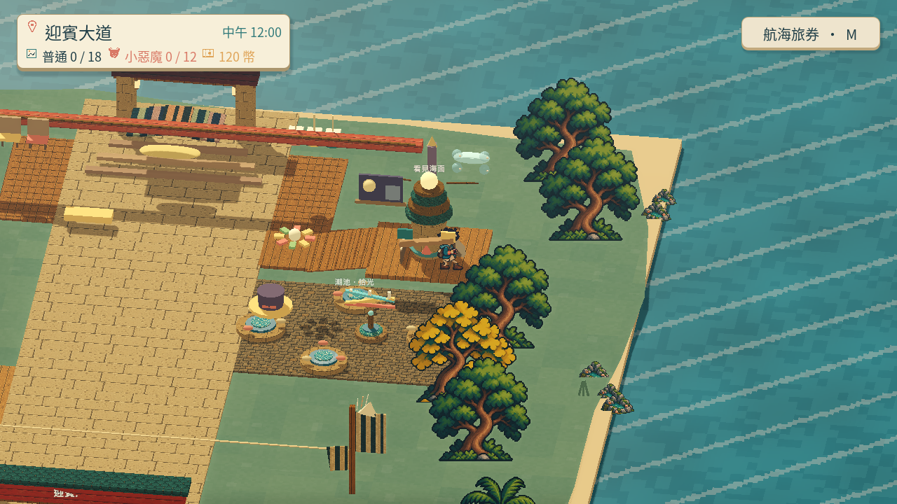
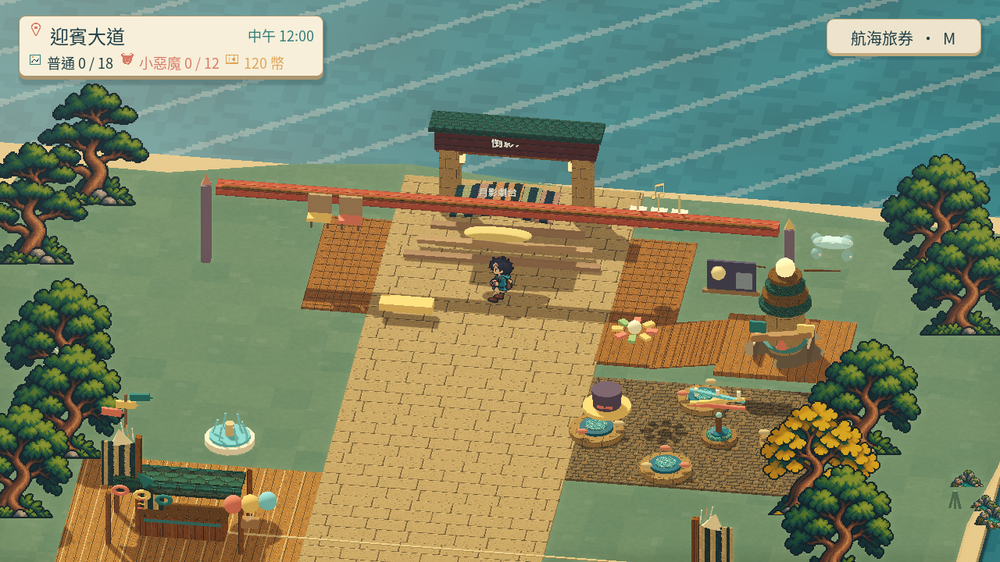

# [MAIN-11] 完善迎賓大道探索動線

> 狀態：進行中

## 內文

### 需求
逐步完善碼頭、主廣場與迎賓大道的探索動線，讓建築、角色和小遊戲位置服務遊玩與故事，空間有地標、可辨的路線與有意義的互動。其他園區依既有範圍保留路口，依 2026-10-20 最新要求擴大首島，補足海岸環線、可辨地標與中途回程，擴圖同時改善實際品質。

### 來源
2026-10-12（Asia/Taipei）使用者要求全面重新審閱 UI 和小遊戲，提升目標、計分及操作手感；先廣泛 survey，減少遊戲當下提示，提供含截圖的完整教學。使用者授權自行決定設計，強調循序完善、細節有主次且不雜亂，以可面向大眾的品質驗收。

### 驗收條件
- [x] 新海岸環線可從碼頭出發、經六處不同地標並返回；中途可回大道，不因擴圖卡住或掉海。
- [x] 跨至少六個來源比較地標、探索路線、節奏與角色站位，保存實際查閱紀錄和圖例。
- [ ] 上島、認識角色、探索、任務及十二款遊戲形成可理解且有選擇的動線。
- [ ] 沒有無意義的空白路程、擁擠設施或長期遮住 NPC 的布局；主角與 NPC 動畫及日夜效果融入環境。
- [ ] 從新存檔原生遊玩、往返探索及不同時段確認動線，保留影片、截圖及局部驗證。

### 測試流程
1. 查看本票研究紀錄與圖例，核對採用的原則和原生前後比較。
2. 使用隔離存檔實際操作本票完整流程，核對各項驗收條件。
3. 核對重試、返回、重開與相關設定，保存原生截圖、影片和受影響測試摘要。

---

# 跟其他票的關係

- Blocks：無
- Blocked by：無
- Related：MAIN-4、ART-17、ART-19、ST-4

---

## 本輪開始

固定基準：`97e7ee8`；分支：`feature/island-experience`。2026-10-13 島上試玩改善依使用者回饋重新驗收，不以舊版畫面或數據檢查替代本輪遊玩。

# Commit-2

### 問題
設施曾像同款攤位排成兩列，路線缺少目的地，高台與旋轉設施入口也不容易走上去。

### 改動
迎賓大道分成風帆工坊、潮池庭院、海岸觀景台和月影劇台，各自有可辨認的設施造型、材質與停留空間。減少重複亮色邊框，打開角色站位及工坊視線；遊樂設施和觀景台接上可實際走過的緩坡。

### 驗收
主 Session 重建本票提交內容，載入與地圖、遮擋、遊樂設施三項局部驗證全過，沒有腳本或執行錯誤。另已實際查看整合候選的原生往返影片：91.667 秒、178.545 公尺，從碼頭走過四處目的地、搭乘／離開潮汐設施並走回碼頭，沒有傳送或卡住後重置；正常與四分之一速度均播放至結尾。影片包含仍在 ART-17 改善的角色動畫與 ART-1 光影，不能當本票單獨提交版本或完整精品品質通過；各時段、NPC 完整動畫與探索趣味的條件仍未勾選，票維持進行中。

### 測試與證據
[多方向研究與實際圖例](../../design/runtime/island-experience-references.md) · [本輪地圖決策](../../design/runtime/island-landscape-polish.md) · [地圖驗證](images/MAIN-11-layout-local.log) · [遮擋驗證](images/MAIN-11-occlusion-local.log) · [設施驗證](images/MAIN-11-ride-local.log)。

[正常影片](images/MAIN-11-motion12-roam-review-normal.mp4) · [四分之一速度影片](images/MAIN-11-motion12-roam-review-slow.mp4) · [路線報告](images/MAIN-11-motion12-roam-report.json) · [原生執行紀錄](images/MAIN-11-motion12-roam-native.log)。影片為方便票內審閱的壓縮副本；原始高品質錄影保留在本 Session 驗收目錄。拍攝為程式化鍵盤操作，沒有人工試玩或試聽的宣稱。

本輪提交基準：`7055915`；分支：`feature/island-experience`。角色及光影共用範圍追蹤 ART-17／ART-1。

# 2026-10-20 接續：擴大首島探索

使用者指出內容、美術及 3D 模型仍簡陋，地圖一眼望到底。已比較七個第一手來源／方向，保存並實際查看 A Short Hike 官方宣傳圖，採有轉折的海岸路線、間隔地標及途中回程。保持十二款既有遊戲、任務與 NPC 位置；本票與 ART-3 接續共同驗證新增空間與立體布景。

[本輪研究、圖例、設計與拒收原因](../../design/runtime/coastal-exploration-expansion.md)。這是本次範圍紀錄，不表示整張探索與角色演出票已結案。

# Commit-3：海岸環線與六個立體目的地

主陸布景外框擴為約 2.52 倍，新增風帆修繕所、聽潮鐘亭、回聲燈塔、北岸觀星庭、海玻璃溫室與潮汐水車。地標有各自的立體輪廓、道具與可用 E 閱讀的觀察文字，路線有石路、岩脊、林隙、遠島及中途回大道的支線。原十二款遊戲、NPC、任務與九區路口保留位置及識別。

原生自動移動約 255.59 公尺，從碼頭出發、六次真實 E 觀察、解除對話後繼續，最後回碼頭，exit 0、0 ERROR。原生影片為 141.7 秒／1417 格／10 FPS，已完整解碼並查看七個均勻抽樣；不是人工連續播放、角色動畫流暢度或真人試玩驗收。小視窗請求為 800×450，但 Movie Maker 實際保留 1280×720 渲染，證據依實際檔案尺寸記錄。

驗收曾抓到導覽亭／石柱附近的狹路及岩壁貼近路緣；已重排入口與回程，最終實際玩家碰撞體逐段核對中線及左右 0.8 公尺餘裕。兩條中途返回皆以真正物理往返，最終含回程支線共約 315.50 公尺、0 ERROR。入口鋪面最後再南退一公尺，錄製路線仍落在最終鋪面內；受影響路緣、完整物理環線與最終原生靜格重驗通過。保留全部原關卡、NPC 來源腳底、上坡與照明斷言。

[影片](images/MAIN-11-coast-20261020-walk.mp4) · [原生路線與六處觀察](images/MAIN-11-coast-20261020-native-walk.json) · [最終含支線物理往返](images/MAIN-11-coast-20261020-physics-route.json) · [四項局部檢查](images/MAIN-11-coast-20261020-map-summary.json) · [完整量測界線](images/MAIN-11-coast-20261020-verification.json)。場景與日夜前後圖見 ART-3。本段驗收新增環線；主線、十二遊戲整體探索節奏、完整角色演出的原條件仍維持未勾，本票保持進行中。
