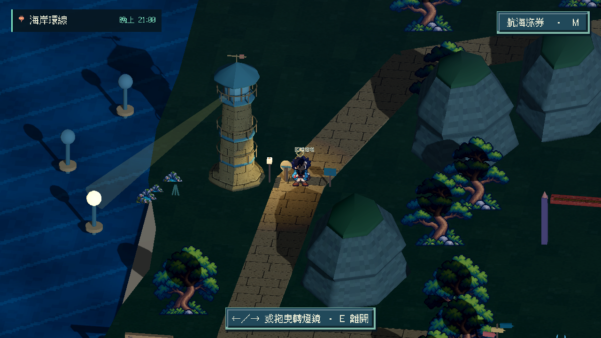
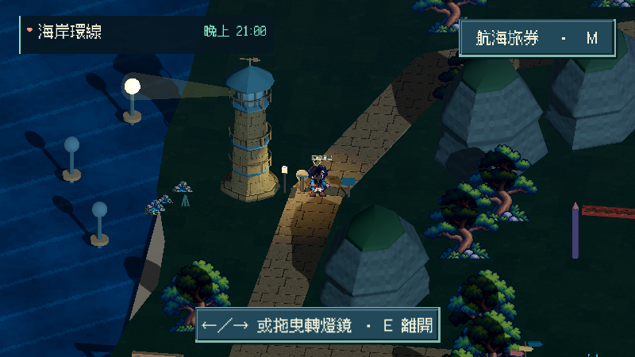
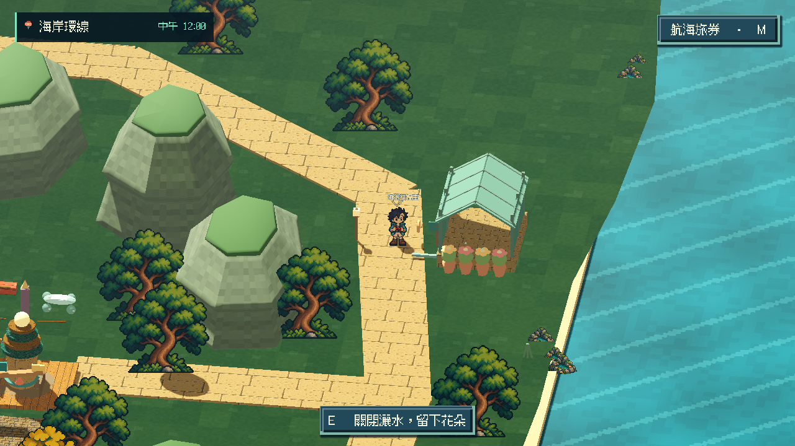
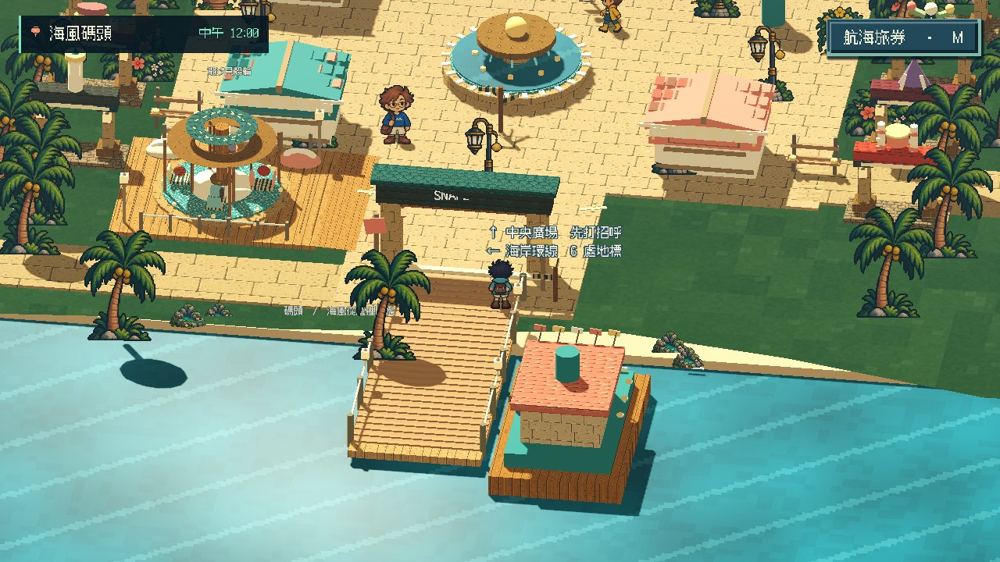
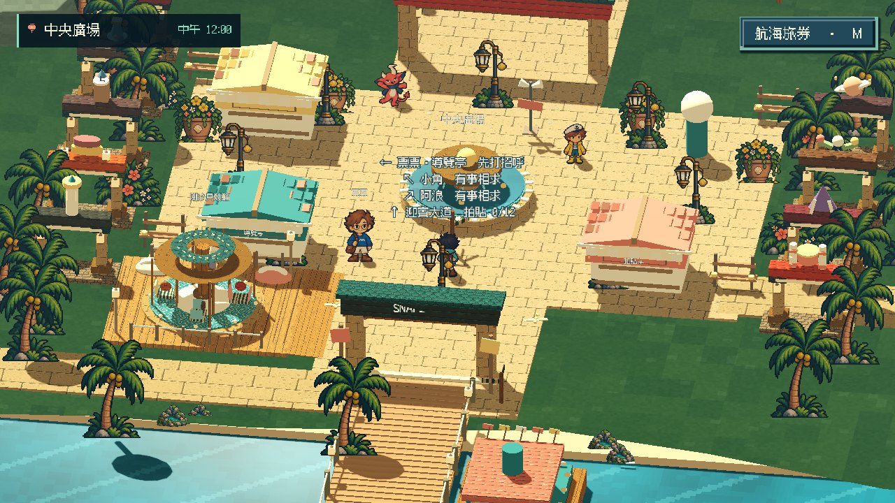
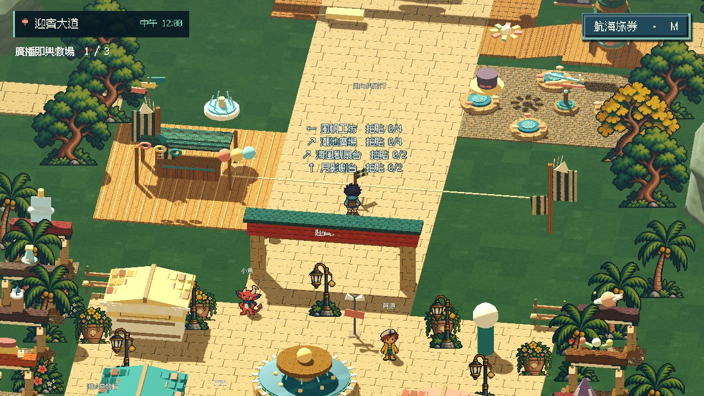
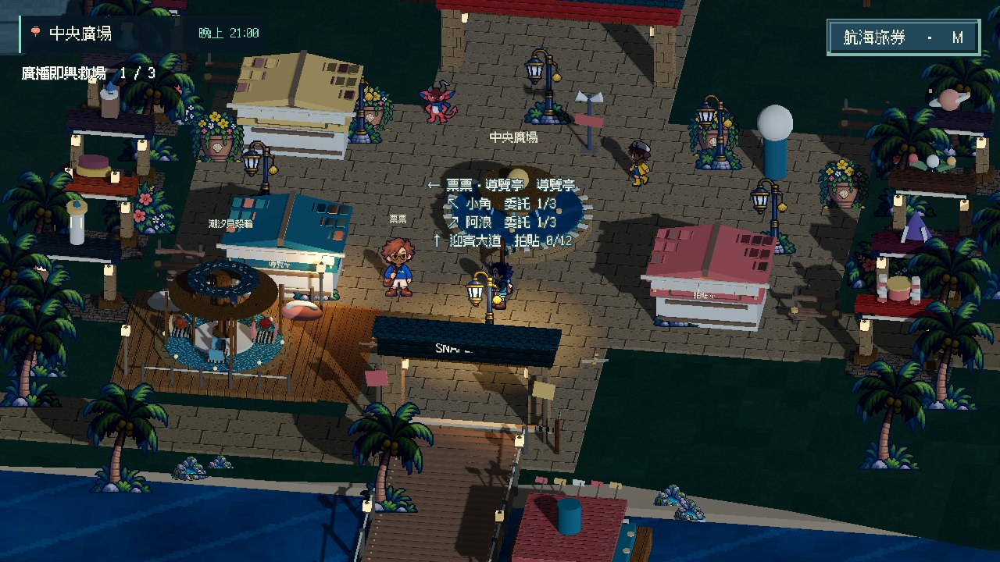
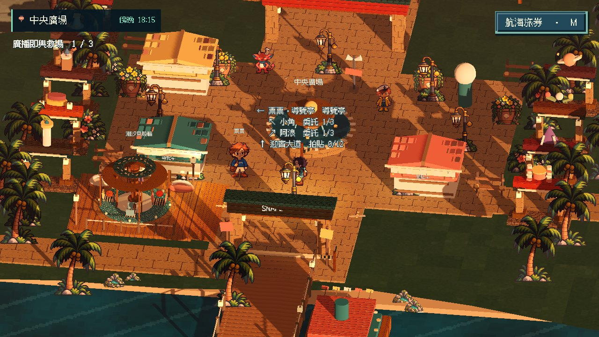
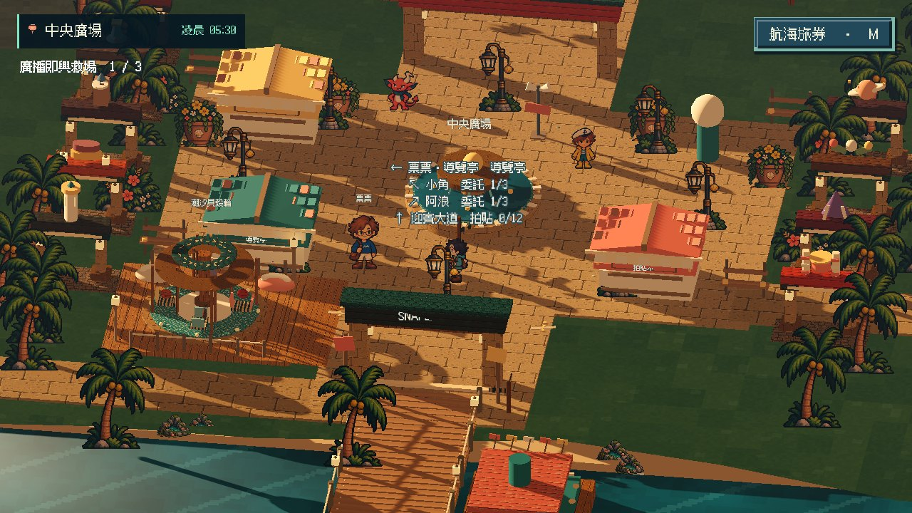
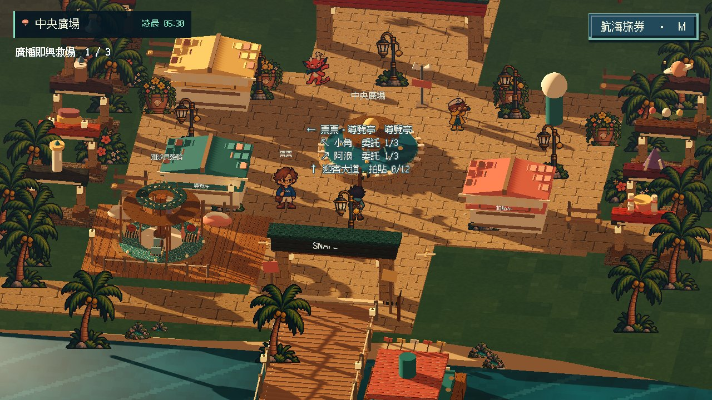

# [MAIN-11] 完善迎賓大道探索動線

> 狀態：進行中

## 內文

### 需求
逐步完善碼頭、主廣場與迎賓大道的探索動線，讓建築、角色和小遊戲位置服務遊玩與故事，空間有地標、可辨的路線與有意義的互動。其他園區依既有範圍保留路口，依 2026-10-20 最新要求擴大首島，補足海岸環線、可辨地標與中途回程，擴圖同時改善實際品質。

### 來源
2026-10-12（Asia/Taipei）使用者要求全面重新審閱 UI 和小遊戲，提升目標、計分及操作手感；先廣泛 survey，減少遊戲當下提示，提供含截圖的完整教學。使用者授權自行決定設計，強調循序完善、細節有主次且不雜亂，以可面向大眾的品質驗收。

### 驗收條件
- [x] 新海岸環線可從碼頭出發、經六處不同地標並返回；中途可回大道，不因擴圖卡住或掉海。
- [x] 跨至少六個來源比較地標、探索路線、節奏與角色站位，保存實際查閱紀錄和圖例。
- [x] 上島、認識角色、探索、任務及十二款遊戲形成可理解且有選擇的動線。
- [ ] 沒有無意義的空白路程、擁擠設施或長期遮住 NPC 的布局；主角與 NPC 動畫及日夜效果融入環境。
- [x] 從新存檔原生遊玩、往返探索及不同時段確認動線，保留影片、截圖及局部驗證。

### 測試流程
1. 查看本票研究紀錄與圖例，核對採用的原則和原生前後比較。
2. 使用隔離存檔實際操作本票完整流程，核對各項驗收條件。
3. 核對重試、返回、重開與相關設定，保存原生截圖、影片和受影響測試摘要。

---

# 跟其他票的關係

- Blocks：無
- Blocked by：無
- Related：MAIN-4、ART-17、ART-19、ST-4

---

## 本輪開始

固定基準：`97e7ee8`；分支：`feature/island-experience`。2026-10-13 島上試玩改善依使用者回饋重新驗收，不以舊版畫面或數據檢查替代本輪遊玩。

# Commit-2

### 問題
設施曾像同款攤位排成兩列，路線缺少目的地，高台與旋轉設施入口也不容易走上去。

### 改動
迎賓大道分成風帆工坊、潮池庭院、海岸觀景台和月影劇台，各自有可辨認的設施造型、材質與停留空間。減少重複亮色邊框，打開角色站位及工坊視線；遊樂設施和觀景台接上可實際走過的緩坡。

### 驗收
主 Session 重建本票提交內容，載入與地圖、遮擋、遊樂設施三項局部驗證全過，沒有腳本或執行錯誤。另已實際查看整合候選的原生往返影片：91.667 秒、178.545 公尺，從碼頭走過四處目的地、搭乘／離開潮汐設施並走回碼頭，沒有傳送或卡住後重置；正常與四分之一速度均播放至結尾。影片包含仍在 ART-17 改善的角色動畫與 ART-1 光影，不能當本票單獨提交版本或完整精品品質通過；各時段、NPC 完整動畫與探索趣味的條件仍未勾選，票維持進行中。

### 測試與證據
[多方向研究與實際圖例](../../design/runtime/island-experience-references.md) · [本輪地圖決策](../../design/runtime/island-landscape-polish.md) · [地圖驗證](images/MAIN-11-layout-local.log) · [遮擋驗證](images/MAIN-11-occlusion-local.log) · [設施驗證](images/MAIN-11-ride-local.log)。

[正常影片](images/MAIN-11-motion12-roam-review-normal.mp4) · [四分之一速度影片](images/MAIN-11-motion12-roam-review-slow.mp4) · [路線報告](images/MAIN-11-motion12-roam-report.json) · [原生執行紀錄](images/MAIN-11-motion12-roam-native.log)。影片為方便票內審閱的壓縮副本；原始高品質錄影保留在本 Session 驗收目錄。拍攝為程式化鍵盤操作，沒有人工試玩或試聽的宣稱。

本輪提交基準：`7055915`；分支：`feature/island-experience`。角色及光影共用範圍追蹤 ART-17／ART-1。

# 2026-10-20 接續：擴大首島探索

使用者指出內容、美術及 3D 模型仍簡陋，地圖一眼望到底。已比較七個第一手來源／方向，保存並實際查看 A Short Hike 官方宣傳圖，採有轉折的海岸路線、間隔地標及途中回程。保持十二款既有遊戲、任務與 NPC 位置；本票與 ART-3 接續共同驗證新增空間與立體布景。

[本輪研究、圖例、設計與拒收原因](../../design/runtime/coastal-exploration-expansion.md)。這是本次範圍紀錄，不表示整張探索與角色演出票已結案。

# Commit-3：海岸環線與六個立體目的地

主陸布景外框擴為約 2.52 倍，新增風帆修繕所、聽潮鐘亭、回聲燈塔、北岸觀星庭、海玻璃溫室與潮汐水車。地標有各自的立體輪廓、道具與可用 E 閱讀的觀察文字，路線有石路、岩脊、林隙、遠島及中途回大道的支線。原十二款遊戲、NPC、任務與九區路口保留位置及識別。

原生自動移動約 255.59 公尺，從碼頭出發、六次真實 E 觀察、解除對話後繼續，最後回碼頭，exit 0、0 ERROR。原生影片為 141.7 秒／1417 格／10 FPS，已完整解碼並查看七個均勻抽樣；不是人工連續播放、角色動畫流暢度或真人試玩驗收。小視窗請求為 800×450，但 Movie Maker 實際保留 1280×720 渲染，證據依實際檔案尺寸記錄。

驗收曾抓到導覽亭／石柱附近的狹路及岩壁貼近路緣；已重排入口與回程，最終實際玩家碰撞體逐段核對中線及左右 0.8 公尺餘裕。兩條中途返回皆以真正物理往返，最終含回程支線共約 315.50 公尺、0 ERROR。入口鋪面最後再南退一公尺，錄製路線仍落在最終鋪面內；受影響路緣、完整物理環線與最終原生靜格重驗通過。保留全部原關卡、NPC 來源腳底、上坡與照明斷言。

[影片](images/MAIN-11-coast-20261020-walk.mp4) · [原生路線與六處觀察](images/MAIN-11-coast-20261020-native-walk.json) · [最終含支線物理往返](images/MAIN-11-coast-20261020-physics-route.json) · [四項局部檢查](images/MAIN-11-coast-20261020-map-summary.json) · [完整量測界線](images/MAIN-11-coast-20261020-verification.json)。場景與日夜前後圖見 ART-3。本段驗收新增環線；主線、十二遊戲整體探索節奏、完整角色演出的原條件仍維持未勾，本票保持進行中。

# Commit-4：燈鏡回光與溫室灑水

## 內文

兩處地標原本只有觀察文字，現在可以留在世界裡直接操作。回聲燈塔在步道旁以左右鍵連續轉鏡，也支援按住滑鼠拖曳；海上三個反光標依真實光軸回光。E、附近的情境按鈕或 Esc 可退出操作；方向鍵不會同時帶走角色，暫停選單和失焦也不會漏操作。新增真實光源仍共用原八盞燈／最多兩盞陰影預算。

海玻璃溫室可以開關灑水，四朵花逐漸展開；關水後水滴停止，花朵留下。降低動態仍保留主要操作與結果。兩項都不開計分面板、不發獎勵，沿用附近的一行主要動作。

[本輪六方閱讀、實際參考圖與取捨](../../design/runtime/coastal-discoveries.md)。實看發現中央反光標太靠左側邊緣，以及提示重複 E；調整距離和文案後再驗。本輪是探索互動交付，原主線整體動線、NPC 動畫與環境完整雕琢仍依未勾條件追蹤。

### 測試結果

| 項目 | 結果 |
|---|---|
| 真實鍵鼠操作 | 86.59 秒、exit 0／0 ERROR；鍵盤轉向、滑鼠拖曳、退出、正常行走、暫停與重進，並重驗海漂球／潮鐘／水閘 |
| 日夜與小視窗 | 新程序／新隔離存檔，41.16 秒、exit 0／0 ERROR；真正 T 選單和滑鼠切時段，選單擋輸入，三個反光標均在可見範圍，800×450 操作不裁切，日間開花 |
| 完整環線 | 125.83 秒、exit 0／0 ERROR；真正物理步行約 255.59 公尺，六處實際 E 操作，離開燈鏡後繼續並回碼頭；無中途傳送或重置 |
| 局部回歸 | 光影、地圖、完整自由互動與主流程四項通過；最後幾何／提示調整後再跑自由互動及主流程兩項，均 exit 0／0 ERROR |
| 保存與畫面 | 純自由操作前後完整存檔位元相同；時段操作另核對沒有新照片／金幣。31 張當前原生圖、完整解碼影片與逐檔雜湊 |

影片為 1280×720、60 FPS、486 格／8.1 秒的原生離線錄製，已完整解碼，未連續觀看或試聽；當前往返路線是另一個原生程序與靜格，沒有冒稱同一支影片含完整環線。已看兩張操作總覽、日夜／小視窗和花朵原尺寸圖；全部是程式派送真實輸入，非玩家試玩。

第一輪在 60 FPS 過早發出第二次踢球，碰到原有冷卻而失敗；改為等實際可輸入再重跑，沒有放寬方向斷言。重跑工具誤沿用輸出目錄，故該輪失敗原始 log 被覆寫；[歷程](images/MAIN-11-discoveries-20261020-attempt-history.json)明列此限制，不冒稱保存了那份 raw log。成功操作已另存唯讀副本，時段／完整路線皆使用不可覆寫的新目錄。

[本輪驗收／來源／雜湊](images/MAIN-11-discoveries-20261020-verification.json) · [操作影片](images/MAIN-11-discoveries-20261020-native.mp4) · [完整物理環線](images/MAIN-11-discoveries-20261020-walk-walk.json)

# Commit — 2026-10-23 三處岔路路標與新存檔步行驗收

## 問題

碼頭、廣場與大道的岔路沒有方向資訊；玩家要靠記憶或打開地圖，才知道哪裡還有委託、哪一區還缺拍貼。票票上島後也沒有再告訴玩家可以先做什麼。

## 改動

碼頭出口、廣場噴泉前、大道中段各立一支路標。每個方向一行：箭頭、目的地與目前狀態，例如「↖ 小角　有事相求」「↗ 阿浪　委託 1/3」「← 風帆工坊　拍貼 0/4」「← 海岸環線　6 處地標」。委託步數和畫面左上的任務列使用同一個計數；文字只在走近時出現，遠處畫面不變雜亂。票票回訪時會依進度建議先找誰，或直接去大道玩設施。路標柱是實體，兩側保留通行空間；檢查時發現新增的廣播角細桿擋住從拱門走向阿浪的路，已改為不阻擋。

## 驗收

| 項目 | 結果 |
|---|---|
| 地圖局部 | 三支路標都在可走範圍內、為實體且兩側可通行；每個方向都有狀態；角色交談空間不受影響；原有地圖、遮擋、設施與海岸環線斷言全部保留並通過 |
| 原生新存檔步行 | 隔離新存檔，真實鍵盤事件步行 39 段共 194.3 公尺（無傳送），經碼頭→廣場→票票→小角→阿浪→大道，再回到廣場；每段停在目標 0.6 公尺內 |
| 時段 | 以時段選單和滑鼠點選切換凌晨、傍晚、晚上，每個時段實際走回阿浪與廣場路標；路標與對話正常 |
| 續玩 | 存檔後以新的 Main 載入，沒有重播上島，委託、照片與金幣不變，路標狀態一致 |
| 影片 | Movie Maker 15 FPS、220.9 秒、1280×720 錄製（存檔為 960×540 壓縮版）；離線固定節拍，非即時試玩 |

未勾選的「無空白路程與擁擠設施、主角與 NPC 動畫融入環境」仍待處理：大道中段仍是較長的直線步道，本輪只加了路標；角色動畫品質依 ART-17 追蹤。廣場路標第一行「票票・導覽亭　導覽亭」名稱重複，待下次調整文字。票維持進行中。

[原生步行影片](images/MAIN-11-flow-20261023-walk.mp4) · [逐段步行、對話與路標紀錄](images/MAIN-11-flow-20261023-report.json) · [設計與研究](../../design/runtime/island-reactive-story.md)

分支：`work/story-explore`（自 `2e95cc6` 開始）。
