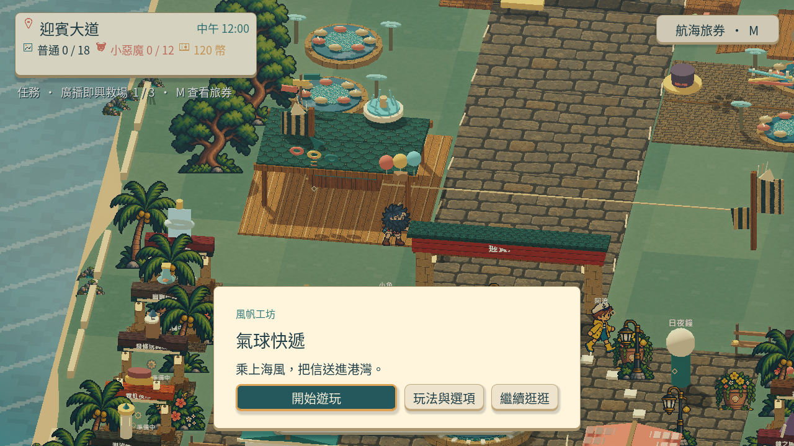
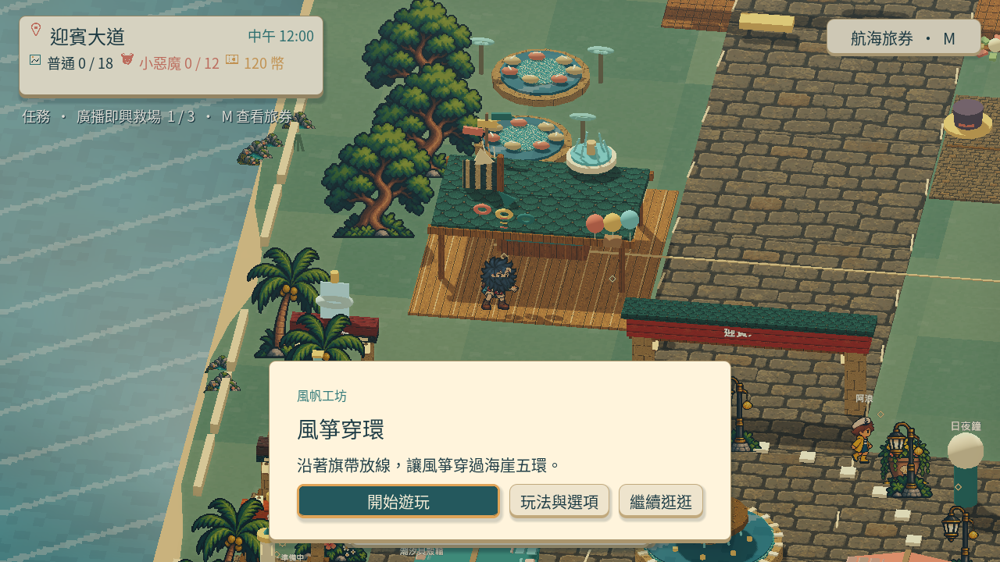
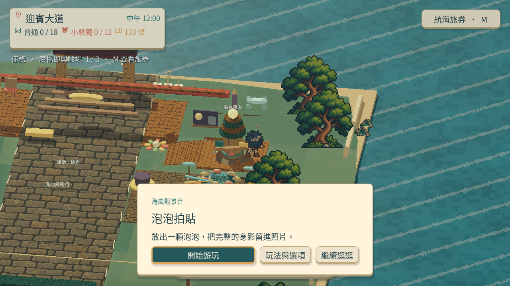
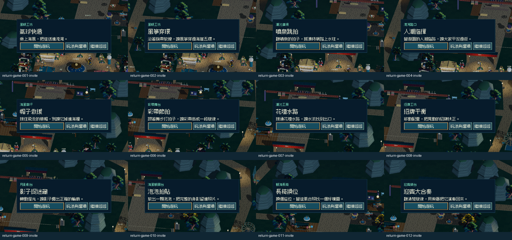

# [MAIN-14] 簡化攤位開場與遊玩入口

> 狀態：完成

## 內文

### 需求

攤位互動先呈現簡單且有特色的遊玩邀請；選擇開始即可進入必要教學或遊戲，詳細規則、輔助與收藏條件按需查看。參考炸彈超人樂園3的園區情境入口，不照抄布局。

### 來源

2026-10-13（Asia/Taipei）使用者試玩回饋，要求先完善島上體驗：角色頭髮分離與動畫怪異、真正 HD-2D、特色攤位、全角色對話、探索與遊樂設施、符合玩家習慣的拍貼與介面。設計自主決定，至少六個多方向實例，研究與實際畫面分開記錄。

### 驗收條件

- [x] 十二款攤位有可辨認遊戲特色的名稱與邀請，開始介面有清楚主要操作，沒有大量規則與按鈕堆疊。
- [x] 初次教學、重看教學、練習與輔助仍可使用，返回和取消不錯誤發獎。
- [x] 以原生新存檔與續玩從島上攤位實際進入及返回，保存截圖和影片。

### 測試流程

1. 使用獨立存檔從上島開始，操作本票涉及功能。
2. 依每項條件確認玩家可見行為，核對返回、重訪、時段與降低動態。
3. 查看原生畫面及正常與慢放影片；需要聲音時實際試聽，保存證據。

---

# 跟其他票的關係

- Blocks：無
- Blocked by：無
- Related：MAIN-10、MAIN-11、ART-20

---

## 本輪開始

固定基準：`97e7ee8`；分支：`feature/island-experience`。2026-10-13 島上試玩改善依使用者回饋重新驗收，不以舊版畫面或數據檢查替代本輪遊玩。

# Commit-1

## 問題

走到攤位後，開始畫面把規則與多種設定集中呈現，玩家不容易立即決定要不要玩。原生檢視又發現主要按鈕取得焦點後文字太暗。

## 改動

攤位先顯示遊戲名稱、所屬活動區、一句邀請，以及開始、玩法與選項、繼續逛逛三個選擇。詳細內容按需打開，主要按鈕在鍵盤焦點下保持淺色文字。

## 驗收

已實際查看原生氣球、風箏與觀景台入口截圖，並透過真實鍵鼠事件從島上打開入口、進入風箏初次教學及取消返回。影片擷取島上驗收的第18至26秒入口段落，檢查站使用定位；不將它描述為全程步行或真人試玩。十二款入口與保留流程另以局部測試核對。提交候選獨立驗證：匯入、入口、故事整合、旅券介面四項全過，0 ERROR；完整套件交 CI。

### 參考資料

參照炸彈超人樂園3的可步行廣場與分散角色，採用園區先行的入口；GDC 的介面講座摘要、Nintendo 的攝影探索設計，以及 Microsoft 的閱讀指引共同提供簡潔資訊、快速操作與可讀性的方向。[跨十八個來源的實際查閱與限制](../../design/runtime/island-experience-references.md)；未觀看 BL3 遊戲影片與完整 GDC 講座，不宣稱其互動細節已查證。

### 截圖與影片

[原生操作驗收影片](images/MAIN-14-native-entry-review.mp4)

分支：`feature/island-experience`；遠端 commit 連結於提交後補入。

# Commit-2

## 內文

首次從「輔助挑戰」進入原本會跳過教學。現在普通與輔助入口都提供同一份可略過、可取消的首次教學；取消保留未讀，開始後保留原選擇的輔助模式。邀請顯示時收起園區收藏數字與舊互動提示，返回即恢復，保持三個主要選擇。

先加反例重現舊版失敗，再保留原有入口、練習、離開與無獎勵檢查，補上輔助首次、取消、略過及 HUD 恢復。流程研究與圖例見[六方向比較](../../design/runtime/entry-and-freeplay-flow.md)；圖例是重新查看既有 Nintendo 擷取，不把下載失敗算作新圖片審閱。

### 測試結果

- 入口、教學已讀／保存失敗、主流程整合三項最終局部測試通過，0 ERROR。
- 原生新存檔十二攤位：實際 E 進入、返回、普通／輔助首次教學、取消後未讀、略過後模式保留及確認離開全部通過。這輪 151.65 秒，先於收起 HUD 的最後外觀修正；其舊畫面只保留作[重複 HUD 反例](images/MAIN-14-entry-20261020-rejected-duplicate-hud.png)。最後修正另有完整局部回歸及下列最終續玩驗收。
- 關閉引擎後，以同一隔離檔新程序載入十二份已讀記錄：十二款直接進入、確認離開與返回通過，完整已保存 payload 前後相同。最後版為 800×450 實體視窗、邏輯 1280×720、1.25 大字、夜間與降低動態；86.55 秒、0 ERROR。十二張邀請總覽及兩張原尺寸畫面已實際查看。
- [原生輸入影片](images/MAIN-14-entry-20261020-returning.mp4)為 MovieMaker 1280×720、10 FPS、527 幀、52.7 秒；全檔解碼 0 錯誤，六個均勻抽樣已看過，不宣稱人類連續觀看、試聽、即時效能或十二款玩法品質通過。

[新存檔報告](images/MAIN-14-entry-20261020-new.json) · [續玩報告](images/MAIN-14-entry-20261020-returning.json) · [原版反例](images/MAIN-14-entry-20261020-rejected-assist.log) · [最終入口測試](images/MAIN-14-entry-20261020-entry.log) · [教學存檔測試](images/MAIN-14-entry-20261020-tutorial-progress.log) · [整合測試](images/MAIN-14-entry-20261020-integration.log) · [證據雜湊](images/MAIN-14-entry-20261020-manifest.json)。

開始基準 `244536b`；分支 `codex/finish-runtime-batch-20261020`。本票結案限攤位入口完整流程；教學截圖的當前版本覆蓋仍由 MAIN-10 追蹤。

本輪遠端交付：[提交 40e27eb](https://github.com/deadline314/Snapland/commit/40e27eb2b5151a686356cd1dd15a2ff8c6644aca)；已依正常快轉流程整合 main。
