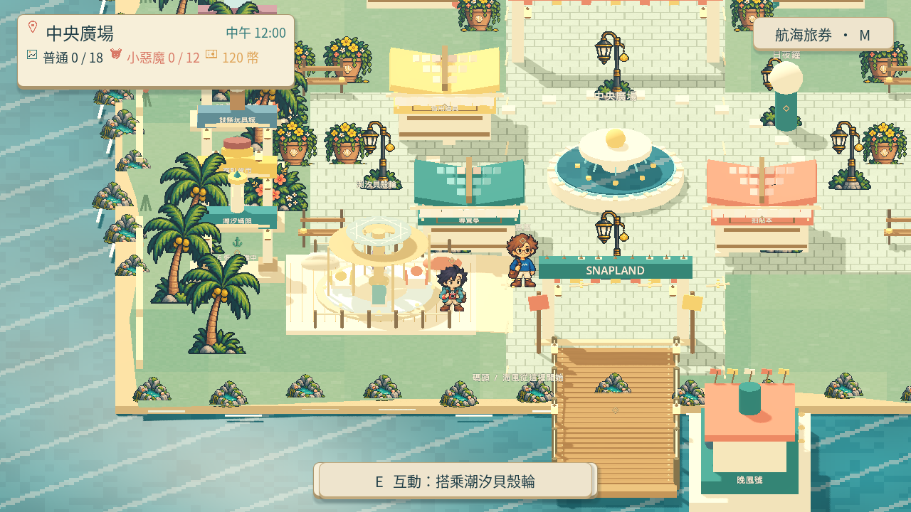
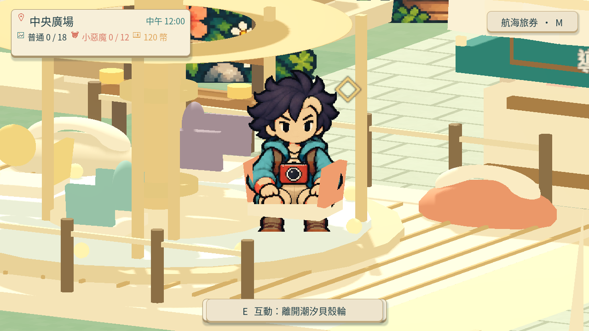
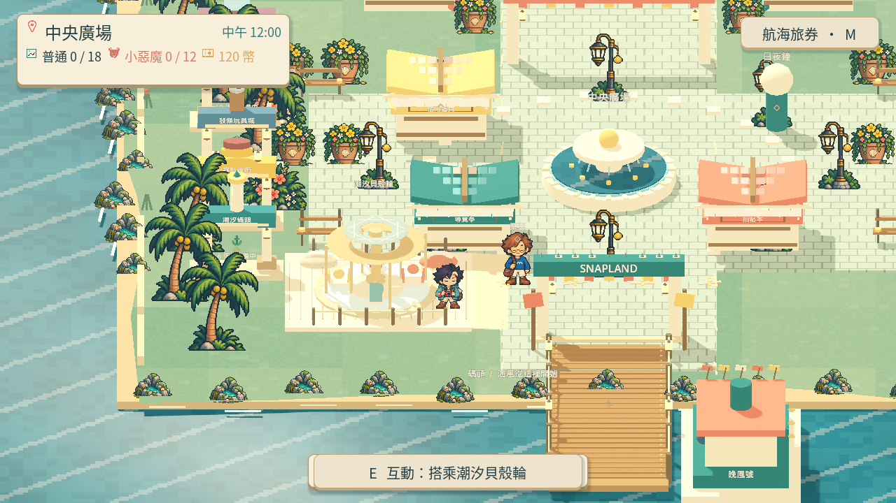

# [MAIN-15] 加入潮汐遊樂設施體驗

> 狀態：進行中

## 內文

### 需求

島上有獨有且可親自乘坐或操作的遊樂設施，形成逛樂園的休閒體驗，與時段、角色或拍照結合，無須每次都進計分小遊戲。

### 來源

2026-10-13（Asia/Taipei）使用者試玩回饋，要求先完善島上體驗：角色頭髮分離與動畫怪異、真正 HD-2D、特色攤位、全角色對話、探索與遊樂設施、符合玩家習慣的拍貼與介面。設計自主決定，至少六個多方向實例，研究與實際畫面分開記錄。

### 驗收條件

- [x] 至少一座原創潮汐主題遊樂設施可互動開始、運行與離開，玩家有可辨認的參與動作。
- [ ] 設施可從探索路線自然發現，日夜照明對應實際燈光，角色和鏡頭不穿透設施。
- [x] 取消、失焦、暫停與重訪可安全恢復探索；原生完整遊玩影片及截圖已實際查看。

### 測試流程

1. 使用獨立存檔從上島開始，操作本票涉及功能。
2. 依每項條件確認玩家可見行為，核對返回、重訪、時段與降低動態。
3. 查看原生畫面及正常與慢放影片；需要聲音時實際試聽，保存證據。

---

# 跟其他票的關係

- Blocks：無
- Blocked by：無
- Related：MAIN-11、ART-1、ART-3、ART-17

---

## 本輪開始

固定基準：`97e7ee8`；分支：`feature/island-experience`。2026-10-13 島上試玩改善依使用者回饋重新驗收，不以舊版畫面或數據檢查替代本輪遊玩。

# Commit-1

### 問題

原本只進入計分遊戲，缺少親自搭乘的島上設施；步道抬高的邊缘會卡住角色，登乘點也落在欄杆與基座附近。搭乘特寫另發現髮際大片透明缺口；原圖完整，實際組合貼圖卻漏掉部分頭髮與額頭。

### 改動

廣場海側加入可乘坐的潮汐貝殼輪，四座不同顏色的貝殼座椅沿圓周慢轉；玩家有獨立坐姿，可隨時離開，完整一圈後回到入口。入口有連續淺坡，導遊移到入口外的開闊位置，欄杆與基座有實際碰撞。坐姿保留作者原有髮型，組合前複製來源，檢查來源與成品的完整頭部而非只挑部分像素。

### 驗收

Root 實際查看三張提交內容的原生截圖，並將正常 15.7 秒與四分之一速度 62.75 秒影片播放至結尾；額頭與髮束完整。真實 E 輸入可開始、退出與重訪，完整 12 秒運行後回到安全入口，Escape 開啟暫停也安全取消，拍貼與獎勵數值未被休閒設施改動。失焦與離開場景的安全恢復另由局部執行測試確認。錄影是腳本操作並在入口定位，不能當真人試玩或步行抵達；最新全島連續走訪的實際抵達證據另屬 MAIN-11。

### 測試結果

本次從待提交內容建立獨立專案，匯入、設施、坐姿、緊湊入口與頭髮換装共 5/5 通過，0 ERROR；原生擷取 exit 0、0 ERROR。頭部逐點驗證 8 個待機與 4 個坐姿均沒有不透明像素缺口，來源雜湊保持不變。完整套件交由 CI。錄影使用靜音驅動，未聲稱試聽通過。

### 研究與畫面

採用海岸主題的獨立休閒設施，與計分小遊戲並置的理由、已讀多方向資料和參考圖見[島上體驗研究](../../design/runtime/island-experience-references.md)。本段原生圖沿用這張票獨立提交的場景與照明，不冒充後續 ART-1 的新照明。

[正常影片](images/MAIN-15-rideproof-v5-normal.mp4) · [慢放影片](images/MAIN-15-rideproof-v5-quarter.mp4) · [原生執行紀錄](images/MAIN-15-rideproof-v5-native.log) · [操作與數值報告](images/MAIN-15-rideproof-v5-report.json) · [設施驗證](images/MAIN-15-ride-validation.log) · [完整頭部驗證](images/MAIN-15-seated-validation.log) · [換髮驗證](images/MAIN-15-attachment-validation.log)。

保留退件證據：[實際貼圖缺口](images/MAIN-15-rejected-transparent-head-texture.png)、[當時的原生缺口畫面](images/MAIN-15-rejected-transparent-head-native.png)。來源貼圖在組合前快照；測試圖或舊式局部髮色範圍不能代替完整頭部檢查。

分支：`feature/island-experience`；遠端提交連結於提交後補記。票況：進行中。本票最小涉及 ART-22 共用角色組合，修正已畫好動作的頭部透明缺口；沒有改動原始圖片。
