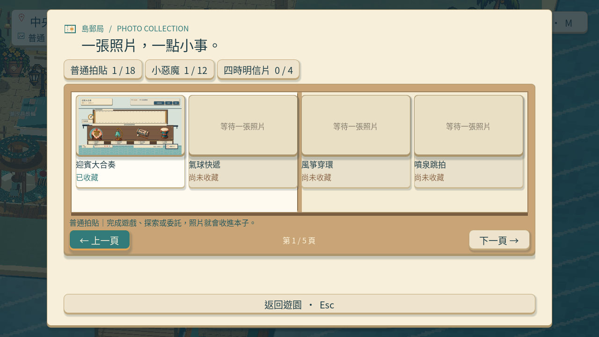
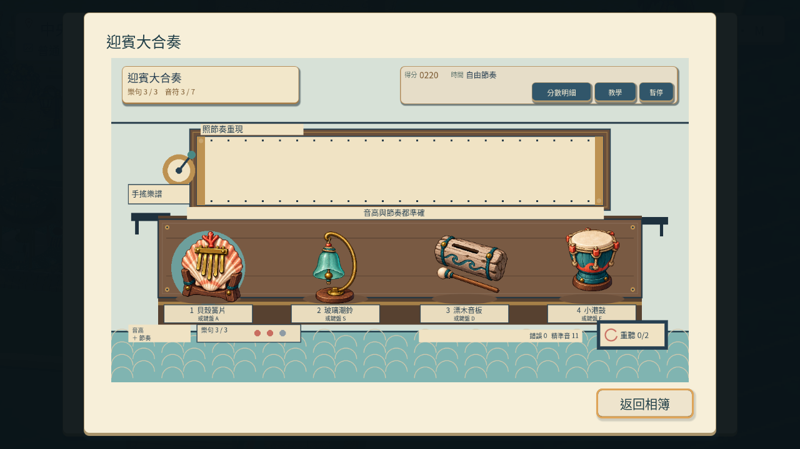
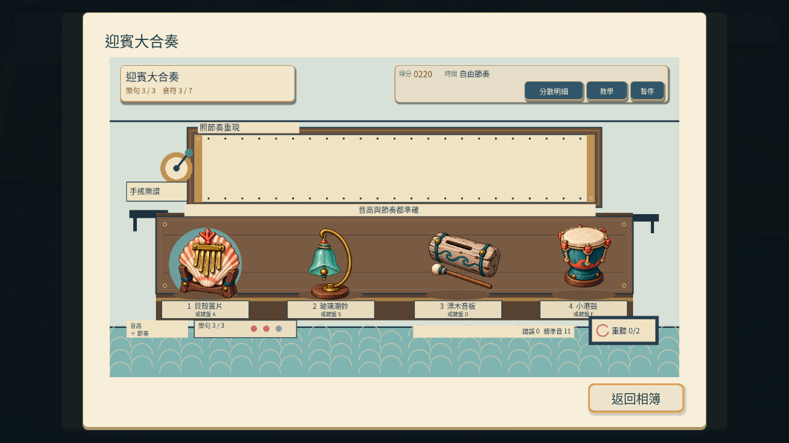
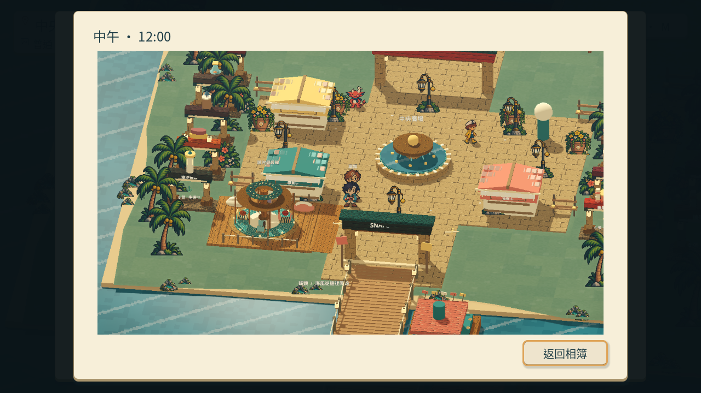
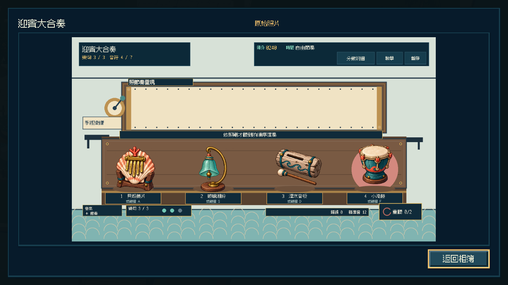
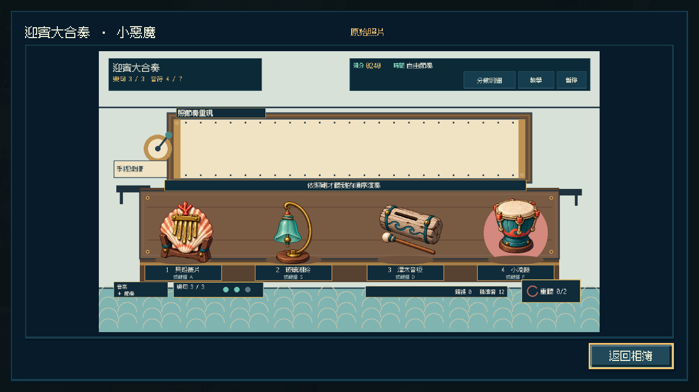

# [MAIN-16] 保存拍貼高清原圖

> 狀態：完成

## 內文

### 需求
收藏冊保留輕量縮圖，點開照片時顯示本次拍攝的高清原圖，避免將 320×180 的小圖放大成模糊畫面。遊戲普通／小惡魔卡片共用同一份原圖；島上時段明信片也保存清楚的實際園區畫面。舊存檔或原圖遺失可顯示原縮圖，保留收藏。

### 來源
2026-10-13 主 Session 在原生相簿中實際查看 ART-20-native-photo-viewer.png，看到 320×180 小圖被放大到約 900px 後模糊。使用者要求高像素 HD-2D 與符合玩家習慣的拍貼體驗，這項獨立問題先登記再實作。

### 驗收條件
- [x] 新拍攝時段明信片與正式遊戲照片可從收藏冊打開清楚的高清原圖，沒有切掉內容，普通與小惡魔共享來源。
- [x] 原圖重開後仍可讀，實際保存大小受控，縮圖與原图分工不使相簿一次解碼所有大圖。
- [x] 舊存檔、缺檔或損毀來源可安全回退到可讀縮圖；練習、失败或取消不誤寫收藏及原圖。
- [x] 原生實際拍照、打開相簿及重開驗收已查看，截圖、影片與相關局部測試摘要已保存。

### 測試流程
1. 用獨立存檔在導覽合照點拍攝時段明信片，打開相簿放大照片。
2. 正式完成遊戲拍攝，核對普通與小惡魔共用原圖；重開確認保存。
3. 測試舊版、缺檔、過大或損毀原圖，以及練習、取消回退。
4. 查看原生畫面與原圖／縮圖區別，不把純資料檢查寫成試玩完成。

---

# 跟其他票的關係

- Blocks：無
- Blocked by：MAIN-13
- Related：ART-20、MAIN-9

---

固定開票基準：`41705b6`（origin/main）；實作基準另記。

## 本輪開始

實作固定基準：`86bd44cd7017fb2d4bc05685271f6cdfa618c9da`；分支：`feature/island-experience`。原生相簿放大實際照片後確認模糊，另外開票保存原圖。驗收分開記錄資料保護與實際畫面。

# Commit-1

### 問題
收藏照片原先只有小縮圖，放大模糊，也缺少原生拍照到重開相簿的完整證據。

### 改動
正式遊戲與時段明信片保存清楚原圖，相簿只在選取照片時讀取大圖。普通與小惡魔共用同一份拍攝來源，舊照片及缺失原圖仍能顯示既有縮圖。

### 驗收
主 Session 透過實際鍵盤與滑鼠事件完成迎賓大合奏的普通及小惡魔拍貼，翻頁、打開原圖，再另啟遊戲讀取同一獨立存檔；兩種照片仍共用三張 1280×720 原圖與 320×180 縮圖，收藏沒有重複增加，重開查看未改寫存檔。時段明信片經實際按鈕拍摄及放大，保存完整畫面，僅取得該拍貼的 20 枚幣。這是自動輸入的原生驗收，並非真人試玩。

### 測試結果
精確提交內容的原圖、縮圖、收藏冊、照片檢視與核心局部檢查 6/6 通過；三次正向原生執行 0 個 ERROR。主 Session 完整播放正式流程 71.4 秒及時段流程 7.483 秒，實際查看相簿、原圖與重開畫面。兩次驗收腳本自身的翻頁／按鈕狀態錯誤保留失敗紀錄，修正後重新執行；沒有刪除收藏或畫面檢查。音訊使用 Dummy，本票沒有試聽宣稱。完整套件交 CI。

### 截圖與影片

[正式拍貼流程影片](images/MAIN-16-final-gameplay-normal.mp4) · [時段拍貼流程影片](images/MAIN-16-final-time-normal.mp4) · [證據與雜湊](images/MAIN-16-final-evidence.json)

分支：`feature/island-experience`。本輪開始基準維持票內固定 SHA；原生證據採本票提交索引。票況維持進行中，與島上整組交付一起核對。程式與證據提交：[55466d2](https://github.com/deadline314/Snapland/commit/55466d2)。

# Commit — 2026-10-20 完成高清原圖與重開驗收並結案

固定開始 SHA：`9d250cf`；分支：`codex/delivery-batch-20261020`。相依 MAIN-13 已完成正式雙分類共用與真正程序重開。

本輪重新從上島實際按鍵行走、正式普通／小惡魔兩局進入收藏冊，兩張卡皆開啟完整 1280×720 原圖，三份原圖及 320×180 縮圖各只共用一組。另啟程序使用旅券、分類及照片按鈕重開查看，進度檔不變。時段明信片透過實際 T／滑鼠拍攝與原圖檢視通過，保留完整畫面並只給該次 20 枚幣；既有縮圖回退、損毀／過大保護、練習／失敗不附圖三項局部回歸通過。所有原生正向執行 0 個引擎 ERROR。

主 Session 已實際查看兩分類、兩原圖、真正重開兩分類及時段原圖。另保存 1280×720、15 FPS、11.133 秒的本輪重開短片，完整解碼通過並檢視六個等距抽樣；包含啟動圖與結束桌面，不宣稱完整逐格觀看或真人試玩。先前完整正式／時段影片保留為舊版本證據。本輪使用 Godot 4.7.2／llvmpipe／Compatibility，Dummy 音訊不代表試聽或 Windows 硬體驗收。

全部四項驗收已有對應證據，票況完成。[正式兩局、照片共用及局部檢查索引](images/MAIN-13-shared-20261020-verification.json) · [本輪真正重開短片](images/MAIN-16-originals-20261020-reopen.mp4) · [範圍、解碼與雜湊](images/MAIN-16-originals-20261020-verification.json) · [時段明信片與原圖](../Snapland-art/images/ART-10-capacity-20261020-native-report.json)。

